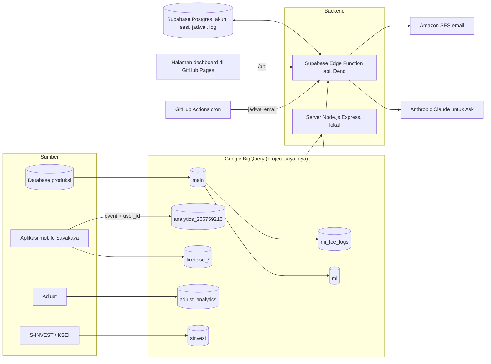

# Dokumentasi Sayakaya Analytics

> File ini dibuat otomatis oleh `scripts/generate-docs.js` setiap kali `npm run docs` atau `npm run deploy:all` dijalankan. Jangan mengedit file ini langsung: ubah kodenya, teks di `docs/content.js`, atau teks tab Documentation di aplikasi, lalu jalankan ulang. Isi ini sesuai kode pada commit `1e873c3 (2026-10-26)`.

## Cara membaca dokumen ini

Dokumen ini ditulis untuk dua jenis pembaca:

- **Bukan orang teknis** (bisnis, operasional, marketing): baca bagian 1 sampai 3, lalu di bagian 6 baca baris **Untuk apa** dan **Penjelasan sederhana** pada tab yang Anda pakai. Istilah yang asing ada di bagian 2.
- **Orang teknis** (engineer, data analyst): semua bagian. Baris **Cara hitung** dan **Detail teknis** di setiap tab menyebut tabel, kunci join, endpoint API, dan fungsi query di kode. Bagian 4 dan 5 menjelaskan arsitektur dan sumber data.

## Daftar isi

1. [Apa itu Sayakaya Analytics](#1-apa-itu-sayakaya-analytics)
2. [Istilah penting](#2-istilah-penting)
3. [Daftar tab](#3-daftar-tab)
4. [Arsitektur dan teknologi](#4-arsitektur-dan-teknologi)
5. [Sumber data](#5-sumber-data)
6. [Tab demi tab](#6-tab-demi-tab)
7. [Deploy dan pemeliharaan](#7-deploy-dan-pemeliharaan)
8. [Lampiran: endpoint bersama](#8-lampiran-endpoint-bersama)

## 1. Apa itu Sayakaya Analytics

Sayakaya Analytics adalah dashboard internal untuk platform reksa dana Sayakaya. Dashboard ini membaca data langsung dari gudang data perusahaan (Google BigQuery) dan menampilkannya sebagai angka, grafik, dan tabel yang bisa diunduh. Tidak ada angka yang diketik manual: setiap angka dihitung ulang dari data saat halaman dibuka.

Yang bisa dilakukan, secara garis besar:

- **Memantau bisnis**: total dana kelolaan (AUM), pembelian dan penjualan, pertumbuhan pengguna, revenue fee.
- **Melihat investor**: portofolio satu investor dari beberapa sumber data, investor terbesar, investor yang lama tidak membeli.
- **Operasional**: menelusuri transaksi, mencocokkan data aplikasi dengan kustodian, mengirim e-statement dan laporan lewat email (termasuk terjadwal).
- **Revenue dan mitra**: fee yang diterima Sayakaya, bagi hasil remisier, hasil kampanye promo.
- **Marketing dan produk**: atribusi iklan, program referral, push notification, kesehatan aplikasi, dan perilaku pengguna di aplikasi yang dicocokkan dengan database (siapa membeli, di mana orang berhenti, fitur apa yang dipakai).
- **Alat bantu**: bertanya dalam bahasa biasa (Ask), menjelajah tabel mentah, dan menulis query SQL sendiri (read-only).

Akses diatur per orang: admin (superuser) memilih tab mana yang boleh dibuka setiap akun. Saat ini ada 52 tab dalam 8 grup.

## 2. Istilah penting

| Istilah | Artinya |
|---|---|
| AUM (Assets Under Management) | Total nilai uang investor yang dikelola, dalam rupiah: unit yang dipegang dikali NAV. |
| NAV (Net Asset Value) | Harga satu unit reksa dana pada suatu hari. |
| Unit | Satuan kepemilikan reksa dana. Membeli Rp1 juta saat NAV Rp1.000 berarti mendapat 1.000 unit. |
| Subscription / pembelian (buy) | Investor membeli unit reksa dana. Dianggap berhasil setelah dibayar. |
| Redemption / penjualan (sell) | Investor menjual unit dan menerima uangnya kembali. Penuh = semua unit fund itu dijual. |
| Switching | Memindahkan uang dari satu fund ke fund lain tanpa menariknya keluar. |
| KYC | Verifikasi identitas (KTP, selfie, data diri, rekening bank) yang wajib sebelum bisa membeli. |
| SID | Single Investor Identification dari KSEI, nomor unik setiap investor pasar modal. |
| IFUA | Investor Fund Unit Account: nomor rekening unit reksa dana investor di sistem kustodian (S-INVEST). |
| AperD / MI | Agen Penjual Efek Reksa Dana (Sayakaya) dan Manajer Investasi. Fee manajemen dibagi di antara keduanya. |
| Remisier | Mitra perujuk yang mendapat bagi hasil dari AUM nasabah yang dibawanya. |
| PWC / GS | Dua sumber snapshot portofolio: mi_fee_logs.portfolio_with_code (PWC) dan main.goal_snapshots (GS). Beberapa tab punya versi dari keduanya untuk dibandingkan. |
| HNWI | High Net Worth Individual: investor dengan AUM besar. |
| GA4 / Google Analytics | Sistem yang mencatat setiap layar dan tombol yang dipakai orang di aplikasi. |
| user_id | Nomor akun yang ditempelkan aplikasi ke setiap event setelah login. Sama dengan main.users.id, sehingga perilaku di aplikasi bisa dicocokkan dengan transaksi. |
| Event / screen view / sesi | Event = satu aksi tercatat; screen view = satu layar dibuka; sesi = satu kali pemakaian aplikasi (berakhir setelah 30 menit tidak aktif). |
| Funnel | Urutan langkah menuju suatu tujuan (misalnya buka form sampai bayar) dan berapa orang yang bertahan di setiap langkah. |
| Cohort | Sekelompok orang yang dimulai pada waktu yang sama (misalnya mendaftar di bulan yang sama), lalu diikuti perjalanannya. |
| Lift | Berapa kali lebih sering sesuatu terjadi pada orang yang melakukan X dibanding yang tidak. Lift 2 = dua kali lebih sering. Menunjukkan pola, bukan sebab. |
| Median | Nilai tengah setelah diurutkan. Lebih tahan terhadap nilai ekstrem dibanding rata-rata. |
| WIB | Waktu Indonesia Barat (UTC+7). Data mentah disimpan dalam UTC. |
| BigQuery | Gudang data Google tempat semua data analitik disimpan dan dihitung dengan SQL. |
| Supabase | Database dan server kecil (Edge Function) yang menjalankan backend dashboard versi live serta menyimpan akun dan log. |

## 3. Daftar tab

Urutan dan pengelompokan mengikuti sidebar aplikasi. Klik nama tab untuk penjelasan lengkapnya.

**Dashboards (Dasbor)**

| Tab | Untuk apa |
|---|---|
| [Overview](#tab-overview) | Snapshot bisnis: total AUM, jumlah user, volume buy/sell, tren transaksi, breakdown per fund, dan peta sebaran investor. Bisa difilter per produk dan per pengguna (sertakan atau kecualikan berdasarkan kode referrer, kode sales, SID, email, atau akun institusi). |
| [AUM history](#tab-aum) | Pergerakan total AUM dan revenue platform dari waktu ke waktu. |
| [Revenue trend](#tab-revenue-trend) | Tren revenue AperD per hari, minggu, atau bulan, dengan penjelasan penyebab perubahan dan rincian per fund. |
| [Performance](#tab-performance) | Performa NAV tiap fund dari 1 hari sampai 5 tahun, dibandingkan antar fund. |
| [Growth](#tab-growth) | Kinerja campaign promo, referrer teratas, dan alur switching antar fund. |
| [Forecast & churn](#tab-predict) | Forecast AUM dan volume transaksi, risiko churn investor, dan tren retensi. Sebelumnya bernama Predict. |
| [AI Insights](#tab-ai-insights) | Empat pengecekan otomatis yang dijalankan lewat tombol: ringkasan mingguan, pemindaian anomali, daftar tindakan churn, dan pengawas kualitas data. |

**Investor**

| Tab | Untuk apa |
|---|---|
| [Portfolio (PWC)](#tab-portfolio) | Cari satu investor (SID, nama, email): holding saat ini, performa, dan riwayat AUM. |
| [Portfolio Explorer (GS)](#tab-portfolio-explorer) | Sama dengan PWC tapi dari sumber kedua, per goal tabungan investor. |
| [Portfolio Explorer (Main)](#tab-portfolio-fix) | Sama dengan PWC, tapi dari tabel harian yang sudah dikoreksi. |
| [Portfolio (TX)](#tab-portfolio-tx) | Lookup investor dengan harga beli rata-rata dari ledger transaksi. |
| [Portfolio (SInvest)](#tab-portfolio-sinvest) | Sama dengan Portfolio (TX) tapi dari feed kustodian KSEI/SInvest, sebagai sumber independen untuk cross-check. |
| [HNWI](#tab-hnwi) | Investor dengan AUM dalam rentang min/max pilihan, per tanggal pilihan, lengkap dengan profil risiko. |
| [Top investors](#tab-top-investors) | Peringkat investor berdasarkan Subscribers, Redeemers, atau Net deposit. |
| [User lifetime](#tab-user-lifetime) | Revenue fee per investor, dibandingkan dengan lama mereka bersama Sayakaya. |
| [Dormant win-back](#tab-dormant) | Dari investor yang lama tidak beli, berapa yang akhirnya beli lagi dan berapa nilainya. |

**Operations & Transactions (Operasional & Transaksi)**

| Tab | Untuk apa |
|---|---|
| [Users transactions](#tab-users-tx) | Telusuri transaksi investor mana pun lewat SID, email, nama, nama produk, atau kode promo, atau lihat semua transaksi satu periode tanpa filter investor. Panel ringkasan di atas tabel menjumlahkan subscription, redemption, dan net flow per hari, minggu, atau bulan. |
| [SInvest transactions](#tab-sinvest-tx) | Browse mentah feed KSEI/SInvest, per baris, bisa difilter dan di-export. |
| [Remisier transactions](#tab-remisier-tx) | Detail transaksi di balik angka remisier. |
| [Reconciliation](#tab-reconciliation) | Cek harian apakah angka ledger aplikasi sama dengan feed kustodian. |
| [Send e-statement & portfolio](#tab-send-statement) | Kirim email portfolio, e-statement transaksi bulanan, atau keduanya ke satu investor atau batch. Dulu bernama Send statement. |
| [Send fund performance](#tab-send-fund-performance) | Kirim PDF "Reksa Dana Update" ke daftar email, untuk semua fund, kategori fund tertentu, atau fund pilihan, dengan NAV per tanggal pilihan. |
| [Email recap](#tab-email-recap) | Rekap setiap email yang dikirim dashboard: penerima, subjek, kategori, asal kiriman (manual, batch, jadwal, email akun), keterangan isi, pengirim, lalu status sampai, dibuka, diklik, bounce, dan spam. |

**Revenue & Partners (Pendapatan & Mitra)**

| Tab | Untuk apa |
|---|---|
| [Revenue (PWC)](#tab-revenue) | Fee manajemen yang diterima Sayakaya per fund dan manajer investasi. |
| [Revenue (GS)](#tab-revenue2) | Perhitungan revenue yang sama dari sumber data kedua. |
| [Campaign revenue](#tab-campaign-revenue) | Berapa fee yang didapat balik dari tiap campaign promo. |
| [Remisier sharing (GS)](#tab-remisier) | Revenue-share untuk remisier berdasarkan AUM yang mereka bawa. |
| [Remisier sharing (PWC)](#tab-remisier-pwc) | Perhitungan yang sama dengan sumber AUM berbeda, untuk dibandingkan. |

**Marketing (Pemasaran)**

| Tab | Untuk apa |
|---|---|
| [Marketing attribution](#tab-marketing) | Funnel per channel iklan dari klik sampai pembayaran, beserta revenue. |
| [Referral program](#tab-referral-program) | Laporan eligibility bonus referral Sep sampai Des 2026. |
| [Referral program (KYC based)](#tab-referral-program-alt) | Aturan dan detail sama dengan Referral program, definisi "Invited" berbeda. |
| [Referral activity](#tab-kalcer) | Siapa mengajak siapa dan kapan, dari semua referral antar pengguna di aplikasi (bukan hanya ambassador satu program), plus AUM investor yang diajak pada tanggal pilihan. Dulu bernama Kalcer ambassadors. |
| [Event code tracking](#tab-event-code) | Lacak kode referral/sales sebuah event: rekap harian registrasi dan transaksi completed terhadap target harian, performa per kode (termasuk keluarga kode lewat wildcard), funnel, daftar pengguna beserta portofolionya, detail transaksi, retensi transaksi, dan retensi portofolio. Semua panel bisa diunduh, termasuk satu workbook Excel berisi semuanya. |
| [Booth event](#tab-booth-event) | Event booth offline di Pondok Indah Mall, Gandaria City, dan Central Park (19 Okt 2026 s.d. 10 Jan 2027): rekap harian nasabah baru per kode sales, insentif sales, flying team, dan team lead per periode, bonus nasabah (welcome bonus, nabung rutin, top up nasabah existing), dan journey Sucorwave. Versi khusus dari Event code tracking. |
| [Promo recap](#tab-promo-recap) | Rekap promo: siapa yang membeli dengan kode promo, peserta yang layak, menunggu holding, atau gugur, bonus yang harus dan sudah dikirim, berapa lama unit promo dipegang, dan fee yang dihasilkan, per promo dan per nasabah, dengan nama, email, HP, SID, IFUA, dan produk untuk pemantauan dan distribusi bonus. |
| [HNWI bonus](#tab-hnwi-bonus) | Program HNWI Bonus (kode promo SYKYPRIO): nasabah dengan AUM 500 jt+ pada 30 Sep 2026 yang membeli produk Sucor AM dengan kode SYKYPRIO (1 Okt s.d. 31 Des 2026) mendapat bonus bulanan dalam unit Sucorinvest Money Market Fund sampai 31 Des 2027. Peserta, cek AUM harian, pembelian dan redemption FIFO, bonus per nasabah per bulan dengan batas tanggal kirim. |
| [Push delivery](#tab-push) | Kesehatan pengiriman push notification: tren, per campaign, per platform. |

**Product (Produk)**

| Tab | Untuk apa |
|---|---|
| [App health](#tab-app-health) | Crash dan trace paling lambat, Android dan iOS digabung. |
| [Product funnel](#tab-product-funnel) | Setiap ponsel yang mulai mendaftar: berapa yang membuat akun, lolos KYC, dan membayar pembelian pertama, di mana mereka berhenti, siapa yang paling banyak sampai, tren per minggu, berapa lama tiap langkah, install baru sebelum mendaftar, download per hari per platform, dan uninstall Android. |
| [Onboarding analysis](#tab-onboarding-analysis) | Rincian KYC: layar KYC yang dicapai di aplikasi, hasil review KYC, profil risiko, waktu mengisi KYC, jam review, dan bagian KYC yang dikembalikan. Jalur sebelum dan sesudah KYC ada di Product funnel. |
| [Subscription analysis](#tab-subscription-analysis) | Analisis alur beli (subscription) di aplikasi: funnel dari form beli sampai dibayar, dari layar mana orang membuka form beli, di mana mereka keluar dari alur beli, order per metode pembayaran (dibayar, kedaluwarsa, dibatalkan), daftar tindak lanjut orang yang mulai beli tapi tidak bayar, layar dan aksi yang dilakukan pembeli sebelum membeli, jam dan hari beli, serta tombol nominal cepat. Mencakup setiap pembelian, pertama atau ulang. |
| [Engagement analysis](#tab-engagement-analysis) | Pengguna aplikasi per hari, pemakaian dan pembelian menurut status investor, fitur aplikasi yang dipakai dibandingkan dengan kepemilikan dan transaksi, investor menurut besar portofolio dan hari aktif di aplikasi (termasuk uang yang dipegang investor yang tidak membuka aplikasi), kata kunci pencarian sampai fund yang dibeli, dan pilihan urutan, rekomendasi ahli, serta level risiko, dampak kampanye push, dan halaman fund dilihat lalu dibeli. |
| [Redemption analysis](#tab-redemption-analysis) | Alur jual dan switching di aplikasi dicocokkan dengan database, profil penjualan (lama memegang, jenis fund, penuh atau sebagian, membeli lagi, tidak memegang apa pun), dan perilaku di aplikasi sebelum menjual. |
| [Investor journey](#tab-user-behavior) | Investor journey: cari satu investor lalu lihat aktivitas aplikasi dan transaksinya dalam satu linimasa. |

**Tools**

| Tab | Untuk apa |
|---|---|
| [Ask](#tab-ask) | Tanya bebas seperti ngobrol (mis. "kenapa AUM turun bulan lalu?" atau "apa itu NAV?") dan dapatkan jawaban tertulis, dengan SQL, tabel, dan chart di bawahnya. |
| [Data explorer](#tab-explorer) | Browse tabel data mentah dengan filter. |
| [SQL lab](#tab-sql) | Menjalankan query read-only sendiri. |
| [Documentation](#tab-docs) | Panduan bahasa sederhana untuk setiap tab, dalam English dan Bahasa Indonesia. Dulu berada di grup Help, sekarang di Tools. |

**Admin**

| Tab | Untuk apa |
|---|---|
| [AI Taskforce](#tab-presentation) | Deck rapat internal, ditampilkan satu halaman per layar. |
| [Monthly Review](#tab-monthly-review) | Deck rapat internal, ditampilkan satu halaman per layar. |
| [Manage users](#tab-admin) | Membuat akun login dan memilih section yang boleh dilihat tiap orang (superuser). |
| [Activity log](#tab-activity-log) | Riwayat login, export, pertanyaan Ask, query SQL, lihat portfolio, lihat linimasa investor di User behavior, dan perubahan akun (superuser). |

## 4. Arsitektur dan teknologi

### 4.1 Gambaran sederhana

Bayangkan tiga lapis:

1. **Data**: semua data perusahaan disalin ke Google BigQuery: database aplikasi (pengguna, transaksi, portofolio), hasil perhitungan fee, catatan aktivitas aplikasi dari Google Analytics, data Firebase, Adjust, dan feed kustodian.
2. **Server**: program kecil yang menerima permintaan dari halaman dashboard, mengecek apakah orang itu boleh melihat tab tersebut, menjalankan query SQL yang sudah disiapkan ke BigQuery, lalu mengembalikan hasilnya. Akun, sesi login, jadwal email, dan log disimpan di Supabase.
3. **Halaman**: satu halaman web yang menggambar tabel dan grafik dari hasil server, dalam Bahasa Inggris atau Indonesia, tema terang atau gelap.

Orang yang membuka dashboard tidak pernah menyentuh BigQuery langsung. Server hanya menjalankan query yang sudah ditulis di kode. SQL lab dan Ask dibatasi read-only, dan kolom sensitif disaring dari setiap hasil.

### 4.2 Diagram alur data

Dari mana halaman tahu server mana yang dipakai: `const API_BASE = location.hostname.endsWith('.github.io') ? 'https://josptpfisrsdjeggkqke.supabase.co/functions/v1' : '';`. Di situs live (github.io) halaman memanggil Supabase Edge Function; saat dijalankan lokal, halaman memanggil server Node di mesin yang sama.

### 4.3 Komponen dan teknologi

| Lapis | Teknologi | Peran |
|---|---|---|
| Halaman (frontend) | HTML, CSS, dan JavaScript biasa tanpa build step (`public/`) | Seluruh tampilan dan interaksi dashboard. |
| Halaman (frontend) | chart.js 4.4.1 (CDN) | Semua grafik. |
| Halaman (frontend) | chartjs-chart-geo 4.3.6 (CDN) | Peta sebaran investor (choropleth). |
| Halaman (frontend) | Google Fonts: Space Grotesk, Inter, JetBrains Mono | Huruf tampilan. |
| Server lokal | Node.js >=18 + Express (`server/`) | Backend untuk pengembangan lokal (`npm start`), Netlify, dan Cloud Run. |
| Server live | Supabase Edge Function `api` di Deno/TypeScript (`supabase/functions/api/`) | Backend yang dipakai situs live. Isinya port dari server Node; query SQL keduanya dijaga identik. |
| Data | Google BigQuery (project `sayakaya`, lokasi asia-southeast2) | Semua data analitik; query dijalankan di sini. |
| Data | BigQuery ML (ARIMA_PLUS, regresi logistik) | Forecast AUM dan transaksi, model risiko churn. |
| Penyimpanan aplikasi | Supabase (Postgres + Storage) | Akun dashboard, sesi, jadwal email, activity log, email log, file deck presentasi. |
| Email | Amazon SES (SMTP lewat nodemailer di Node, API di Deno) | Kirim e-statement, laporan, undangan, reset password; event dibuka/diklik lewat webhook SNS. |
| AI | Anthropic Claude (model default `claude-sonnet-5`, bisa diganti lewat `ANTHROPIC_MODEL`) | Fitur Ask: mengubah pertanyaan bahasa biasa menjadi SQL read-only dan memilih grafik. |
| Hosting halaman | GitHub Pages | Menyajikan folder `public/` untuk situs live. |
| Otomasi | GitHub Actions | Deploy halaman, cron jadwal email. |
| Tes | Node (skrip di `test/`) + jsdom | Merender setiap tab dengan data contoh dan mengecek aturan penting. |

Library Node (dari `package.json`):

| Paket | Versi | Dipakai untuk |
|---|---|---|
| `@google-cloud/bigquery` | ^7.9.1 | Menjalankan query BigQuery. |
| `cors` | ^2.8.5 | Mengizinkan halaman memanggil API dari domain lain. |
| `dotenv` | ^16.4.5 | Membaca pengaturan dari file .env. |
| `exceljs` | ^4.4.0 | Membuat file Excel. |
| `express` | ^4.19.2 | Server HTTP dan routing /api. |
| `google-auth-library` | ^9.15.1 | Login ke Google API (Sheets). |
| `nodemailer` | ^9.0.6 | Kirim email lewat SMTP SES. |
| `pdfkit` | ^0.19.1 | Membuat PDF. |
| `serverless-http` | ^3.2.0 | Menjalankan Express di Netlify Functions. |
| `jsdom` | ^30.1.1 | DOM palsu untuk tes. |

### 4.4 Struktur repo

| Path | Isi |
|---|---|
| `public/index.html` | Seluruh halaman dashboard: sidebar, setiap tab (section), dan tab Documentation. |
| `public/app.js` | Logika frontend: memanggil API, menggambar tabel dan grafik, ekspor, pengaturan akun. |
| `public/i18n.js` | Teks dalam Bahasa Inggris dan Indonesia untuk semua label dan penjelasan. |
| `public/styles.css` | Tampilan: warna, tema terang/gelap, layout responsif. |
| `server/app.js` | Backend Node.js (Express): semua endpoint /api, cek login dan hak akses tab. |
| `server/queries.js` | Semua query SQL BigQuery, satu fungsi (builder) per kebutuhan data. Komentar di atas setiap builder menjelaskan aturannya. |
| `server/bigquery.js` | Koneksi BigQuery, batas biaya per query, dan penyaringan kolom sensitif. |
| `server/auth.js` | Akun, sesi, reset password, dan activity log (di Supabase). |
| `server/ask.js` | Fitur Ask: pertanyaan bahasa biasa diubah menjadi SQL read-only oleh model Claude (Anthropic). |
| `server/explore.js` | Fitur Data explorer: daftar tabel yang boleh dijelajahi beserta filternya. |
| `server/export.js` | Ekspor CSV dan Excel. |
| `server/pdf.js` | Pembuatan PDF laporan portofolio, e-statement, dan performa fund. |
| `server/sheets.js` | Ekspor ke Google Sheets. |
| `server/mail.js` | Pengiriman email lewat Amazon SES, setiap kirim dicatat ke email log. |
| `server/schedules.js` | Jadwal kirim email berulang dan OTP konfirmasinya. |
| `server/ml.js` | Membaca hasil model BigQuery ML (forecast dan churn). |
| `server/ml-train.js` | Melatih ulang model BigQuery ML secara berkala. |
| `server/index.js` | Menjalankan server lokal (npm start). |
| `supabase/functions/api` | Salinan backend dalam Deno (TypeScript) yang berjalan sebagai Supabase Edge Function. Ini backend yang dipakai situs live. |
| `supabase/migrations` | Struktur tabel Supabase (akun, sesi, jadwal, log). |
| `netlify/functions` | Pembungkus backend untuk Netlify (target deploy cadangan). |
| `setup/ml_models.sql` | SQL pembuatan awal model BigQuery ML. |
| `.github/workflows` | GitHub Actions: deploy GitHub Pages, cron jadwal email, deploy Cloud Run. |
| `test` | Tes otomatis (npm test): render setiap tab dengan data contoh, ekspor, format, dan aturan lain. |
| `presentation-docs` | Deck presentasi internal (AI Taskforce, Monthly Review) dan skrip pembuatnya. |
| `docs/content.js` | Teks dokumentasi yang ditulis manusia: ringkasan, dataset, dan cara hitung per tab, deskripsi dataset, istilah. |
| `scripts/generate-docs.js` | Membuat DOKUMENTASI.md dari kode dan docs/content.js. |
| `scripts/deploy-all.sh` | Rutinitas "deploy all": dokumentasi, tes, migrasi, deploy function, push. |

### 4.5 Pengaturan (environment variables)

Diambil dari `.env.example`. Nilai rahasia disimpan di `.env` (lokal) atau sebagai secret Supabase (live), tidak pernah di repo.

| Variabel | Keterangan |
|---|---|
| `GCP_PROJECT_ID` | Project Google Cloud tempat query BigQuery dijalankan dan ditagih (sayakaya). |
| `GOOGLE_APPLICATION_CREDENTIALS` | Path file kunci service account Google untuk pengembangan lokal. Tidak dipakai di Cloud Run. |
| `PORT` | Port server lokal (default 8080). |
| `MAX_BYTES_BILLED` | Batas byte yang boleh ditagih per query BigQuery, pengaman biaya. |
| `BQ_LOCATION` | Lokasi dataset BigQuery (asia-southeast2, Jakarta). |
| `APP_PASSWORD` | Sisa sistem login lama; tidak dipakai lagi. |
| `ANTHROPIC_API_KEY` | Kunci API Anthropic untuk fitur Ask. Kosong = fitur Ask mati. |
| `SUPABASE_URL` | Alamat project Supabase (akun, sesi, jadwal, log). |
| `SUPABASE_SERVICE_ROLE_KEY` | Kunci server Supabase; rahasia, hanya di server. |
| `GSHEET_TRACKER_ID` | Id Google Sheet tujuan ekspor portofolio. Sheet harus dibagikan ke service account sebagai Editor. |
| `SMTP_HOST` | Server SMTP Amazon SES untuk mengirim email. |
| `SMTP_PORT` | Port SMTP (587). |
| `SMTP_USER` | Username SMTP SES (bukan access key IAM biasa). |
| `SMTP_PASS` | Password SMTP SES. |
| `SMTP_FROM` | Alamat pengirim email; harus identitas yang sudah diverifikasi di SES. |
| `CRON_SECRET` | Kunci rahasia yang wajib dikirim pemanggil endpoint cron (jadwal email, latih ulang model) di header X-Cron-Key. |
| `SES_WEBHOOK_SECRET` | Kunci rahasia di URL webhook SNS untuk event email (terkirim, dibuka, diklik). |
| `SES_CONFIGURATION_SET` | Configuration set SES untuk pelacakan email. Biarkan kosong sampai configuration set itu benar-benar ada di SES, karena SES menolak email yang menyebut configuration set yang tidak ada. |

### 4.6 Akses dan keamanan

- **Login**: email/username dan password; password disimpan sebagai hash. Sesi login berlaku 7 hari sejak login, tanpa diperpanjang otomatis.
- **Hak akses per tab**: setiap endpoint dijaga `requireTab(<id tab>)`. Superuser boleh semua tab; akun lain hanya tab yang dicentang di Manage users. Tab Documentation selalu terbuka.
- **Kolom sensitif disaring** dari setiap hasil query, termasuk SQL lab dan Ask, berdasarkan nama kolom: `/^(password|password_hash|id_number|mothers_maiden_name|address|full_address|home_address)$|_photo_url$|signature/i`. Akibatnya query tidak boleh memakai nama kolom yang cocok dengan pola ini untuk data biasa.
- **Batas biaya**: setiap query BigQuery dibatasi 2 GB yang ditagih secara bawaan (bisa diubah lewat `MAX_BYTES_BILLED`). Query yang melebihi batas ditolak BigQuery sebelum berjalan.
- **SQL lab dan Ask hanya membaca**: hanya SELECT/WITH, satu statement, dan tabel yang diizinkan.
- **Activity log**: login, ekspor, pertanyaan Ask, query SQL, melihat portofolio atau linimasa satu investor, dan perubahan akun dicatat.

### 4.7 Proses otomatis

| Workflow | Kapan jalan | Fungsi |
|---|---|---|
| Run due e-statement schedules (`cron-run-schedules.yml`) | cron `3,18,33,48 * * * *` (UTC); manual | Memanggil endpoint cron untuk mengirim email terjadwal yang sudah jatuh tempo. Dalam praktik GitHub menjalankannya tiap beberapa jam, bukan tiap 15 menit. |
| Deploy to Cloud Run (`deploy-cloud-run.yml`) | manual | Deploy server Node ke Cloud Run (pemicu push sedang dimatikan, hanya manual). |
| Deploy GitHub Pages (`gh-pages.yml`) | push ke main yang mengubah path tertentu; manual | Menerbitkan folder public/ ke GitHub Pages saat ada perubahan di public/. |
| Monthly review deck (`monthly-review-refresh.yml`) | cron `30 22 * * *` (UTC); manual |  |

## 5. Sumber data

### 5.1 Dataset BigQuery

Daftar tabel di bawah dibaca langsung dari SQL di kode, jadi selalu sesuai dengan yang benar-benar dipakai.

#### `adjust_analytics`

Ekspor Adjust (atribusi iklan): klik, install, dan event dari setiap channel iklan, termasuk pembayaran yang dilaporkan aplikasi.

| Tabel | Isi | Dipakai di tab |
|---|---|---|
| `events` | Event atribusi iklan per tracker/channel. | Marketing attribution |

#### `analytics_266759216`

Ekspor Google Analytics 4 (Firebase) dari aplikasi mobile Android dan iOS: setiap layar yang dibuka dan setiap aksi, satu tabel per hari (events_YYYYMMDD), sejak Februari 2026. Setelah login setiap event membawa user_id, yaitu main.users.id, dan itulah kunci join ke database utama.

| Tabel | Isi | Dipakai di tab |
|---|---|---|
| `events_*` | Semua event aplikasi; dibaca per rentang tanggal lewat _TABLE_SUFFIX. | Engagement analysis, Investor journey, Onboarding analysis, Product funnel, Redemption analysis, Subscription analysis |

#### `firebase_crashlytics`

Ekspor Firebase Crashlytics: crash dan error aplikasi, satu tabel per platform.

| Tabel | Isi | Dipakai di tab |
|---|---|---|
| `com_sayakaya_android_ANDROID` |  | App health |
| `com_sayakaya_ios_IOS` |  | App health |

#### `firebase_messaging`

Log pengiriman push notification Firebase Cloud Messaging (FCM): diterima atau gagal per pesan. Tidak berisi user_id, jadi tidak bisa dihubungkan ke investor.

| Tabel | Isi | Dipakai di tab |
|---|---|---|
| `data` | Satu baris per status pengiriman push. | Push delivery |

#### `firebase_performance`

Ekspor Firebase Performance Monitoring: durasi pemanggilan API (GraphQL) dan pemuatan layar, satu tabel per platform.

| Tabel | Isi | Dipakai di tab |
|---|---|---|
| `com_sayakaya_android_ANDROID` |  | App health |
| `com_sayakaya_ios_IOS` |  | App health |

#### `github`

(Belum ada deskripsi.)

| Tabel | Isi | Dipakai di tab |
|---|---|---|
| `io` |  | alat bantu (Ask, Data explorer, ML) |

#### `main`

Salinan database produksi aplikasi Sayakaya di BigQuery: akun dan profil pengguna, transaksi, kepemilikan (portofolio), produk reksa dana, kampanye promo, referral, dan snapshot NAV/AUM harian. Sumber kebenaran untuk uang dan pengguna.

| Tabel | Isi | Dipakai di tab |
|---|---|---|
| `__TABLES__` |  | alat bantu (Ask, Data explorer, ML) |
| `bonus_portfolios` | Unit bonus dari kampanye promo, dengan status on_going, redeemed, atau succeeded. | Campaign revenue, Data explorer, Engagement analysis, Forecast & churn, Growth, Investor journey, Overview, Portfolio (PWC), Portfolio (SInvest), Portfolio (TX), Portfolio Explorer (Main), Product funnel, Redemption analysis, Send e-statement & portfolio, Subscription analysis |
| `campaigns` | Kampanye promo: kode, kuota, bonus, periode. | Campaign revenue, Data explorer, Growth |
| `funds` | Daftar reksa dana: nama, jenis, manajer investasi, NAV dan AUM terbaru, fee. | AUM history, Booth event, Campaign revenue, Data explorer, Engagement analysis, Event code tracking, Forecast & churn, Growth, HNWI bonus, Investor journey, Overview, Performance, Portfolio (PWC), Portfolio (SInvest), Portfolio (TX), Portfolio Explorer (GS), Portfolio Explorer (Main), Product funnel, Redemption analysis, Referral program, Referral program (KYC based), Remisier sharing (GS), Remisier sharing (PWC), Remisier transactions, Revenue (GS), Revenue (PWC), Revenue trend, Send e-statement & portfolio, Subscription analysis, User lifetime, Users transactions |
| `geo` | Provinsi dan kota untuk peta sebaran investor. | Overview |
| `goal_snapshots` | Snapshot harian nilai per goal (sumber "GS"). | Portfolio Explorer (GS), Remisier sharing (GS), Revenue (GS) |
| `goals` | Tujuan/portofolio tabungan yang dibuat investor di aplikasi. | Portfolio Explorer (GS), Remisier sharing (GS), Revenue (GS) |
| `investment_managers` | Daftar manajer investasi. | AUM history, Campaign revenue, Data explorer, Growth, HNWI bonus, Overview, Referral program, Referral program (KYC based), Revenue (GS), Revenue (PWC), Revenue trend, User lifetime |
| `investment_plan_funds` |  | alat bantu (Ask, Data explorer, ML) |
| `investment_plans` |  | alat bantu (Ask, Data explorer, ML) |
| `management_fee_logs` | Rate fee manajemen per fund dan perubahannya, termasuk bagian AperD dan MI. | Campaign revenue, Remisier sharing (GS), Remisier sharing (PWC), Revenue (GS), Revenue (PWC), Revenue trend, User lifetime |
| `portfolios` | Kepemilikan unit per investor per fund saat ini, beserta harga beli awal. | Data explorer, Engagement analysis, Forecast & churn, Growth, Investor journey, Overview, Portfolio (PWC), Portfolio (SInvest), Portfolio (TX), Portfolio Explorer (Main), Product funnel, Redemption analysis, Send e-statement & portfolio, Subscription analysis |
| `snapshots` | Riwayat harian NAV (dan AUM) per fund. | Campaign revenue, Performance, Portfolio (PWC), Portfolio (SInvest), Portfolio (TX), Portfolio Explorer (GS), Portfolio Explorer (Main), Send e-statement & portfolio |
| `switching_transactions` | Transaksi switching antar fund: fund asal dan tujuan, nominal, status. | Data explorer, Engagement analysis, Growth, Onboarding analysis, Product funnel, Redemption analysis, Subscription analysis |
| `transactions` | Semua transaksi: buy, sell, SWITCH_IN/OUT, reinvestment; status, nominal (amount, final_amount), metode pembayaran, waktu dibuat dan dibayar. | AUM history, Booth event, Campaign revenue, Data explorer, Dormant win-back, Engagement analysis, Event code tracking, Forecast & churn, Growth, HNWI bonus, Investor journey, Onboarding analysis, Overview, Portfolio (PWC), Portfolio (TX), Portfolio Explorer (Main), Product funnel, Reconciliation, Redemption analysis, Referral program, Referral program (KYC based), Remisier transactions, Send e-statement & portfolio, Subscription analysis, Top investors, User lifetime, Users transactions |
| `user_profiles` | Profil KYC: nama, nomor HP, tanggal lahir, gender, pekerjaan, tujuan investasi, level risiko. Kolom identitas sensitif disaring oleh dashboard. | Booth event, Data explorer, Event code tracking, Forecast & churn, Growth, HNWI, Investor journey, Onboarding analysis, Overview, Referral activity, Referral program, Referral program (KYC based), Remisier sharing (GS), Remisier sharing (PWC), Remisier transactions, Send e-statement & portfolio, Subscription analysis, Top investors, User lifetime, Users transactions |
| `user_referrals` | Hubungan referral: siapa mengajak siapa dan kapan. | Referral activity, Referral program, Referral program (KYC based) |
| `user_status_logs` | Riwayat perubahan status KYC (pending ke verified atau failed) beserta waktunya, sejak 21 Juli 2026. | Onboarding analysis |
| `users` | Akun pengguna: email, SID, status KYC (verification_status, verified_at), kode referral dan sales, tanggal daftar, akun institusi. | Booth event, Data explorer, Engagement analysis, Event code tracking, Forecast & churn, Growth, HNWI, Investor journey, Onboarding analysis, Overview, Portfolio Explorer (GS), Product funnel, Redemption analysis, Referral activity, Referral program, Referral program (KYC based), Remisier sharing (GS), Remisier sharing (PWC), Remisier transactions, Send e-statement & portfolio, Subscription analysis, Top investors, User lifetime, Users transactions |

#### `mi_fee_logs`

Hasil pipeline perhitungan fee: fee harian per manajer investasi dan snapshot portofolio harian per investor (per SID), dipakai untuk AUM historis dan revenue.

| Tabel | Isi | Dipakai di tab |
|---|---|---|
| `INFORMATION_SCHEMA` |  | HNWI, Overview, Referral activity |
| `mi_fee` | Fee harian per fund dan AUM harian platform. | AUM history, Forecast & churn |
| `portfolio_fix` | Versi portfolio_with_code dengan harga beli rata-rata yang sudah dikoreksi. | Booth event, Event code tracking, Portfolio (SInvest), Portfolio (TX), Portfolio Explorer (Main), Referral program, Referral program (KYC based), Send e-statement & portfolio |
| `portfolio_with_code` | Snapshot portofolio harian per investor (sumber "PWC"), mulai 14 Januari 2026. | HNWI, Overview, Portfolio (PWC), Portfolio Explorer (GS), Referral activity, Remisier sharing (PWC), Revenue (PWC), Revenue trend, User lifetime |
| `portfolios` |  | Forecast & churn |

#### `ml`

Model BigQuery ML yang dibuat oleh dashboard (forecast AUM dan transaksi, model churn) beserta tabel fiturnya.

| Tabel | Isi | Dipakai di tab |
|---|---|---|
| `aum_forecast` |  | Forecast & churn |
| `churn_features` |  | Forecast & churn |
| `churn_model` |  | Forecast & churn |
| `tx_forecast` |  | Forecast & churn |

#### `sinvest`

Feed transaksi dari S-INVEST (KSEI), sistem kustodian. Sumber independen untuk mencocokkan transaksi aplikasi; semua kolomnya bertipe teks.

| Tabel | Isi | Dipakai di tab |
|---|---|---|
| `trx_history` | Riwayat transaksi dari kustodian. | Data explorer, Portfolio (SInvest), Reconciliation, SInvest transactions |

### 5.2 Tabel, view, dan fungsi Supabase

Dibuat oleh migrasi di `supabase/migrations/` (16 file).

| Nama | Isi |
|---|---|
| `dashboard_users` | Akun login dashboard: username/email, hash password, superuser atau bukan, daftar tab yang boleh dibuka, status undangan. |
| `dashboard_sessions` | Token sesi login (berlaku 7 hari) untuk setiap perangkat yang login. |
| `dashboard_audit_log` | Activity log: login, export, pertanyaan Ask, query SQL lab, lihat portofolio atau linimasa investor, perubahan akun. |
| `dashboard_password_resets` | Token sekali pakai untuk tautan reset password dan undangan. |
| `dashboard_scheduled_jobs` | Jadwal kirim email berulang (e-statement, portofolio, performa fund) dan pengaturannya. |
| `dashboard_schedule_otps` | Kode OTP email untuk mengonfirmasi pembuatan jadwal. |
| `dashboard_schedule_queue` | Antrean pengiriman per jadwal dan per penerima. |
| `dashboard_email_log` | Satu baris per email yang dikirim dashboard: penerima, subjek, kategori, asal, pengirim. |
| `dashboard_email_events` | Event dari Amazon SES per email: terkirim, dibuka, diklik, bounce, spam. |
| `dashboard_email_overview` | View: setiap email beserta status terakhirnya (terkirim, dibuka, diklik, bounce), gabungan dua tabel di atas. |
| `dashboard_email_recap` | Fungsi SQL: rekap email per hari, kategori, dan subjek untuk tab Email recap. |
| `dashboard_claim_queue` | Fungsi: mengklaim potongan antrean satu jadwal (10 statement atau 50 fund performance) untuk satu runner, tanpa dobel. |
| `dashboard_schedule_workers` | Fungsi: jumlah runner yang dijalankan pg_cron tiap 10 detik (5 bila ada antrean, 1 bila ada jadwal jatuh tempo, 0 bila kosong). |
| `dashboard_schedule_progress` | View: jumlah email per jadwal yang terkirim, menunggu, gagal, dan dilewati (kolom Emails). |
| `dashboard_send_exclusions` | Daftar pengecualian kiriman email (opt-out): email/SID, cakupan, alasan, penambah. |

### 5.3 Menghubungkan aktivitas aplikasi dengan database

Setelah login, aplikasi mobile menempelkan `user_id` ke setiap event yang dikirim ke Google Analytics. `user_id` itu sama dengan `main.users.id`. Dengan satu kunci ini, apa yang dilakukan seseorang di aplikasi (layar yang dibuka, tombol yang ditekan) bisa dicocokkan dengan siapa dia (`main.users`, `main.user_profiles`), apa yang dia beli atau jual (`main.transactions`, `main.switching_transactions`), dan apa yang dia pegang (`main.portfolios`).

Aturan pencocokan yang dipakai di seluruh tab analisis:

- Event sebelum login tidak punya `user_id`, jadi tidak ikut dihitung di analisis per orang.
- Event pasif (push masuk, push ditutup, update aplikasi atau OS) tidak dihitung sebagai memakai aplikasi.
- Transaksi dicocokkan dengan jendela waktu, karena backend dan aplikasi mencatat di detik yang berbeda: baris pembelian ditulis beberapa detik sebelum event `order_created`, sedangkan baris penjualan ditulis sekitar 8 detik setelah `confirm_redeem_click`.
- Pembelian dianggap berhasil bila statusnya completed, completed_payment, atau verified; pembelian bonus yang diinput admin (`manual_bonus`) tidak dihitung.
- Setiap tab analisis menampilkan peta data yang mengukur kecocokan kedua sisi untuk periode yang dipilih: berapa persen `user_id` GA4 ditemukan di `main.users`, dan berapa persen transaksi di database punya event aplikasi yang cocok.

## 6. Tab demi tab

Setiap tab berisi: **Untuk apa** (ringkas), **Penjelasan sederhana** (sama dengan tab Documentation di aplikasi), **Data yang dibaca**, **Cara hitung**, **Isi tab** (narasi singkat per panel dan arti kolom yang tidak jelas dari namanya), **Catatan penting**, dan **Detail teknis** yang dibaca otomatis dari kode (id tab untuk hak akses, endpoint API, fungsi query, dan tabel yang benar-benar disentuh query). Label kolom ditulis seperti di aplikasi (Bahasa Inggris), dengan label Bahasa Indonesia di dalam kurung bila ada.

### Dashboards (Dasbor)

#### Overview

- **Untuk apa**: Snapshot bisnis: total AUM, jumlah user, volume buy/sell, tren transaksi, breakdown per fund, dan peta sebaran investor. Bisa difilter per produk dan per pengguna (sertakan atau kecualikan berdasarkan kode referrer, kode sales, SID, email, atau akun institusi).
- **Penjelasan sederhana**: Ringkasan, satu, halaman, untuk, seluruh, bisnis:, total, dana, kelolaan, (AUM), jumlah, pengguna, volume, beli/jual, grafik, tren, transaksi, rincian, per, produk, dan, peta, sebaran, investor, di, seluruh, Indonesia., Kartu, AUM, platform, punya, tanggal, acuannya, sendiri, (terpisah, dari, rentang, tanggal, beli/jual, di, bagian, atas, halaman), dan, hanya, menghitung, produk, yang, masih, berstatus, aktif, karena, saldo, produk, yang, sudah, dilikuidasi, seharusnya, tidak, lagi, dihitung, setelah, produk, itu, tidak, aktif., Filter, produk, di, atas, KPI, membatasi, AUM, transaksi, dan, grafik, produk, ke, satu, atau, beberapa, produk, pilihan., Tabel, "Produk, terbesar, berdasarkan, AUM", menampilkan, semua, produk/MI, per, tanggal, pilihan, (bukan, hanya, 10, teratas), beserta, porsinya, dari, total, dan, Anda, bisa, memilih, produk, mana, saja, yang, ikut, dihitung., Membatalkan, pilihan, sebuah, produk, juga, mengurangi, AUM-nya, dari, total, MI-nya., Setiap, grafik, donat, menampilkan, porsi, tiap, bagian, dari, total, di, samping, namanya., AUM, per, jenis, produk, hanya, menghitung, dana, yang, dipegang, nasabah, Sayakaya, bukan, total, AUM, tiap, produk, di, pasar., Di, sebelah, filter, produk, filter, pengguna, menyertakan, atau, mengecualikan, pengguna, berdasarkan, kode, referrer, kode, sales, SID, email, atau, akun, institusi, (misalnya, keluarkan, semua, pengguna, dengan, referrer, RAIZKAYA)., Filter, ini, berlaku, untuk, semua, angka, di, tab, ini, termasuk, jumlah, pengguna, dan, tabel, Produk, terbesar.
- **Data yang dibaca**: main.users, main.user_profiles, main.funds, main.portfolios, main.bonus_portfolios, main.transactions, mi_fee_logs.portfolio_with_code, main.geo
- **Cara hitung**: KPI buy/sell dan transaksi dari main.transactions pada rentang tanggal terpilih. Platform AUM dan tabel Largest funds dari snapshot portfolio_with_code pada tanggal as-of (koreksi -1 hari, hanya fund ACTIVE untuk Platform AUM). Donat AUM per jenis produk menjumlahkan holding live nasabah Sayakaya (unit x latest_nav_value, termasuk unit kampanye yang masih terkunci), bukan funds.latest_aum_value yang merupakan total AUM produk di seluruh pasar. Peta dan top kota: investor = orang yang memegang fund ACTIVE hari ini (main.portfolios + main.bonus_portfolios on_going, unit x latest_nav_value), kota dari alamat KYC (user_profiles.id_address_city) lewat main.geo. Sebelum 12 Oktober 2026 peta menghitung semua profil yang punya alamat KYC (sekitar 279 ribu), termasuk yang tidak memegang apa pun. Filter pengguna: aturan digabung AND, nilai dalam satu aturan OR, tidak peka huruf besar/kecil, * sebagai wildcard, maksimal 300 nilai. Berlaku ke semua angka di tab (dicocokkan lewat users.id, atau sid_code untuk snapshot portfolio_with_code), termasuk export Largest funds. Selama filter aktif, donat itu hanya menjumlahkan holding pengguna tersebut.
- **Isi tab**:
  - *Kartu ringkasan di atas tab*:
    - **Platform AUM / AUM platform**: Total nilai kepemilikan semua investor pada tanggal "Platform AUM as of" (snapshot harian portfolio_with_code, hanya fund yang masih ACTIVE). Baris kecil di bawahnya: jumlah investor yang memegang unit pada tanggal itu.
    - **Total investors / Total investor**: Jumlah SID unik yang memegang unit pada tanggal AUM tersebut. Di bawahnya: total akun terdaftar dan berapa yang sudah KYC verified (persen dari total akun).
    - **Buy volume (range) / Volume beli (rentang)**: Jumlah final_amount pembelian berstatus completed yang dibuat dalam rentang tanggal di atas, beserta jumlah transaksinya.
    - **Active users (range) / Pengguna aktif (rentang)**: Pengguna unik yang punya minimal satu transaksi (tipe dan status apa pun) dalam rentang tanggal.
    - **New users (30d) / Pengguna baru (30h)**: Akun baru dalam 30 hari terakhir dihitung dari hari ini, tidak mengikuti rentang tanggal.
  - *Transaction, volume* (Volume, transaksi): Volume beli dan jual (completed) per hari, minggu, atau bulan, dengan garis jumlah pengguna aktif.
  - *By, transaction, type* (Berdasarkan, jenis, transaksi): Jumlah transaksi per tipe dalam rentang: buy, sell, SWITCH_IN, SWITCH_OUT, reinvestment. Semua status ikut dihitung.
  - *By, status* (Berdasarkan, status): Jumlah transaksi per status dalam rentang: completed, expired, cancelled, completed_payment, verified, dan lainnya.
  - *User, verification* (Verifikasi, pengguna): Semua akun per status KYC (unverified, verified, failed, pending_verification). Tidak mengikuti rentang tanggal.
  - *AUM, by, fund, type* (AUM, berdasarkan, jenis, produk): Dana nasabah Sayakaya per jenis fund: unit yang dipegang hari ini (termasuk unit kampanye yang masih terkunci) dikali NAV terbaru. Totalnya seharusnya sama dengan kartu Platform AUM pada tanggal data terbaru; selisih kecil bisa muncul karena kartu itu memakai snapshot harian.
  - *Investor, distribution, by, province* (Sebaran, investor, per, provinsi): Peta per provinsi berdasarkan kota di KTP (user_profiles.id_address_city dicocokkan ke main.geo). Arahkan kursor untuk jumlah orang dan AUM live.
  - *Top, cities, by, investors* (Kota, teratas, berdasarkan, jumlah, investor): 15 kota dengan pengguna terbanyak menurut alamat KTP.
    - **Investors / Investor**: Jumlah orang dengan alamat KTP di kota itu. Tanpa filter fund, ini mencakup semua pengguna yang sudah mengisi alamat, termasuk yang belum memegang unit.
  - *Top, cities, by, AUM* (Kota, teratas, berdasarkan, AUM): 15 kota dengan nilai kepemilikan terbesar.
    - **AUM**: Nilai kepemilikan live orang-orang di kota itu: unit saat ini (main.portfolios) dikali NAV terbaru fund.
  - *Largest, funds, by, AUM* (Produk, terbesar, berdasarkan, AUM): Semua fund (atau manajer investasi) yang dipegang nasabah pada tanggal terpilih, dari yang terbesar. Fund bisa dikeluarkan dari hitungan lewat pilihan fund.
    - **AUM**: Jumlah nilai kepemilikan nasabah Sayakaya di fund itu pada tanggal AUM (portfolio_with_code).
- **Catatan penting**:
  - Tab ini memakai dua sumber AUM: snapshot portfolio_with_code (kartu Platform AUM, Largest funds) dan kepemilikan live (AUM by fund type, peta, tabel kota). Keduanya hanya dana nasabah Sayakaya; selisih kecil wajar karena snapshot dan NAV terbaru bisa berbeda hari.
  - Rentang tanggal di bagian atas hanya berlaku untuk angka transaksi (volume, pengguna aktif, grafik tren, tipe, status). Platform AUM punya tanggalnya sendiri.
  - Tanggal transaksi memakai tanggal created_at dalam UTC, jadi transaksi pukul 00:00 sampai 06:59 WIB tercatat di hari sebelumnya.
- **Detail teknis** (otomatis dari kode):
  - Id tab untuk hak akses: `overview`
  - Endpoint: `GET /api/overview`, `GET /api/trends`, `GET /api/breakdown/:dimension`, `GET /api/funds/top/latest-date`, `GET /api/funds/top`, `GET /api/users/growth`, `GET /api/users/verification`, `GET /api/users/by-province`, `GET /api/users/top-cities`, `GET /api/users/top-cities-aum`
  - Fungsi query (`server/queries.js`): `breakdownBy`, `largestFundsAum`, `largestFundsLatestDate`, `overviewFunds`, `overviewTx`, `overviewUsers`, `platformAumAsOf`, `topCitiesByAum`, `topCitiesByInvestors`, `trends`, `userGrowth`, `usersByProvince`, `verificationBreakdown`
  - Tabel BigQuery yang disentuh: `main.bonus_portfolios`, `main.funds`, `main.geo`, `main.investment_managers`, `main.portfolios`, `main.transactions`, `main.user_profiles`, `main.users`, `mi_fee_logs.INFORMATION_SCHEMA`, `mi_fee_logs.portfolio_with_code`

#### AUM history

- **Untuk apa**: Pergerakan total AUM dan revenue platform dari waktu ke waktu.
- **Penjelasan sederhana**: Bagaimana, total, dana, kelolaan, (AUM), dan, pendapatan, platform, berubah, dari, waktu, ke, waktu, hanya, menghitung, produk, yang, masih, berstatus, aktif., Saldo, sebuah, produk, berhenti, dihitung, begitu, produk, itu, dilikuidasi, atau, dihapus, dari, pencatatan., Perubahan, tiap, periode, dipecah, menjadi, arus, bersih, (dana, yang, disetor, investor, dikurangi, yang, ditarik), dan, efek, pasar, (pergerakan, harga, dan, lainnya), sehingga, terlihat, apakah, AUM, naik, karena, investor, menyetor, dana, atau, karena, harga, naik., Klik, periode, mana, pun, untuk, melihat, produk, yang, menggerakkannya.
- **Data yang dibaca**: mi_fee_logs.mi_fee, main.funds, main.transactions
- **Cara hitung**: AUM per periode = nilai hari terakhir periode (bukan jumlah). Revenue = jumlah aperd_share_per_day. Net flow = buy dikurangi sell. Market effect = perubahan AUM dikurangi net flow. Tanggal transaksi digeser +1 hari karena baris mi_fee hari D sudah memuat transaksi D-1. Hanya fund ACTIVE.
- **Isi tab**:
  - *AUM, &, revenue, history* (Riwayat, AUM, &, pendapatan): Garis AUM platform per hari atau bulan dan batang revenue AperD per periode, dari mi_fee_logs.mi_fee (hanya fund ACTIVE).
  - *What, moved, AUM* (Penyebab, perubahan, AUM): Memecah perubahan AUM tiap periode menjadi arus bersih (beli dikurangi jual) dan efek pasar (sisanya). Klik batang untuk rincian per fund.
  - *Detail*: Angka per periode di balik grafik, dengan baris total di bawah.
    - **AUM**: AUM platform pada hari terakhir periode itu (bukan jumlah harian).
    - **Δ AUM**: Perubahan AUM dibanding periode sebelumnya.
    - **Net flow**: Pembelian completed dikurangi penjualan completed pada periode itu. Tanggal transaksi digeser +1 hari karena baris mi_fee hari D sudah memuat transaksi hari D-1.
    - **Market effect / Efek pasar**: Δ AUM dikurangi Net flow: pergerakan NAV, reinvestasi, dan unit bonus. Kosong di baris pertama karena tidak ada periode pembanding.
    - **Revenue / Pendapatan**: Jumlah aperd_share_per_day: bagian fee manajemen yang menjadi hak Sayakaya sebagai agen penjual.
  - *Rincian, per, fund, (setelah, klik, batang)*: Fund mana yang menggerakkan AUM pada periode yang diklik, diurutkan dari perubahan terbesar.
    - **Switch (net) / Switch (bersih)**: Switch masuk dikurangi switch keluar. Secara platform hampir nol, tetapi per fund bisa besar.
    - **Market effect / Efek pasar**: Sisa perubahan setelah dikurangi beli, jual, dan switch: efek NAV.
- **Detail teknis** (otomatis dari kode):
  - Id tab untuk hak akses: `aum`
  - Endpoint: `GET /api/aum-history`, `GET /api/aum-history/drill`
  - Fungsi query (`server/queries.js`): `aumHistory`, `aumHistoryDrill`
  - Tabel BigQuery yang disentuh: `main.funds`, `main.investment_managers`, `main.transactions`, `mi_fee_logs.mi_fee`

#### Revenue trend

- **Untuk apa**: Tren revenue AperD per hari, minggu, atau bulan, dengan penjelasan penyebab perubahan dan rincian per fund.
- **Penjelasan sederhana**: Pendapatan, platform, dari, waktu, ke, waktu, bisa, dilihat, total, harian, mingguan, atau, bulanan, beserta, perubahan, dibanding, periode, sebelumnya, yang, dipecah, menjadi, efek, hari, AUM, dan, tarif, fee, serta, rincian, per, produk, saat, diklik., Cara, menghitungnya, sama, dengan, Revenue, (PWC).
- **Data yang dibaca**: mi_fee_logs.portfolio_with_code, main.management_fee_logs, main.funds, main.investment_managers
- **Cara hitung**: Memakai perhitungan yang sama persis dengan Revenue (PWC), jadi totalnya sama: AUM harian dikali rate fee, bagian AperD dijumlah per periode. Minggu mulai hari Minggu, sama seperti tab Revenue (PWC). Revenue = hari x rata-rata AUM x rate harian, sehingga perubahan tiap periode dipecah tepat menjadi efek hari (jumlah hari berbeda, termasuk periode awal atau akhir yang terpotong rentang tanggal), efek AUM (rata-rata AUM bergerak, pada rate lama), dan efek rate dan mix (sisanya: rate fee dan komposisi fund). Klik baris untuk melihat fund yang menggerakkannya. Fund yang baru atau hilang di salah satu periode tidak punya rate pembanding, jadi hanya perubahan revenue yang tampil.
- **Isi tab**:
  - *Revenue, trend* (Tren, pendapatan): Revenue AperD per hari, minggu (mulai hari Minggu), atau bulan, dihitung sama persis dengan tab Revenue (PWC).
  - *What, moved, revenue* (Penyebab, perubahan, pendapatan): Memecah perubahan revenue dibanding periode sebelumnya menjadi tiga efek. Klik baris atau batang untuk rincian per fund.
  - *Detail*: Angka per periode di balik grafik. Klik baris untuk melihat fund penyebab perubahannya.
    - **vs previous**: Persen perubahan revenue dibanding periode sebelumnya.
    - **Days effect / Efek hari**: Bagian perubahan yang datang dari beda jumlah hari (misalnya Februari lebih pendek, atau periode terpotong).
    - **AUM effect / Efek AUM**: Bagian perubahan dari naik turunnya rata-rata AUM, dihitung dengan rate periode sebelumnya.
    - **Rate & mix effect / Efek tarif & campuran**: Sisanya: perubahan rate fee dan pergeseran dana ke fund dengan fee lebih tinggi atau rendah.
- **Catatan penting**:
  - Ketiga efek selalu berjumlah persis sama dengan perubahan revenue, sehingga bisa dibaca sebagai "penyebab" perubahan.
- **Detail teknis** (otomatis dari kode):
  - Id tab untuk hak akses: `revenue-trend`
  - Endpoint: `GET /api/revenue-trend`, `GET /api/revenue-trend/drill`
  - Fungsi query (`server/queries.js`): `revenueTrend`, `revenueTrendDrill`
  - Tabel BigQuery yang disentuh: `main.funds`, `main.investment_managers`, `main.management_fee_logs`, `mi_fee_logs.portfolio_with_code`

#### Performance

- **Untuk apa**: Performa NAV tiap fund dari 1 hari sampai 5 tahun, dibandingkan antar fund.
- **Penjelasan sederhana**: Bagaimana, kinerja, harga, (NAV), tiap, produk, pilih, rentang, waktu, dari, 1, hari, hingga, 5, tahun, dan, bandingkan, beberapa, produk, sekaligus.
- **Data yang dibaca**: main.snapshots (type NAV), main.funds
- **Cara hitung**: % perubahan = (NAV terbaru dikurangi NAV pada awal periode) dibagi NAV awal periode. Periode: 1D, 1W, 1M, 3M, YTD, 1Y, 3Y, 5Y. Tanggal acuan relatif terhadap data terbaru tiap fund, bukan hari ini. Rata-rata per tipe fund.
- **Isi tab**:
  - *Fund, performance, trend* (Tren, performa, produk): Grafik NAV harian fund yang dipilih (main.snapshots tipe NAV).
  - *Fund, performance, by, type* (Performa, produk, berdasarkan, jenis): Ringkasan imbal hasil NAV per jenis fund untuk delapan periode.
    - **1D, 1W, 1M, 3M, YTD, 1Y, 3Y, 5Y**: Rata-rata persen perubahan NAV fund-fund jenis itu selama periode tersebut. Hijau naik, merah turun.
  - *Fund, detail* (Detail, produk): Imbal hasil NAV setiap fund, bisa disaring per jenis dan dihitung per tanggal tertentu. Kalimat di atas tabel menyebut fund terbaik dan terburuk 1 bulan.
    - **Tanggal Emisi**: Tanggal fund pertama kali diterbitkan (funds.ipo_date).
    - **1D sampai 5Y**: Persen perubahan NAV fund itu: (NAV terakhir dikurangi NAV pada awal periode) dibagi NAV awal periode.
- **Catatan penting**:
  - Periode dihitung mundur dari tanggal NAV terbaru masing-masing fund, bukan dari hari ini. Bila NAV awal periode tidak ada tepat di tanggalnya, dipakai NAV terdekat sebelumnya; fund yang lebih muda dari periodenya tampil n/a.
- **Detail teknis** (otomatis dari kode):
  - Id tab untuk hak akses: `performance`
  - Endpoint: `GET /api/product-performance`, `GET /api/product-performance/detail`, `GET /api/product-performance/trend`
  - Fungsi query (`server/queries.js`): `fundNavTrend`, `productPerformance`, `productPerformanceDetail`
  - Tabel BigQuery yang disentuh: `main.funds`, `main.snapshots`

#### Growth

- **Untuk apa**: Kinerja campaign promo, referrer teratas, dan alur switching antar fund.
- **Penjelasan sederhana**: Angka, pemasaran, dan, pertumbuhan:, seberapa, efektif, kampanye, promo, siapa, yang, paling, banyak, mereferensikan, investor, baru, dan, produk, apa, yang, paling, sering, dipindahkan, (switching), investor., Grafik, AUM, per, manajer, investasi, dan, per, toleransi, risiko, hanya, menghitung, dana, yang, dipegang, nasabah, Sayakaya.
- **Data yang dibaca**: main.campaigns, main.users, main.transactions, main.switching_transactions, main.portfolios, main.bonus_portfolios, main.funds, main.investment_managers, main.user_profiles
- **Cara hitung**: Redemption % = used_quota / quota. Estimasi biaya = used_quota x bonus_amount. Leaderboard referrer = jumlah user dengan referrer_code yang sama plus total buy mereka. Switching = jumlah dan nilai per pasangan fund asal dan tujuan. AUM per manajer investasi, per toleransi risiko, dan per penghasilan = holding live nasabah Sayakaya di fund ACTIVE (main.portfolios + main.bonus_portfolios on_going, unit x latest_nav_value, termasuk unit kampanye yang masih terkunci), bukan funds.latest_aum_value yang merupakan total AUM produk di seluruh pasar.
- **Isi tab**:
  - *Campaign, performance* (Performa, kampanye): Pemakaian dan perkiraan biaya setiap kampanye promo.
    - **Redemption**: Used dibagi Quota, dalam persen.
    - **Est. cost / Estimasi biaya**: Perkiraan biaya: Used dikali Bonus/redemption.
  - *Top, referrers* (Perekomendasi, teratas): Pengajak yang membawa volume pembelian terbesar.
    - **Referred / Direferensikan**: Jumlah akun yang mendaftar dengan kode itu (users.referrer_code), terverifikasi atau belum.
    - **Volume brought / Volume yang dibawa**: Total seluruh pembelian completed sepanjang masa dari akun-akun yang diajak.
  - *AUM, by, investment, manager* (AUM, berdasarkan, manajer, investasi): Dana nasabah Sayakaya per manajer investasi (15 teratas): unit yang dipegang hari ini, termasuk unit kampanye yang masih terkunci, dikali NAV terbaru. Persentase tiap irisan dihitung dari total manajer yang tampil.
  - *Platform, AUM, by, risk, tolerance* (AUM, platform, berdasarkan, toleransi, risiko): Kepemilikan live nasabah Sayakaya dikelompokkan menurut user_profiles.investment_risk_tolerance.
- **Catatan penting**:
  - Data penghasilan dan toleransi risiko di profil hampir semuanya kosong, jadi panel income bracket dan risk tolerance hampir seluruhnya berisi "(unknown)".
  - Panel kampanye, referrer, dan switching tidak mengikuti rentang tanggal: semuanya sepanjang masa.
- **Detail teknis** (otomatis dari kode):
  - Id tab untuk hak akses: `growth`
  - Endpoint: `GET /api/campaigns/performance`, `GET /api/switching/top-pairs`, `GET /api/funds/by-manager`, `GET /api/users/aum-by-risk`, `GET /api/users/aum-by-income`, `GET /api/referrals/top`
  - Fungsi query (`server/queries.js`): `aumByIncome`, `aumByManager`, `aumByRisk`, `campaignPerformance`, `switchingTopPairs`, `topReferrers`
  - Tabel BigQuery yang disentuh: `main.bonus_portfolios`, `main.campaigns`, `main.funds`, `main.investment_managers`, `main.portfolios`, `main.switching_transactions`, `main.transactions`, `main.user_profiles`, `main.users`

#### Forecast & churn

- **Untuk apa**: Forecast AUM dan volume transaksi, risiko churn investor, dan tren retensi. Sebelumnya bernama Predict.
- **Penjelasan sederhana**: Prediksi, berbasis, machine, learning:, proyeksi, AUM, dan, volume, transaksi, investor, mana, yang, berisiko, keluar, (churn), dan, tren, retensi, dari, waktu, ke, waktu.
- **Data yang dibaca**: Model BigQuery ML: sayakaya.ml.aum_forecast, tx_forecast, churn_model (view ml.churn_features); main.transactions, main.portfolios, main.bonus_portfolios, main.funds
- **Cara hitung**: Forecast AUM dan transaksi memakai ARIMA_PLUS. Churn memakai regresi logistik (LOGISTIC_REG) yang menghasilkan probabilitas per investor. Sejak 12 Oktober 2026 churn hanya menghitung fund ACTIVE: investor = pernah beli completed di fund ACTIVE, pemegang = main.portfolios + main.bonus_portfolios on_going di fund ACTIVE, churned = investor yang tidak memegang apa pun. Sebelumnya fund INACTIVE (Avrist Liquid Fund, sisa promo di sekitar 215 ribu akun) membuat ringkasan menghitung 263 ribu investor dan 232 ribu pemegang; sekarang 15.710 investor, 13.837 pemegang, 1.881 churn. Model dilatih ulang dengan definisi ini. Retensi dihitung sebagai cohort bulanan, untuk user dan untuk AUM.
- **Isi tab**:
  - *Model, status* (Status, model): Kapan model terakhir dilatih, dan tombol Retrain now untuk melatih ulang. Jadwal bulanannya pg_cron di Supabase (tanggal 1, 07.00 WIB), jadi cek tanggal di panel ini untuk memastikan masih berjalan.
  - *AUM, forecast* (Prediksi, AUM): AUM harian historis dan perkiraan ke depan dari model ARIMA_PLUS (sayakaya.ml.aum_forecast), dengan rentang ketidakpastian (batas bawah dan atas).
  - *Transaction, (buy, volume), forecast* (Prediksi, transaksi, (volume, beli)): Volume pembelian completed harian dan perkiraannya (sayakaya.ml.tx_forecast), memperhitungkan hari libur Indonesia.
  - *Churn, risk, (current, holders)* (Risiko, churn, (pemegang, saat, ini)): Investor yang masih memegang unit, diurutkan dari risiko churn tertinggi.
    - **Churn prob**: Peluang (0 sampai 100%) investor ini akan menjual habis semua unitnya, menurut model regresi logistik.
    - **Risk**: High = 50% ke atas, Medium = 20% sampai 50%, Low = di bawah 20%.
    - **Recency**: Hari sejak transaksi completed terakhir.
  - *Churn, rate, by, tenure* (Tingkat, churn, berdasarkan, masa, keanggotaan): Seberapa banyak investor yang sudah keluar, dikelompokkan menurut lama sejak pembelian pertama.
    - **Tenure**: Lama sejak pembelian pertama: 0-3 bulan, 3-6 bulan, 6-12 bulan, lebih dari 12 bulan.
    - **Churn rate**: Churned dibagi Investors.
  - *Churn, overview* (Ringkasan, churn): Overall churn rate = orang yang pernah membeli tetapi sekarang tidak memegang apa pun, dibagi semua orang yang pernah membeli. Active holders = yang sekarang memegang minimal satu fund.
  - *Retention, cohorts* (Kohort, retensi): Setiap baris adalah cohort bulan transaksi completed pertama. Kolom M0, M1, M2, dan seterusnya: persen anggota cohort yang punya transaksi completed lagi pada bulan ke-n sesudahnya. Size = jumlah anggota cohort.
  - *AUM, retention, cohorts* (Kohort, retensi, AUM): Cohort berdasarkan bulan pertama SID itu punya AUM (mi_fee_logs.portfolios). Bulan ke-n dihitung bertahan bila arus bersih kumulatif (beli dikurangi jual sejak bulan cohort) masih nol atau positif.
- **Catatan penting**:
  - "Churn" di sini berarti pernah membeli tetapi sekarang sudah tidak memegang unit sama sekali. Model tidak memakai AUM saat ini sebagai fitur karena itu sama saja dengan membocorkan jawabannya.
- **Detail teknis** (otomatis dari kode):
  - Id tab untuk hak akses: `predict`
  - Endpoint: `GET /api/ml/status`, `GET /api/predict/aum`, `GET /api/predict/transactions`, `GET /api/predict/churn`, `GET /api/churn/overview`, `GET /api/retention/cohorts`, `GET /api/retention/aum-cohorts`, `GET /api/ml/retrain-status`
  - Tabel BigQuery yang disentuh: `main.bonus_portfolios`, `main.funds`, `main.portfolios`, `main.transactions`, `main.user_profiles`, `main.users`, `mi_fee_logs.mi_fee`, `mi_fee_logs.portfolios`, `ml.aum_forecast`, `ml.churn_features`, `ml.churn_model`, `ml.tx_forecast`
  - Tabel Supabase: `dashboard_audit_log`

#### AI Insights

- **Untuk apa**: Empat pengecekan otomatis yang dijalankan lewat tombol: ringkasan mingguan, pemindaian anomali, daftar tindakan churn, dan pengawas kualitas data.
- **Penjelasan sederhana**: Empat, pengecekan, sesuai, permintaan, masing-masing, dengan, tombolnya, sendiri., Ringkasan, mingguan:, AUM, (hanya, fund, ACTIVE, dari, portfolio_fix, aturan, yang, sama, dengan, tab, AUM, history), buy, dikurangi, sell, dan, user, baru, 7, hari, terakhir, dibanding, 7, hari, sebelumnya, dihitung, di, SQL, lalu, ditulis, model, dalam, bahasa, Indonesia., Pemindaian, anomali:, statistik, biasa, tanpa, model, menandai, hari, dalam, 14, hari, terakhir, ketika, perubahan, AUM, volume, buy, atau, volume, sell, berjarak, 3, simpangan, baku, atau, lebih, dari, 28, hari, sebelumnya., Daftar, tindakan, churn:, investor, yang, dulu, punya, AUM, besar, dan, kini, tinggal, sedikit, yaitu, sudah, redeem, semua, atau, turun, ke, separuh, AUM, puncaknya, atau, kurang, dan, tidak, beli, dalam, 30, hari., Prioritas, 1, =, puncak, 100, jt, atau, lebih, dengan, sisa, 20%, atau, kurang, prioritas, 2, =, 25, jt, atau, lebih, dengan, sisa, separuh, atau, kurang, prioritas, 3, =, 10, jt, atau, lebih, dengan, sisa, separuh, atau, kurang., AUM, per, hari, =, jumlah, amount, per, SID, dari, portfolio_with_code, (data, mulai, pertengahan, Januari, 2026)., Pengawas, kualitas, data:, tanggal, terbaru, tiap, sumber, dan, perbandingan, AUM, hari, yang, sama, antara, portfolio_with_code, portfolio_fix, dan, goal_snapshots, hanya, fund, ACTIVE, (portfolio_fix, dan, portfolio_with_code, seharusnya, hampir, sama, persis)., Nama, SID, dan, email, tidak, pernah, dikirim, ke, model., Tab, Portfolio, dan, Portfolio, Explorer, punya, tombol, "Catatan, portofolio", dan, Ask, kini, menjawab, dengan, kalimat, lebih, dulu, SQL, dan, tabelnya, dilipat, di, bawahnya, dibuat, dengan, cara, yang, sama.
- **Data yang dibaca**: mi_fee_logs.portfolio_with_code, mi_fee_logs.portfolio_fix, main.funds, main.goal_snapshots, main.snapshots, main.transactions, main.users, main.user_profiles
- **Cara hitung**: Semua angka dan penanda dihitung di SQL dan JavaScript, model hanya menulis kalimat di sekitarnya dan tidak pernah menerima nama, SID, atau email. Digest: AUM terbaru dibanding 7 dan 30 hari sebelumnya, dari portfolio_fix, hanya fund ACTIVE (aturan yang sama dengan tab AUM history; tanggal = created_at dikurangi 1 hari), buy dan sell completed fund ACTIVE 7 hari terakhir dibanding 7 hari sebelumnya, dan user baru. Bahasa tulisan mengikuti toggle EN atau ID. Anomali: AUM dari portfolio_fix (fund ACTIVE), z-score tiap hari terhadap 28 hari sebelumnya, AUM dinilai dari perubahan harian dan volume buy/sell dari levelnya, ditandai bila 3 atau lebih. Churn: AUM harian per investor = jumlah amount per SID dari portfolio_with_code, tanggal = created_at dikurangi 1 hari, dicocokkan ke users lewat sid_code; puncak = hari AUM tertinggi, sekarang = AUM di hari terbaru (0 bila tidak ada baris dalam 2 hari terakhir, karena baris berhenti muncul setelah investor tidak memegang apa pun). Masuk daftar bila tidak beli dalam 30 hari dan AUM turun: prioritas 1 puncak 100 jt ke atas dengan sisa 20 persen atau kurang, prioritas 2 puncak 25 jt ke atas dengan sisa separuh atau kurang, prioritas 3 puncak 10 jt ke atas dengan sisa separuh atau kurang. Urut prioritas lalu jumlah AUM yang hilang. Data portfolio_with_code baru mulai pertengahan Januari 2026, jadi puncak sebelum itu tidak terlihat. Satu kali muat memindai sekitar 3 GB. Watchdog: tanggal terbaru tiap sumber (stale bila lebih dari 2 hari) dan AUM hari yang sama dari portfolio_with_code, portfolio_fix, dan goal_snapshots, hanya fund ACTIVE; ditandai bila goal_snapshots berbeda lebih dari 3 persen atau portfolio_fix berbeda lebih dari 1 persen dari portfolio_with_code. Memindai sekitar 1 GB per klik.
- **Detail teknis** (otomatis dari kode):
  - Id tab untuk hak akses: `ai-insights`
  - Endpoint: `GET /api/ai/digest`, `GET /api/ai/anomalies`, `GET /api/ai/churn-actions`, `GET /api/ai/watchdog`

### Investor

#### Portfolio (PWC)

- **Untuk apa**: Cari satu investor (SID, nama, email): holding saat ini, performa, dan riwayat AUM.
- **Penjelasan sederhana**: Cari, satu, investor, berdasarkan, kode, SID, nama, atau, email, lalu, lihat, persis, produk, apa, saja, yang, sedang, mereka, pegang, bagaimana, dananya, bertumbuh, di, berbagai, periode, dan, riwayat, AUM, mereka, dari, waktu, ke, waktu.
- **Data yang dibaca**: mi_fee_logs.portfolio_with_code, main.users
- **Cara hitung**: Holding dan AUM dari snapshot harian portfolio_with_code. Bisa dipilih as-of date. Ada tombol PDF, Google Sheet, dan Bulk export.
- **Isi tab**:
  - *Kartu ringkasan di atas tab*:
    - **Total AUM**: Jumlah Market Value semua kepemilikan investor ini, beserta jumlah fund yang dipegang.
    - **Regular portfolio / Portofolio reguler**: Bagian dari unit hasil pembelian sendiri (main.portfolios). Tidak tersedia untuk tanggal lampau.
    - **Bonus portfolio / Portofolio bonus**: Bagian dari unit bonus kampanye yang masih on_going (main.bonus_portfolios). Tidak tersedia untuk tanggal lampau.
  - *Bulk, export* (Ekspor, massal): Kumpulkan beberapa investor (per kode referral atau sales, atau satu per satu) untuk melihat AUM gabungannya atau mengekspor portofolio mereka sekaligus. Kontak hanya tampil di layar, tidak ikut file ekspor.
  - *AUM, over, time* (AUM, dari, waktu, ke, waktu): AUM harian investor ini dari mi_fee_logs.portfolio_with_code (data mulai 14 Januari 2026).
  - *Holdings* (Kepemilikan): Tanpa tanggal: kepemilikan live (unit bonus ikut) dengan harga beli dari portfolios.initial_price. Dengan tanggal: snapshot portfolio_with_code pada tanggal itu.
    - **Average NAV / NAV rata-rata**: Harga beli rata-rata per unit (sumbernya berbeda per tab, lihat catatan tab).
    - **Fund Value / Nilai reksa dana**: Modal: Unit Balance dikali Average NAV.
    - **Unrealized G/L**: Untung atau rugi yang belum direalisasikan: Market Value dikurangi Fund Value. Hijau untung, merah rugi.
    - **%**: Unrealized G/L dibagi Fund Value. Di baris Total hanya menghitung fund yang harga beli rata-ratanya diketahui.
  - *AUM, performance* (Performa, AUM): Persen perubahan total AUM investor ini dibanding 1 hari, 1 minggu, 1, 3 bulan, awal tahun, 1, 3, dan 5 tahun sebelum data terakhirnya.
- **Catatan penting**:
  - AUM performance adalah perubahan nilai total, sehingga setoran dan penarikan ikut terhitung. Investor yang menambah dana akan terlihat "naik" walau NAV turun. Untuk imbal hasil investasi, lihat kolom % di Holdings.
  - Harga beli rata-rata dari portfolios.initial_price bisa berbeda dari harga beli sebenarnya untuk sebagian investor. Untuk harga beli yang dikoreksi lihat Portfolio Explorer (Main), untuk yang dihitung dari ledger transaksi lihat Portfolio (TX).
- **Detail teknis** (otomatis dari kode):
  - Id tab untuk hak akses: `portfolio`
  - Endpoint: `GET /api/portfolio`
  - Fungsi query (`server/queries.js`): `userAumHistory`, `userHoldings`, `userHoldingsAsOf`, `userHoldingsLatestDate`, `userPerformance`, `userPortfolioSplit`, `userRecentTransactions`
  - Tabel BigQuery yang disentuh: `main.bonus_portfolios`, `main.funds`, `main.portfolios`, `main.snapshots`, `main.transactions`, `mi_fee_logs.portfolio_with_code`
  - Tabel Supabase: `dashboard_audit_log`

#### Portfolio Explorer (GS)

- **Untuk apa**: Sama dengan PWC tapi dari sumber kedua, per goal tabungan investor.
- **Penjelasan sederhana**: Sama, seperti, Portfolio, (PWC), cari, investor, dan, lihat, kepemilikannya, tapi, dari, sumber, data, kedua, disusun, berdasarkan, goal, investor, dan, bisa, dilihat, per, tanggal, mana, pun, di, masa, lalu.
- **Data yang dibaca**: main.goals, main.goal_snapshots
- **Cara hitung**: Holding dari goal_snapshots, dikelompokkan per goal, bisa dilihat as-of tanggal lampau.
- **Isi tab**:
  - *Kartu ringkasan di atas tab*:
    - **Total AUM (as of date) / Total AUM (per tanggal)**: Jumlah Market Value semua kepemilikan investor ini pada tanggal snapshot (main.goal_snapshots), beserta jumlah fund.
    - **Goals / Goal**: Jumlah goal (tujuan investasi di aplikasi) yang punya kepemilikan pada tanggal itu.
  - *Bulk, export* (Ekspor, massal): Kumpulkan beberapa investor (per kode referral atau sales, atau satu per satu) untuk melihat AUM gabungannya atau mengekspor portofolio mereka sekaligus. Kontak hanya tampil di layar, tidak ikut file ekspor.
  - *Holdings, by, fund* (Kepemilikan, per, produk): Kepemilikan digabung per fund dari semua goal, pada tanggal snapshot terpilih (default: terbaru).
    - **Average NAV / NAV rata-rata**: Harga beli rata-rata per unit (sumbernya berbeda per tab, lihat catatan tab).
    - **Fund Value / Nilai reksa dana**: Modal: Unit Balance dikali Average NAV.
    - **Unrealized G/L**: Untung atau rugi yang belum direalisasikan: Market Value dikurangi Fund Value. Hijau untung, merah rugi.
    - **%**: Unrealized G/L dibagi Fund Value. Di baris Total hanya menghitung fund yang harga beli rata-ratanya diketahui.
  - *Holdings, by, goal* (Kepemilikan, per, goal): Kepemilikan yang sama dipisah per goal (tujuan investasi yang dibuat investor di aplikasi). Hanya tampilan; ekspor tetap digabung.
- **Catatan penting**:
  - Sumber "GS" (main.goal_snapshots) dan "PWC" (portfolio_with_code) dihitung oleh pipeline yang berbeda, jadi angkanya bisa sedikit berbeda untuk investor yang sama.
- **Detail teknis** (otomatis dari kode):
  - Id tab untuk hak akses: `portfolio-explorer`
  - Endpoint: `GET /api/portfolio-explorer`
  - Fungsi query (`server/queries.js`): `goalAumHistory`, `goalAumPerformance`, `goalLatestSnapshotDate`, `goalUserHoldings`, `goalUserHoldingsByGoal`
  - Tabel BigQuery yang disentuh: `main.funds`, `main.goal_snapshots`, `main.goals`, `main.snapshots`, `main.users`, `mi_fee_logs.portfolio_with_code`
  - Tabel Supabase: `dashboard_audit_log`

#### Portfolio Explorer (Main)

- **Untuk apa**: Sama dengan PWC, tapi dari tabel harian yang sudah dikoreksi.
- **Penjelasan sederhana**: Sama, seperti, Portfolio, (PWC), punya, fitur, snapshot, per, tanggal, yang, sama, tapi, bersumber, dari, tabel, harian, yang, sudah, dikoreksi, (mi_fee_logs.portfolio_fix), yang, harga, beli, rata-ratanya, dibobot, per, unit, bukan, dirata-rata, per, lot, memperbaiki, bug, cost-basis, pada, pipeline, portfolio_with_code, aslinya.
- **Data yang dibaca**: mi_fee_logs.portfolio_fix
- **Cara hitung**: Harga beli rata-rata dibobot per unit, bukan dirata-rata per lot. Ini memperbaiki bug cost basis di pipeline portfolio_with_code.
- **Isi tab**:
  - *Kartu ringkasan di atas tab*:
    - **Total AUM**: Jumlah Market Value semua kepemilikan investor ini, beserta jumlah fund yang dipegang.
    - **Regular portfolio / Portofolio reguler**: Bagian dari unit hasil pembelian sendiri (main.portfolios). Tidak tersedia untuk tanggal lampau.
    - **Bonus portfolio / Portofolio bonus**: Bagian dari unit bonus kampanye yang masih on_going (main.bonus_portfolios). Tidak tersedia untuk tanggal lampau.
  - *Bulk, export* (Ekspor, massal): Kumpulkan beberapa investor (per kode referral atau sales, atau satu per satu) untuk melihat AUM gabungannya atau mengekspor portofolio mereka sekaligus. Kontak hanya tampil di layar, tidak ikut file ekspor.
  - *AUM, over, time* (AUM, dari, waktu, ke, waktu): AUM harian investor ini dari mi_fee_logs.portfolio_fix (data mulai awal Agustus 2026).
  - *Holdings* (Kepemilikan): Dengan tanggal: snapshot portfolio_fix, yang harga beli rata-ratanya sudah dikoreksi. Tanpa tanggal: kepemilikan live. Centang Export memilih fund yang ikut file ekspor.
    - **Average NAV / NAV rata-rata**: Harga beli rata-rata per unit (sumbernya berbeda per tab, lihat catatan tab).
    - **Fund Value / Nilai reksa dana**: Modal: Unit Balance dikali Average NAV.
    - **Unrealized G/L**: Untung atau rugi yang belum direalisasikan: Market Value dikurangi Fund Value. Hijau untung, merah rugi.
    - **%**: Unrealized G/L dibagi Fund Value. Di baris Total hanya menghitung fund yang harga beli rata-ratanya diketahui.
  - *AUM, performance* (Performa, AUM): Persen perubahan total AUM investor ini dibanding 1 hari, 1 minggu, 1, 3 bulan, awal tahun, 1, 3, dan 5 tahun sebelum data terakhirnya.
- **Catatan penting**:
  - AUM performance adalah perubahan nilai total, sehingga setoran dan penarikan ikut terhitung. Investor yang menambah dana akan terlihat "naik" walau NAV turun. Untuk imbal hasil investasi, lihat kolom % di Holdings.
- **Detail teknis** (otomatis dari kode):
  - Id tab untuk hak akses: `portfolio-fix`
  - Endpoint: `GET /api/portfolio-fix`
  - Fungsi query (`server/queries.js`): `userAumHistoryFix`, `userHoldings`, `userHoldingsAsOfFix`, `userHoldingsLatestDateFix`, `userPerformanceFix`, `userPortfolioSplit`, `userRecentTransactions`
  - Tabel BigQuery yang disentuh: `main.bonus_portfolios`, `main.funds`, `main.portfolios`, `main.snapshots`, `main.transactions`, `mi_fee_logs.portfolio_fix`
  - Tabel Supabase: `dashboard_audit_log`

#### Portfolio (TX)

- **Untuk apa**: Lookup investor dengan harga beli rata-rata dari ledger transaksi.
- **Penjelasan sederhana**: Pencarian, investor, yang, harga, beli, rata-ratanya, dihitung, langsung, dari, ledger, transaksi, bukan, dari, portfolios.initial_price, hanya, transaksi, buy/SWITCH_IN/reinvestment/transfer_in, yang, selesai, yang, memengaruhi, rata-rata;, penjualan, tidak, pernah, mengubahnya., Mendukung, tanggal, acuan, (direkonstruksi, murni, dari, transaksi, sampai, tanggal, itu;, kepemilikan, bonus, hanya, tampil, live, karena, bonus_portfolios, tidak, punya, riwayat)., Anda, bisa, membatalkan, centang, baris, produk, tertentu, (mis., saldo, sisa, kecil), sebelum, mengekspor.
- **Data yang dibaca**: main.transactions, main.funds, main.snapshots, main.bonus_portfolios
- **Cara hitung**: Hanya buy, SWITCH_IN, reinvestment, dan transfer_in completed yang mengubah rata-rata. Sell tidak mengubahnya. As-of date direkonstruksi dari transaksi sampai tanggal itu. Holding bonus hanya tersedia live. Baris fund bisa di-uncheck sebelum export.
- **Isi tab**:
  - *Kartu ringkasan di atas tab*:
    - **Total AUM**: Jumlah Market Value semua kepemilikan investor ini, beserta jumlah fund yang dipegang.
    - **Regular portfolio / Portofolio reguler**: Bagian dari unit hasil pembelian sendiri (main.portfolios). Tidak tersedia untuk tanggal lampau.
    - **Bonus portfolio / Portofolio bonus**: Bagian dari unit bonus kampanye yang masih on_going (main.bonus_portfolios). Tidak tersedia untuk tanggal lampau.
  - *Bulk, export* (Ekspor, massal): Kumpulkan beberapa investor (per kode referral atau sales, atau satu per satu) untuk melihat AUM gabungannya atau mengekspor portofolio mereka sekaligus. Kontak hanya tampil di layar, tidak ikut file ekspor.
  - *AUM, over, time* (AUM, dari, waktu, ke, waktu): AUM harian investor ini dari mi_fee_logs.portfolio_fix.
  - *Holdings* (Kepemilikan): Harga beli rata-rata dihitung ulang dari riwayat transaksi: hanya pembelian dan switch masuk yang mengubah rata-rata, penjualan hanya mengurangi unit. Centang Export memilih fund yang ikut file ekspor.
    - **Average NAV / NAV rata-rata**: Harga beli rata-rata per unit (sumbernya berbeda per tab, lihat catatan tab).
    - **Fund Value / Nilai reksa dana**: Modal: Unit Balance dikali Average NAV.
    - **Unrealized G/L**: Untung atau rugi yang belum direalisasikan: Market Value dikurangi Fund Value. Hijau untung, merah rugi.
    - **%**: Unrealized G/L dibagi Fund Value. Di baris Total hanya menghitung fund yang harga beli rata-ratanya diketahui.
  - *AUM, performance* (Performa, AUM): Persen perubahan total AUM investor ini dibanding 1 hari, 1 minggu, 1, 3 bulan, awal tahun, 1, 3, dan 5 tahun sebelum data terakhirnya.
- **Catatan penting**:
  - AUM performance adalah perubahan nilai total, sehingga setoran dan penarikan ikut terhitung. Investor yang menambah dana akan terlihat "naik" walau NAV turun. Untuk imbal hasil investasi, lihat kolom % di Holdings.
  - Unit bonus hanya tersedia live, tidak untuk tanggal lampau.
- **Detail teknis** (otomatis dari kode):
  - Id tab untuk hak akses: `portfolio-tx`
  - Endpoint: `GET /api/portfolio-tx`
  - Fungsi query (`server/queries.js`): `userAumHistoryFix`, `userHoldingsFromTx`, `userHoldingsFromTxAsOf`, `userPerformanceFix`, `userPortfolioSplit`, `userRecentTransactions`
  - Tabel BigQuery yang disentuh: `main.bonus_portfolios`, `main.funds`, `main.portfolios`, `main.snapshots`, `main.transactions`, `mi_fee_logs.portfolio_fix`
  - Tabel Supabase: `dashboard_audit_log`

#### Portfolio (SInvest)

- **Untuk apa**: Sama dengan Portfolio (TX) tapi dari feed kustodian KSEI/SInvest, sebagai sumber independen untuk cross-check.
- **Penjelasan sederhana**: Sama, seperti, Portfolio, (TX), tapi, semua, angkanya, dibangun, dari, feed, kustodian, KSEI/SInvest, (sinvest.trx_history), bukan, dari, tabel, transaksi, milik, aplikasi, sendiri, sumber, kedua, yang, independen, untuk, mengecek, silang, kepemilikan, dan, harga, beli, rata-rata, seorang, investor.
- **Data yang dibaca**: sinvest.trx_history, main.funds
- **Cara hitung**: Semua kolom di sumbernya bertipe STRING, jadi tanggal (YYYYMMDD) dan nominal di-parse dulu. Rumus rata-rata sama dengan versi TX.
- **Isi tab**:
  - *Kartu ringkasan di atas tab*:
    - **Total AUM**: Jumlah Market Value semua kepemilikan investor ini, beserta jumlah fund yang dipegang.
    - **Regular portfolio / Portofolio reguler**: Bagian dari unit hasil pembelian sendiri (main.portfolios). Tidak tersedia untuk tanggal lampau.
    - **Bonus portfolio / Portofolio bonus**: Bagian dari unit bonus kampanye yang masih on_going (main.bonus_portfolios). Tidak tersedia untuk tanggal lampau.
  - *Bulk, export* (Ekspor, massal): Kumpulkan beberapa investor (per kode referral atau sales, atau satu per satu) untuk melihat AUM gabungannya atau mengekspor portofolio mereka sekaligus. Kontak hanya tampil di layar, tidak ikut file ekspor.
  - *AUM, over, time* (AUM, dari, waktu, ke, waktu): AUM harian investor ini dari mi_fee_logs.portfolio_fix.
  - *Holdings* (Kepemilikan): Kepemilikan dihitung dari catatan kustodian (S-INVEST) dengan aturan yang sama seperti Portfolio (TX), untuk mengecek apakah catatan aplikasi cocok dengan kustodian.
    - **Average NAV / NAV rata-rata**: Harga beli rata-rata per unit (sumbernya berbeda per tab, lihat catatan tab).
    - **Fund Value / Nilai reksa dana**: Modal: Unit Balance dikali Average NAV.
    - **Unrealized G/L**: Untung atau rugi yang belum direalisasikan: Market Value dikurangi Fund Value. Hijau untung, merah rugi.
    - **%**: Unrealized G/L dibagi Fund Value. Di baris Total hanya menghitung fund yang harga beli rata-ratanya diketahui.
  - *AUM, performance* (Performa, AUM): Persen perubahan total AUM investor ini dibanding 1 hari, 1 minggu, 1, 3 bulan, awal tahun, 1, 3, dan 5 tahun sebelum data terakhirnya.
- **Catatan penting**:
  - AUM performance adalah perubahan nilai total, sehingga setoran dan penarikan ikut terhitung. Investor yang menambah dana akan terlihat "naik" walau NAV turun. Untuk imbal hasil investasi, lihat kolom % di Holdings.
  - Semua kolom di sinvest.trx_history bertipe teks; tanggal (YYYYMMDD) dan nominal di-parse dulu, jadi data yang formatnya rusak bisa terlewat.
- **Detail teknis** (otomatis dari kode):
  - Id tab untuk hak akses: `portfolio-sinvest`
  - Endpoint: `GET /api/portfolio-sinvest`
  - Fungsi query (`server/queries.js`): `sinvestHoldings`, `sinvestHoldingsAsOf`, `sinvestTransactions`, `userAumHistoryFix`, `userPerformanceFix`, `userPortfolioSplit`
  - Tabel BigQuery yang disentuh: `main.bonus_portfolios`, `main.funds`, `main.portfolios`, `main.snapshots`, `mi_fee_logs.portfolio_fix`, `sinvest.trx_history`
  - Tabel Supabase: `dashboard_audit_log`

#### HNWI

- **Untuk apa**: Investor dengan AUM dalam rentang min/max pilihan, per tanggal pilihan, lengkap dengan profil risiko.
- **Penjelasan sederhana**: "High-Net-Worth, Individuals", daftar, investor, dengan, kepemilikan, dalam, rentang, AUM, tertentu, (Anda, tentukan, ambang, batas, min/max), per, tanggal, yang, dipilih, termasuk, profil, risiko, tiap, investor, (tingkat, risiko, prioritas, investasi, toleransi, risiko), lengkap, dengan, ringkasan, total, dan, fitur, ekspor., Rincian, per, produk, di, bawah, secara, default, mengikuti, daftar, investor, yang, sama;, menerapkan, filter, Min/Max, AUM, produknya, sendiri, akan, beralih, menghasilkan, daftarnya, sendiri, berdasarkan, nilai, tiap, kepemilikan, produk, independen, dari, filter, di, atas.
- **Data yang dibaca**: mi_fee_logs.portfolio_with_code, main.users, main.user_profiles
- **Cara hitung**: AUM = jumlah amount per SID pada tanggal itu, dengan koreksi -1 hari pada created_at. Breakdown per fund punya filter Min/Max sendiri yang menghasilkan daftar investor sendiri.
- **Isi tab**:
  - *Filters* (Filter): Pilih tanggal AUM dan rentang AUM minimum dan maksimum. Panel per fund punya filter AUM per fund sendiri.
  - *AUM, per, investor, (total)*: Investor dengan total AUM dalam rentang pilihan, dari yang terbesar (maksimal 500), lengkap dengan kontak dan profil risiko.
    - **Risk level / Level risiko**: Hasil kuesioner profil risiko di aplikasi (user_profiles.risk_level, 1 sampai 6).
    - **Investment risk tolerance / Toleransi risiko investasi**: Toleransi risiko yang diisi saat KYC (sering kosong).
- **Catatan penting**:
  - Sumber AUM: mi_fee_logs.portfolio_with_code. Kolom kontak (nama sampai tanggal lahir) juga ada di tabel per fund.
- **Detail teknis** (otomatis dari kode):
  - Id tab untuk hak akses: `hnwi`
  - Endpoint: `GET /api/hnwi/latest-date`, `GET /api/hnwi/total`, `GET /api/hnwi/by-fund`
  - Fungsi query (`server/queries.js`): `hnwiByFund`, `hnwiLatestDate`, `hnwiTotal`
  - Tabel BigQuery yang disentuh: `main.user_profiles`, `main.users`, `mi_fee_logs.INFORMATION_SCHEMA`, `mi_fee_logs.portfolio_with_code`

#### Top investors

- **Untuk apa**: Peringkat investor berdasarkan Subscribers, Redeemers, atau Net deposit.
- **Penjelasan sederhana**: Mengurutkan, investor, berdasarkan, jumlah, yang, disetor, (Subscriber), ditarik, (Redeemer), atau, setoran, bersih, setelah, dikurangi, penarikan, (Net, deposit), dalam, satu, hari, satu, minggu, satu, bulan, atau, rentang, tanggal, kustom., Pilih, urutan, menurun, atau, menaik, dan, ketik, berapa, banyak, yang, ditampilkan, (1, sampai, 1.000)., Tiap, baris, menampilkan, SID, nama, email, nominal, jumlah, transaksi, dan, porsinya, dari, total, seluruh, investor, pada, periode, itu., Versi, singkat, di, bawahnya, hanya, menampilkan, nama, buys, sell, dan, net, increase, dan, bisa, diurutkan, per, kolom., Setiap, tabel, punya, tombol, Copy, yang, menyalin, tabel, ke, clipboard, tanpa, mengunduh, file., Bisa, diekspor, ke, CSV, atau, Excel.
- **Data yang dibaca**: main.transactions, main.users
- **Cara hitung**: Hanya buy dan sell completed, dibucket per tanggal created_at. Net = buy dikurangi sell. Share % dihitung terhadap total semua investor di periode itu, bukan hanya baris yang ditampilkan. Urutan menurun atau menaik, jumlah baris diketik manual (1 sampai 1.000). Untuk Net deposit, menurun hanya memuat net positif dan menaik hanya net negatif (penarik bersih terbesar). Di bawahnya ada versi singkat (Name, Buys, Sell, Net increase; Buys dan Sell adalah nominal rupiah, Net increase = Buys dikurangi Sell) yang bisa diurutkan per kolom dari baris yang sudah diambil. Semua tabel punya tombol Copy (tab-separated plus HTML) untuk menyalin tanpa mengunduh.
- **Isi tab**:
  - *Top, investors* (Investor, teratas): Peringkat investor menurut pembelian, penjualan, atau net deposit dalam rentang tanggal.
    - **% of all subscriptions / % dari semua subscription**: Porsi investor ini dari total pembelian semua investor dalam rentang (bukan hanya baris yang tampil).
    - **Net deposit**: Subscriptions dikurangi Redemptions. Positif = uang masuk bersih, negatif = uang keluar bersih.
  - *Short, version* (Versi, singkat): Versi ringkas dari tabel di atas yang bisa diurutkan per kolom, untuk disalin ke laporan.
    - **Net increase / Kenaikan bersih**: Buys dikurangi Sell.
- **Catatan penting**:
  - Mode Net deposit menurun hanya menampilkan net positif (penabung terbesar); menaik hanya net negatif (penarik terbesar).
- **Detail teknis** (otomatis dari kode):
  - Id tab untuk hak akses: `top-investors`
  - Endpoint: `GET /api/top-investors`
  - Fungsi query (`server/queries.js`): `topInvestors`
  - Tabel BigQuery yang disentuh: `main.transactions`, `main.user_profiles`, `main.users`

#### User lifetime

- **Untuk apa**: Revenue fee per investor, dibandingkan dengan lama mereka bersama Sayakaya.
- **Penjelasan sederhana**: Pendapatan, fee, yang, sama, seperti, Revenue, (PWC), tapi, dijawab, per, nasabah, bukan, per, produk:, berapa, yang, dihasilkan, masing-masing, untuk, platform, berdampingan, dengan, berapa, lama, mereka, bertahan, kapan, mendaftar, kapan, pertama, membeli, dan, berapa, lama, tetap, berinvestasi., Klik, nasabah, mana, pun, untuk, melihat, rinciannya, per, bulan, dan, per, produk.
- **Data yang dibaca**: mi_fee_logs.portfolio_with_code, main.transactions, main.users
- **Cara hitung**: Kolom uang dihitung seperti Revenue (PWC). Tanggal register, beli pertama, dan lama bertahan diambil dari transaksi dan users.created_at, karena portfolio_with_code baru mulai 14 Januari 2026. Klik investor untuk rincian per bulan dan per fund.
- **Isi tab**:
  - *Revenue, &, investors, over, time* (Pendapatan, &, jumlah, nasabah, dari, waktu, ke, waktu): Revenue fee (mgmt fee, AperD, MI) dan jumlah investor per periode.
  - *Revenue, &, lifetime, per, investor* (Pendapatan, &, lifetime, per, nasabah): Satu baris per investor (maksimal 200), diurutkan dari Total AperD terbesar. Klik baris untuk rincian per bulan dan fund.
    - **Transacting span (d) / Rentang transaksi (hari)**: Hari dari transaksi pertama sampai terakhir.
    - **Holding lifetime (d) / Lama kepemilikan (hari)**: Hari dari pembelian pertama sampai hari ini (bila masih memegang) atau sampai penjualan terakhir.
    - **First hold (feed) / Kepemilikan pertama (feed)**: Hari pertama investor ini muncul di snapshot portfolio_with_code dalam rentang.
    - **Total AperD**: Bagian fee untuk Sayakaya (agen penjual).
  - *Investor*: Rincian investor yang diklik, per periode dan fund.
    - **Mgmt fee rate / Tarif biaya manajemen**: Rate fee manajemen tahunan yang berlaku.
  - *Period, summary, (all, funds)* (Ringkasan, periode, (semua, produk)): Rekap revenue fee semua investor per periode.
    - **AperD per investor**: Total AperD dibagi jumlah investor.
- **Catatan penting**:
  - Kolom uang memakai perhitungan yang sama dengan Revenue (PWC): AUM harian dikali rate fee. Tanggal daftar, beli pertama, dan transaksi diambil dari database utama karena snapshot portfolio_with_code baru mulai 14 Januari 2026.
- **Detail teknis** (otomatis dari kode):
  - Id tab untuk hak akses: `user-lifetime`
  - Endpoint: `GET /api/user-lifetime`, `GET /api/user-lifetime/summary`, `GET /api/user-lifetime/detail`
  - Fungsi query (`server/queries.js`): `userLifetimeDetail`, `userLifetimeSummary`, `userLifetimeUsers`
  - Tabel BigQuery yang disentuh: `main.funds`, `main.investment_managers`, `main.management_fee_logs`, `main.transactions`, `main.user_profiles`, `main.users`, `mi_fee_logs.portfolio_with_code`

#### Dormant win-back

- **Untuk apa**: Dari investor yang lama tidak beli, berapa yang akhirnya beli lagi dan berapa nilainya.
- **Penjelasan sederhana**: Dihitung, langsung, dari, main.transactions, bukan, tabel, precomputed., Untuk, setiap, investor, setiap, jeda, 14+, hari, antara, dua, pembelian, yang, selesai, adalah, "episode, tidak, aktif", dikelompokkan, ke, kategori, 2, Minggu, /, 1, Bulan, /, 2, Bulan, /, 3, Bulan;, dianggap, "konversi", jika, pembelian, berikutnya, akhirnya, menutup, jeda, tersebut., Episode, yang, sudah, lebih, dari, 180, hari, tidak, aktif, dikecualikan, itu, sudah, dianggap, churn, bukan, akan, segera, kembali, (populasi, itu, sudah, dicakup, model, churn, di, tab, Forecast, &, churn)., Menampilkan, tingkat, konversi, dan, pendapatan, (median, berdampingan, dengan, rata-rata, karena, segelintir, transaksi, besar, membuat, rata-rata, bias), per, lama, tidak, aktif, ditambah, dua, daftar, per, pengguna, yang, bisa, diekspor:, pembeli, berulang, (aktivitas, pembelian, seumur, hidup, dari, semua, yang, pernah, pulih), dan, waktu, hingga, konversi, (jumlah, hari, antara, pembelian, terakhir, sebelum, tiap, jeda, dan, pembelian, yang, menutupnya).
- **Data yang dibaca**: main.transactions (buy completed)
- **Cara hitung**: Per user, selisih dua pembelian berturut-turut (LEAD) di atas 14 hari = satu episode dormant. Bucket 2 Weeks, 1 Month, 2 Month, 3 Month (30 sampai 179 hari ke atas sesuai tingkatnya). Gap 180 hari ke atas dibuang karena dianggap churn. Converted = ada pembelian berikutnya. Revenue dari final_amount pembelian penutup (total, rata-rata, median, maksimum). Ada tabel repeat buyers dan time-to-convert, masing-masing maksimal 1.000 baris.
- **Isi tab**:
  - *Kartu ringkasan di atas tab*:
    - **Dormancy episodes / Episode tidak aktif**: Jumlah jeda lebih dari 14 hari di antara dua pembelian berturut-turut seorang investor, semua panjang jeda, termasuk yang belum berakhir.
    - **Episodes converted / Episode terkonversi**: Jeda yang ditutup oleh pembelian berikutnya.
    - **Conversion rate / Tingkat konversi**: Episodes converted dibagi Dormancy episodes.
    - **Reactivation revenue / Pendapatan reaktivasi**: Total nominal pembelian yang menutup setiap jeda.
  - *Conversion, by, dormancy, length* (Konversi, berdasarkan, lama, tidak, aktif): Berapa jeda pembelian yang akhirnya ditutup pembelian baru, per panjang jeda.
    - **Dormancy length / Lama dormant**: Kelompok panjang jeda: 2 Weeks, 1 Month, 2 Month, 3 Month. Jeda 180 hari ke atas dibuang karena dianggap churn.
    - **Conversion / Konversi**: Converted dibagi Episodes.
  - *Repeat, buyers* (Pembeli, berulang): Investor yang pernah kembali membeli setelah jeda, beserta seberapa sering mereka membeli.
    - **Longest dormancy recovered / Dormant terlama yang pulih**: Kelompok jeda terpanjang yang pernah dia tutup dengan membeli lagi.
    - **Buyer type / Tipe pembeli**: One-time (1 pembelian), Light (2 sampai 3), atau Power (4 ke atas), dihitung dari pembelian completed sepanjang masa.
- **Catatan penting**:
  - Tab ini tidak punya filter tanggal: dihitung dari seluruh riwayat pembelian completed. Tabel daftar maksimal 1.000 baris.
- **Detail teknis** (otomatis dari kode):
  - Id tab untuk hak akses: `dormant`
  - Endpoint: `GET /api/dormant/conversion-summary`, `GET /api/dormant/repeat-buyers`, `GET /api/dormant/time-to-convert`
  - Fungsi query (`server/queries.js`): `dormantConversionSummary`, `dormantRepeatBuyers`, `dormantTimeToConvert`
  - Tabel BigQuery yang disentuh: `main.transactions`

### Operations & Transactions (Operasional & Transaksi)

#### Users transactions

- **Untuk apa**: Telusuri transaksi investor mana pun lewat SID, email, nama, nama produk, atau kode promo, atau lihat semua transaksi satu periode tanpa filter investor. Panel ringkasan di atas tabel menjumlahkan subscription, redemption, dan net flow per hari, minggu, atau bulan.
- **Penjelasan sederhana**: Telusuri, transaksi, investor, mana, pun, berdasarkan, kode, SID, email, atau, nama, (kecocokan, sebagian, wajib, diisi), lengkap, dengan, info, kontak, pembeli, dan, nama, produk, di, setiap, barisnya:, join, yang, sama, dengan, Remisier, transactions, tapi, dicari, berdasarkan, identitas, investor, bukan, kode, referrer/sales., Persempit, lebih, lanjut, dengan, jenis, transaksi, status, produk, atau, rentang, tanggal., Bisa, diekspor, ke, CSV, Excel, atau, PDF., Klik, judul, kolom, mana, pun, untuk, mengurutkan, semua, transaksi, yang, cocok, bukan, hanya, halaman, yang, terlihat;, unduhan, mengikuti, urutan, yang, sama.
- **Data yang dibaca**: main.transactions, main.users, main.user_profiles, main.funds
- **Cara hitung**: Semua kolom pencarian opsional: SID/email/nama (pencarian parsial), nama produk (funds.name), dan kode promo (transactions.promo_code). Kalau semuanya kosong, tampil transaksi seluruh investor pada rentang tanggal (mis. jenis sell + satu periode = semua redeem); tanpa tanggal, seluruh riwayat. Panel ringkasan di atas tabel memakai filter investor, produk, dan promo yang sama, tetapi tidak memakai filter tipe dan status: subscription = transactions.type 'buy', redemption = 'sell', net flow = subscription − redemption, per hari, minggu Senin–Minggu (WEEK(MONDAY)), atau bulan. Aturannya sama dengan query cek finance yang biasa dijalankan manual di Metabase: hanya order yang sudah settle (status verified_by_operational, verified, completed, completed_payment), memakai nominal amount, tanpa transaksi bonus (payment_method mengandung 'bonus', yaitu bonus dan manual_bonus), dan wajib punya transaction_number; transaksi in-flight, expired, atau cancelled tidak masuk. Jumlah order dihitung COUNT(DISTINCT transaction_number), bukan jumlah baris. Tanggal dan batas From/To dihitung menurut hari WIB (DATE(created_at, 'Asia/Jakarta')), sama dengan Metabase; created_at tersimpan UTC, jadi tanpa konversi ini order jam 00.00-07.00 WIB masuk ke hari sebelumnya. Kolom Date (WIB) di tabel bawah juga memakai jam WIB dan filter From/To tabel mengikuti hari WIB yang sama. Nama produk dan kode promo memakai pola codePatterns: tanpa * = mengandung kata itu, * mengunci posisi (sucor* = diawali Sucor), koma untuk beberapa kata (digabung OR), tidak peka huruf besar/kecil. Filter tipe, status, fund, dan tanggal. Tiap baris memuat kontak pembeli, nama fund, dan kode promo. Export CSV, Excel, PDF. Semua kolom bisa diurutkan dengan klik judul kolom; pengurutan dijalankan di BigQuery (pagedOrder, hanya nama kolom output yang diizinkan, teks tanpa membedakan huruf besar/kecil, NULL di akhir) sehingga berlaku untuk semua baris dan ikut ke export. Di tab lain, export server dari tabel yang diurutkan di layar dikirim beserta kolom urutannya (sortExportRows di report-helpers): diurutkan menurut field kolom itu, atau mengikuti urutan kolom pertama di layar untuk pivot dan kolom yang dihitung di halaman.
- **Isi tab**:
  - *Users, transactions* (Transaksi, pengguna): Cari lewat investor (SID, email, atau nama, sebagian kata cukup), nama produk, atau kode promo; semuanya opsional. Kosongkan semua dan pilih rentang tanggal untuk melihat transaksi seluruh investor (jenis sell = redeem). Nama produk dan kode promo: tanpa * cocok di bagian mana pun, sucor* = diawali Sucor, koma untuk beberapa kata. Saring juga menurut tipe, status, fund, dan tanggal. Ekspor CSV, Excel, atau PDF.
  - *Subscription, and, redemption, summary* (Ringkasan, subscription, dan, redemption): Ringkasan rentang tanggal di atas: subscription (buy), redemption (sell), dan net flow = subscription − redemption, dengan filter investor, produk, dan promo yang sama seperti panel di atasnya. Filter tipe dan status tidak berlaku di sini: kedua sisi selalu dijumlahkan, hanya order settle yang masuk, dan transaksi bonus, in-flight, expired, atau cancelled tidak pernah dihitung. Pilih per hari, per minggu (Senin–Minggu), atau per bulan; default per minggu. Tombol Run di panel atas memuat ulang ringkasan ini juga.
    - **Date / Tanggal**: Tanggal transaksi (created_at, zona Asia/Jakarta) saat ringkasan per hari.
    - **Month / Bulan**: Bulan transaksi (YYYY-MM) saat ringkasan per bulan.
    - **Subscriptions / Subscription**: Jumlah nominal transaksi buy pada bucket itu.
    - **# buys / # pembelian**: Jumlah transaksi buy pada bucket itu.
    - **Redemptions / Redemption**: Jumlah nominal transaksi sell pada bucket itu.
    - **# sells / # penjualan**: Jumlah transaksi sell pada bucket itu.
    - **Net flow**: Subscriptions dikurangi redemptions: positif berarti dana masuk bersih, negatif dana keluar bersih.
  - *Transaction, detail* (Detail, transaksi): Satu baris per transaksi, terbaru di atas, dengan kontak pembeli.
    - **Type / Tipe**: buy (pembelian), sell (penjualan), SWITCH_IN dan SWITCH_OUT (dua sisi switching), reinvestment (pembagian hasil yang diinvestasikan ulang).
    - **Status**: completed (selesai), expired (batas bayar habis), cancelled (dibatalkan), completed_payment (uang diterima, unit belum dialokasikan), verified, verified_by_operational, dan lainnya.
    - **Promo**: Kode promo yang dipakai saat transaksi (transactions.promo_code), kosong kalau tanpa promo.
    - **NAV**: Harga per unit yang dipakai untuk transaksi itu (value_per_unit).
    - **Final amount / Jumlah akhir**: Nominal akhir setelah fee dan promo. Untuk order yang tidak dibayar biasanya 0.
- **Catatan penting**:
  - Semua status ikut tampil kecuali disaring. Untuk angka bisnis (volume, revenue) biasanya hanya status completed yang dihitung.
- **Detail teknis** (otomatis dari kode):
  - Id tab untuk hak akses: `users-tx`
  - Endpoint: `GET /api/users-transactions`, `GET /api/users-transactions/summary`
  - Fungsi query (`server/queries.js`): `usersTransactions`, `usersTransactionsSummary`
  - Tabel BigQuery yang disentuh: `main.funds`, `main.transactions`, `main.user_profiles`, `main.users`

#### SInvest transactions

- **Untuk apa**: Browse mentah feed KSEI/SInvest, per baris, bisa difilter dan di-export.
- **Penjelasan sederhana**: Telusuri, langsung, feed, kustodian, KSEI/SInvest, (sinvest.trx_history), sumber, yang, sama, yang, dibandingkan, Reconciliation, tapi, per, baris, dan, bisa, difilter/diekspor, untuk, menelusuri, transaksi, atau, investor, tertentu.
- **Data yang dibaca**: sinvest.trx_history
- **Cara hitung**: Tanggal diformat ke ISO dan nominal di-cast ke NUMERIC untuk tampilan. Filter tetap memakai string YYYYMMDD.
- **Isi tab**:
  - *SInvest, transactions* (Transaksi, SInvest): Data mentah dari kustodian (sinvest.trx_history), bisa disaring per SID, kata kunci, tipe, dan tanggal.
  - *Transaction, detail* (Detail, transaksi): Satu baris per transaksi di feed kustodian.
    - **Type / Tipe**: Tipe transaksi kustodian: BUY, SELL, SWITCH_IN, SWITCH_OUT, REINVESTMENT, LIQUIDATION, TRANSFER_IN, TRANSFER_OUT, UNIT_ADJUSTMENT (kode 1 sampai 9 di data asli).
    - **Input date / Tanggal input**: Tanggal transaksi diinput ke sistem kustodian (dipakai tab Reconciliation).
- **Catatan penting**:
  - Semua kolom di sumbernya bertipe teks; tanggal dan nominal diubah formatnya hanya untuk tampilan.
- **Detail teknis** (otomatis dari kode):
  - Id tab untuk hak akses: `sinvest-tx`
  - Endpoint: `GET /api/sinvest-transactions`
  - Fungsi query (`server/queries.js`): `sinvestTransactions`
  - Tabel BigQuery yang disentuh: `sinvest.trx_history`

#### Remisier transactions

- **Untuk apa**: Detail transaksi di balik angka remisier.
- **Penjelasan sederhana**: Detail, transaksi, di, balik, angka, remisier, sharing, bisa, dicari, dan, difilter.
- **Data yang dibaca**: main.transactions, main.users
- **Cara hitung**: Filter berdasarkan referrer_code atau sales_code, tipe, status, dan tanggal.
- **Isi tab**:
  - *Remisier, transactions* (Transaksi, remisier): Transaksi milik nasabah seorang remisier, dipilih lewat referrer_code atau sales_code, plus filter tipe, status, dan tanggal.
  - *Transaction, detail* (Detail, transaksi): Satu baris per transaksi nasabah remisier.
    - **Status**: completed (selesai), expired (batas bayar habis), cancelled (dibatalkan), completed_payment (uang diterima, unit belum dialokasikan), verified, verified_by_operational, dan lainnya.
    - **Final amount / Jumlah akhir**: Nominal akhir setelah fee dan promo. Untuk order yang tidak dibayar biasanya 0.
    - **Realized G/L / Untung/rugi terealisasi**: Untung atau rugi yang terealisasi saat menjual (dari main.transactions.realized_gain_loss).
- **Detail teknis** (otomatis dari kode):
  - Id tab untuk hak akses: `remisier-tx`
  - Endpoint: `GET /api/transactions/filters`, `GET /api/transactions`, `GET /api/remisier/transactions`
  - Fungsi query (`server/queries.js`): `remisierTransactions`, `transactions`, `txFilterValues`
  - Tabel BigQuery yang disentuh: `main.funds`, `main.transactions`, `main.user_profiles`, `main.users`

#### Reconciliation

- **Untuk apa**: Cek harian apakah angka ledger aplikasi sama dengan feed kustodian.
- **Penjelasan sederhana**: Pengecekan, harian, untuk, memastikan, angka, di, berbagai, sistem, sudah, cocok, gunakan, ini, untuk, menangkap, selisih, sebelum, menjadi, masalah, nyata.
- **Data yang dibaca**: sinvest.trx_history, main.transactions
- **Cara hitung**: Kedua sisi dijumlah per tanggal dan tipe (dengan baris ALL), lalu di-FULL JOIN. Selisih = nominal app dikurangi nominal SInvest. Kode tipe SInvest 1 sampai 9 dipetakan ke BUY, SELL, SWITCH, dst. Liquidation, transfer, dan unit adjustment belum dibukukan backoffice, jadi tampil hanya di sisi SInvest.
- **Isi tab**:
  - *App, ledger, vs, custodian, feed* (Buku, besar, aplikasi, vs, feed, kustodian): Perbandingan harian jumlah dan nominal transaksi antara aplikasi dan kustodian, per tipe.
    - **Date / Tanggal**: Tanggal. Sisi aplikasi memakai tanggal transaksi selesai (completed_at); sisi kustodian memakai Input_Date.
    - **Type / Tipe**: Tipe transaksi. Baris ALL menjumlah semua tipe di tanggal itu.
    - **Diff / Selisih**: App amount dikurangi Custodian amount. Nol berarti cocok.
- **Catatan penting**:
  - Liquidation, transfer, dan unit adjustment belum dibukukan di aplikasi, jadi tipe-tipe itu hanya punya angka di sisi kustodian; selisihnya bukan berarti salah.
- **Detail teknis** (otomatis dari kode):
  - Id tab untuk hak akses: `reconciliation`
  - Endpoint: `GET /api/reconciliation`
  - Fungsi query (`server/queries.js`): `reconciliationDaily`
  - Tabel BigQuery yang disentuh: `main.transactions`, `sinvest.trx_history`

#### Send e-statement & portfolio

- **Untuk apa**: Kirim email portfolio, e-statement transaksi bulanan, atau keduanya ke satu investor atau batch. Dulu bernama Send statement.
- **Penjelasan sederhana**: Cari, investor, lalu, kirim, email, berisi, portofolionya, (hanya, kepemilikan, tanpa, rincian, performa, produk), per, tanggal, pilihan, e-statement, transaksi, bulanannya, untuk, bulan, pilihan, atau, keduanya, dalam, satu, email., Langkah, tulis, email, menampilkan, subjek, dan, isi, yang, bisa, diedit, (sudah, terisi, surat, default), sebelum, apa, pun, dikirim., Setiap, PDF, lampiran, dikunci, dengan, tanggal, lahir, investor, yang, tercatat, (DDMMYYYY), sebagai, kata, sandi, pembukanya, atau, dibiarkan, tanpa, kunci, jika, kami, tidak, punya, tanggal, lahirnya, dan, surat, defaultnya, memberi, tahu, format, kata, sandinya., Kirim, batch, mengirim, dokumen, yang, sama, ke, banyak, investor, sekaligus:, cari, berdasarkan, nama, (*, bisa, dipakai, sebagai, wildcard, mis., budi*santoso), SID, email, atau, nomor, HP, lalu, tambahkan, investor, satu, per, satu, dan/atau, tempel, daftar, email, atau, SID., Yang, tidak, cocok, dengan, investor, mana, pun, dilaporkan, kembali, bukan, dilewati, diam-diam., Bisa, juga, unggah, CSV:, semua, email, dan, SID, di, dalamnya, diambil, kolom, lain, diabaikan., Lebih, dari, 10, investor, sekaligus, dikirim, lewat, antrean, dengan, kode, konfirmasi, seperti, kiriman, ke, kelompok., "+, Jadwal, baru", mengubahnya, menjadi, pengiriman, berkala, (harian, mingguan, atau, bulanan, pada, jam, WIB, pilihan), untuk, portofolio, e-statement, atau, keduanya., Jadwal, bisa, dikirim, ke, satu, email, daftar, yang, ditempel, atau, diunggah, investor, dengan, AUM, di, fund, aktif, (memegang, fund, aktif, hari, ini), investor, terverifikasi, dengan, AUM, di, fund, aktif, (kelompok, yang, sama, hanya, akun, yang, sudah, verifikasi, KYC), semua, investor, dengan, AUM, (snapshot, terakhir, termasuk, sisa, unit, di, fund, nonaktif, seperti, promo, pendaftaran, Avrist, Liquid), atau, semua, pengguna, terdaftar, (dua, yang, terakhir, dimatikan, sementara)., Jumlah, penerimanya, tampil, di, form, sebelum, dikonfirmasi., Kirim, batch, juga, bisa, ke, salah, satu, kelompok, ini, sekali, dan, langsung:, pilih, kelompok, di, Recipients, konfirmasi, dengan, kode, dari, email, lalu, email, dikirim, dari, antrean, beberapa, sekaligus., Kolom, Emails, di, Automated, sending, menunjukkan, berapa, yang, terkirim, menunggu, atau, gagal., Kelompok, selalu, mendapat, portofolio, live., Orang, di, daftar, Penerima, dikecualikan, (satu, daftar, untuk, kedua, tab, Send;, tiap, baris, berlaku, untuk, semua, kiriman, hanya, e-statement, atau, hanya, fund, performance), dilewati, oleh, jadwal, kiriman, ke, kelompok, dan, kirim, batch, juga, bila, ditambahkan, saat, pengiriman, sedang, berjalan., Kirim, e-statement, ke, satu, investor, tetap, terkirim., Membuat, jadwal, memerlukan, kode, sekali, pakai, yang, dikirim, ke, email, orang, yang, mengaturnya., Jadwal, berjalan, sampai, tanggal, berakhir, opsional., Melanjutkan, jadwal, yang, dijeda, langsung, mengirim, yang, jatuh, tempo, selama, dijeda, dan, memperbarui, tanggal, kirim, berikutnya., Setiap, pengiriman, terjadwal, tercatat, di, riwayat, yang, sama, dengan, pengiriman, manual.
- **Data yang dibaca**: Portfolio tanpa tanggal: main.portfolios + main.bonus_portfolios + main.funds (live). Portfolio dengan tanggal: mi_fee_logs.portfolio_fix + main.snapshots. E-statement: main.transactions + main.funds. Kontak: main.users + main.user_profiles
- **Cara hitung**: Portfolio tanpa tanggal = holding live (unit > 0 plus bonus on_going), nilai = unit x latest_nav_value, harga beli rata-rata dari portfolios.initial_price. Dengan tanggal = snapshot portfolio_fix pada (created_at - 1 hari) itu, NAV dari snapshots tanggal itu (fallback latest_nav_value). E-statement = transaksi status completed, verified, completed_payment dalam bulan terpilih. PDF dikunci tanggal lahir (DDMMYYYY). Batch: cari investor per nama (* sebagai wildcard), SID, email, atau nomor HP (0812/+62 812/812 dianggap sama), tambahkan satu per satu, dan/atau tempel daftar email/SID, atau unggah CSV (semua email dan SID di file diambil lewat extractRecipients, SID = 3 huruf + 4 angka + 8 huruf/angka, kolom lain diabaikan). Lebih dari 10 investor sekaligus dikirim sebagai job once csv_list lewat antrean (OTP), karena kirim langsung membuat semua PDF dalam satu request. Jadwal (OTP email, tanggal akhir opsional) selalu memakai portfolio live dan e-statement bulan lalu. Melanjutkan jadwal yang dijeda langsung mengirim yang terlewat sekali dan memperbarui tanggal kirim berikutnya. Penerima jadwal: satu email, daftar tempel/CSV, investor dengan AUM di fund aktif (allActiveFundInvestors: kepemilikan live main.portfolios + main.bonus_portfolios on_going, hanya fund ACTIVE, aturan sama dengan tab Product), investor terverifikasi dengan AUM di fund aktif (verifiedActiveFundInvestors: kelompok yang sama, hanya users.verification_status = 'verified'; 5.208 orang per 19 Oktober 2026), semua investor dengan AUM (allInvestorsWithAum: snapshot portfolio_fix terakhir, termasuk sisa unit fund nonaktif seperti promo Avrist Liquid), atau semua pengguna terdaftar. Per 13 Oktober 2026: 13.837 dibanding 232.392 orang; semua 13.837 termasuk di kelompok kedua. Jumlah penerima tampil di form untuk setiap pilihan sebelum OTP. Kirim batch ke kelompok = job frekuensi once (konfirmasi OTP, statement_month / nav_as_of dari form, portofolio selalu live) lewat antrean yang sama. Antrean diproses pg_cron tiap 10 detik selama ada pekerjaan (dashboard_schedule_workers: 5 runner paralel bila ada antrean, 1 bila ada jadwal jatuh tempo); tiap runner mengklaim potongan satu job lewat dashboard_claim_queue (FOR UPDATE SKIP LOCKED, jadi tidak ada email dobel): 10 statement (kontak, holding, transaksi diambil 3 query untuk satu potongan) atau 50 fund performance, dikirim 5 sekaligus. Email yang ditolak SES karena batas kecepatan dikembalikan ke antrean; baris yang macet di status sending 10 menit ditandai gagal, tidak dikirim ulang. Kolom Emails = view dashboard_schedule_progress (terkirim, menunggu, gagal, dilewati). Daftar pengecualian (dashboard_send_exclusions): email/SID yang diketik plus SID, email, dan nama hasil BigQuery saat ditambahkan; cakupan all, statement, atau fund_performance. Diterapkan di resolveSendable (hitungan form, OTP, isi antrean, preview detail), lagi di drainChunk sebelum tiap email (baris jadi skipped), dan di kirim batch manual (dilaporkan sebagai excluded). Kirim e-statement ke satu investor tidak memakai daftar ini.
- **Isi tab**:
  - *Portfolio, preview*: Isi lampiran portofolio sebelum dikirim: tanpa tanggal memakai kepemilikan live (unit dikali NAV terbaru, harga beli dari portfolios.initial_price); dengan tanggal memakai snapshot portfolio_fix pada tanggal itu.
  - *Transaction, e-statement, preview*: Transaksi berstatus completed, verified, atau completed_payment pada bulan terpilih yang akan masuk e-statement.
  - *Batch, send*: Kirim dokumen yang sama ke banyak investor sekaligus: cari per nama (* sebagai wildcard), SID, email, atau nomor HP, atau tempel daftar email/SID. Satu email per penerima. Recipients juga bisa satu kelompok (investor dengan AUM di fund aktif, semua investor dengan AUM, semua pengguna terdaftar): dikirim sekali lewat antrean jadwal setelah kode OTP, portofolio selalu live.
  - *Automated, sending*: Jadwal kirim berulang. Membuat jadwal meminta kode OTP lewat email. Jadwal selalu memakai portofolio live dan e-statement bulan lalu. Penerima: satu email, daftar tempel/CSV, investor dengan AUM di fund aktif (holding live ACTIVE, sama dengan tab Product, ~13,8 rb per Okt 2026), semua investor dengan AUM (snapshot portfolio_fix terakhir, termasuk sisa unit fund nonaktif, ~232 rb), atau semua pengguna terdaftar. Jumlah penerima tampil sebelum OTP.
    - **Sends / Pengiriman**: Apa yang dikirim: Portfolio, E-statement, atau Fund performance beserta cakupan fund-nya.
    - **Status**: Active (berjalan), Paused (dijeda), Ended (melewati tanggal akhir).
    - **Emails / Email**: Email dari jadwal ini, semua putaran: terkirim, menunggu di antrean, gagal, dilewati (daftar pengecualian).
  - *Excluded, recipients*: Daftar pengecualian bersama untuk kedua tab Send: email atau SID yang selalu dilewati jadwal, kiriman ke kelompok, dan kirim batch, untuk semua kiriman atau satu jenis saja, beserta alasan dan siapa yang menambahkan.
- **Catatan penting**:
  - PDF dikunci dengan tanggal lahir investor (format DDMMYYYY).
  - Setiap pengiriman dicatat di tab Email recap (sampai, dibuka, diklik) dan di Activity log.
- **Detail teknis** (otomatis dari kode):
  - Id tab untuk hak akses: `send-statement`
  - Endpoint: `GET /api/statement/preview`, `POST /api/statement/email`, `POST /api/statement/email-batch`, `GET /api/statement/log`
  - Fungsi query (`server/queries.js`): `userContact`, `userHoldings`, `userHoldingsAsOfFix`, `userTransactions`, `usersByIdentifiers`
  - Tabel BigQuery yang disentuh: `main.bonus_portfolios`, `main.funds`, `main.portfolios`, `main.snapshots`, `main.transactions`, `main.user_profiles`, `main.users`, `mi_fee_logs.portfolio_fix`
  - Tabel Supabase: `dashboard_audit_log`, `dashboard_send_exclusions`

#### Send fund performance

- **Untuk apa**: Kirim PDF "Reksa Dana Update" ke daftar email, untuk semua fund, kategori fund tertentu, atau fund pilihan, dengan NAV per tanggal pilihan.
- **Penjelasan sederhana**: Mengirim, PDF, "Reksa, Dana, Update", lewat, email, ke, daftar, penerima., Pilih, produk, yang, dicakup, laporan:, semua, produk, satu, atau, beberapa, kategori, produk, atau, produk, tertentu, beserta, tanggal, NAB., Tambahkan, penerima, dengan, mencari, nama, (*, bisa, dipakai, sebagai, wildcard), SID, email, atau, nomor, HP, lalu, tambahkan, satu, per, satu, dan/atau, tempel, daftar, email., Setiap, penerima, mendapat, emailnya, sendiri, jadi, satu, alamat, yang, salah, tidak, menghambat, yang, lain., Bisa, juga, unggah, CSV:, semua, email, di, dalamnya, diambil, kolom, lain, diabaikan., Lebih, dari, 50, email, sekaligus, dikirim, lewat, antrean, dengan, kode, konfirmasi., Berbeda, dengan, Send, e-statement, &, portfolio, ini, bisa, dikirim, ke, email, siapa, pun, investor, atau, bukan., Punya, riwayat, kirimnya, sendiri, dan, "+, Jadwal, baru", membuat, pengiriman, berkala, dengan, pilihan, produk, yang, sama., Jadwal, bisa, dikirim, ke, satu, email, daftar, yang, ditempel, atau, diunggah, investor, dengan, AUM, di, fund, aktif, (memegang, fund, aktif, hari, ini), investor, terverifikasi, dengan, AUM, di, fund, aktif, (kelompok, yang, sama, hanya, akun, yang, sudah, verifikasi, KYC), semua, investor, dengan, AUM, (snapshot, terakhir, termasuk, sisa, unit, di, fund, nonaktif, seperti, promo, pendaftaran, Avrist, Liquid), atau, semua, pengguna, terdaftar, (dua, yang, terakhir, dimatikan, sementara)., Jumlah, penerimanya, tampil, di, form, sebelum, dikonfirmasi., Penerima, juga, bisa, salah, satu, kelompok, ini, dikirim, sekali, dan, langsung:, konfirmasi, dengan, kode, dari, email, lalu, email, dikirim, dari, antrean, beberapa, sekaligus., Kolom, Emails, di, Automated, sending, menunjukkan, berapa, yang, terkirim, menunggu, atau, gagal., Orang, di, daftar, Penerima, dikecualikan, (satu, daftar, untuk, kedua, tab, Send;, tiap, baris, berlaku, untuk, semua, kiriman, hanya, e-statement, atau, hanya, fund, performance), dilewati, oleh, jadwal, kiriman, ke, kelompok, dan, kirim, batch, juga, bila, ditambahkan, saat, pengiriman, sedang, berjalan., Melanjutkan, jadwal, yang, dijeda, langsung, mengirim, yang, jatuh, tempo, selama, dijeda, dan, memperbarui, tanggal, kirim, berikutnya.
- **Data yang dibaca**: main.snapshots (type NAV), main.funds; pencarian penerima dari main.users + main.user_profiles; penerima jadwal per kelompok dari main.portfolios + main.bonus_portfolios (fund aktif) atau mi_fee_logs.portfolio_fix (semua dengan AUM)
- **Cara hitung**: % perubahan per periode sama dengan tab Performance. Filter fund diterapkan sebelum PDF dibuat (kategori = funds.type, fund = funds.id); jika filter tidak cocok dengan fund mana pun, kiriman gagal alih-alih mengirim PDF kosong. Penerima dicari per nama (* sebagai wildcard), SID, email, atau nomor HP, ditempel, atau diunggah sebagai CSV (semua email di file diambil). Lebih dari 50 email sekaligus dikirim lewat antrean (job once csv_list, OTP). Satu email per penerima. Jadwal menyimpan pilihan fund yang sama (kolom fund_filter); melanjutkan jadwal yang dijeda langsung mengirim yang terlewat sekali dan memperbarui tanggal kirim berikutnya. Penerima jadwal: satu email, daftar tempel/CSV, investor dengan AUM di fund aktif (allActiveFundInvestors: kepemilikan live main.portfolios + main.bonus_portfolios on_going, hanya fund ACTIVE, aturan sama dengan tab Product), investor terverifikasi dengan AUM di fund aktif (verifiedActiveFundInvestors: kelompok yang sama, hanya users.verification_status = 'verified'; 5.208 orang per 19 Oktober 2026), semua investor dengan AUM (allInvestorsWithAum: snapshot portfolio_fix terakhir, termasuk sisa unit fund nonaktif seperti promo Avrist Liquid), atau semua pengguna terdaftar. Per 13 Oktober 2026: 13.837 dibanding 232.392 orang; semua 13.837 termasuk di kelompok kedua. Jumlah penerima tampil di form untuk setiap pilihan sebelum OTP. Kirim batch ke kelompok = job frekuensi once (konfirmasi OTP, statement_month / nav_as_of dari form, portofolio selalu live) lewat antrean yang sama. Antrean diproses pg_cron tiap 10 detik selama ada pekerjaan (dashboard_schedule_workers: 5 runner paralel bila ada antrean, 1 bila ada jadwal jatuh tempo); tiap runner mengklaim potongan satu job lewat dashboard_claim_queue (FOR UPDATE SKIP LOCKED, jadi tidak ada email dobel): 10 statement (kontak, holding, transaksi diambil 3 query untuk satu potongan) atau 50 fund performance, dikirim 5 sekaligus. Email yang ditolak SES karena batas kecepatan dikembalikan ke antrean; baris yang macet di status sending 10 menit ditandai gagal, tidak dikirim ulang. Kolom Emails = view dashboard_schedule_progress (terkirim, menunggu, gagal, dilewati). Daftar pengecualian (dashboard_send_exclusions): email/SID yang diketik plus SID, email, dan nama hasil BigQuery saat ditambahkan; cakupan all, statement, atau fund_performance. Diterapkan di resolveSendable (hitungan form, OTP, isi antrean, preview detail), lagi di drainChunk sebelum tiap email (baris jadi skipped), dan di kirim batch manual (dilaporkan sebagai excluded). Kirim e-statement ke satu investor tidak memakai daftar ini.
- **Isi tab**:
  - *Recipients* (Penerima): Daftar penerima: cari investor per nama, SID, email, atau nomor HP, atau tempel daftar email. Bisa juga satu kelompok penerima, dikirim sekali lewat antrean jadwal setelah kode OTP.
  - *Fund, performance, report* (Laporan, performa, produk): PDF "Reksa Dana Update": persen perubahan NAV per periode (sama dengan tab Performance) untuk semua fund, kategori tertentu, atau fund pilihan, dengan NAV per tanggal terpilih.
  - *Automated, sending*: Jadwal kirim laporan performa fund berulang. Penerima: satu email, daftar tempel/CSV, investor dengan AUM di fund aktif (holding live ACTIVE, sama dengan tab Product, ~13,8 rb per Okt 2026), semua investor dengan AUM (snapshot portfolio_fix terakhir, termasuk sisa unit fund nonaktif, ~232 rb), atau semua pengguna terdaftar. Jumlah penerima tampil sebelum OTP.
    - **Sends / Pengiriman**: Apa yang dikirim: Portfolio, E-statement, atau Fund performance beserta cakupan fund-nya.
    - **Status**: Active (berjalan), Paused (dijeda), Ended (melewati tanggal akhir).
    - **Emails / Email**: Email dari jadwal ini, semua putaran: terkirim, menunggu di antrean, gagal, dilewati (daftar pengecualian).
  - *Excluded, recipients*: Daftar pengecualian bersama untuk kedua tab Send: email atau SID yang selalu dilewati jadwal, kiriman ke kelompok, dan kirim batch, untuk semua kiriman atau satu jenis saja, beserta alasan dan siapa yang menambahkan.
- **Catatan penting**:
  - Bila filter fund tidak cocok dengan fund mana pun, pengiriman gagal alih-alih mengirim PDF kosong.
- **Detail teknis** (otomatis dari kode):
  - Id tab untuk hak akses: `send-fund-performance`
  - Endpoint: `POST /api/fund-performance/email`, `GET /api/fund-performance/log`
  - Tabel Supabase: `dashboard_audit_log`, `dashboard_send_exclusions`

#### Email recap

- **Untuk apa**: Rekap setiap email yang dikirim dashboard: penerima, subjek, kategori, asal kiriman (manual, batch, jadwal, email akun), keterangan isi, pengirim, lalu status sampai, dibuka, diklik, bounce, dan spam.
- **Penjelasan sederhana**: Semua, email, yang, dikirim, dasbor, ini, di, satu, tempat:, e-statement, dan, portofolio, pembaruan, kinerja, reksa, dana, pengiriman, terjadwal, dan, email, akun, (undangan, reset, kata, sandi, kode, konfirmasi, jadwal, dengan, kodenya, sendiri, tidak, pernah, disimpan)., Setiap, email, menunjukkan, penerima, subjek, kategori, asal, pengirimannya, (kirim, manual, massal, atau, jadwal), keterangan, singkat, isinya, dan, siapa, yang, mengirim., Amazon, SES, lalu, melaporkan, apakah, email, sampai, dibuka, atau, diklik, atau, bounce, atau, ditandai, spam;, tingkat, buka, dan, klik, dihitung, dari, email, yang, sampai., Saring, menurut, periode, kategori, dan, asal, pengiriman;, ringkasan, per, kategori, dan, per, subjek, bisa, dibaca, seperti, laporan, kampanye, dan, Riwayat, di, setiap, baris, menampilkan, catatan, lengkap, satu, email., Pembukaan, dihitung, saat, gambar, dimuat, jadi, sebagian, aplikasi, email, bisa, mencatat, lebih, banyak, atau, lebih, sedikit., Email, yang, dikirim, sebelum, tab, ini, ada, ikut, ditampilkan, dari, riwayat, pengiriman, tanpa, data, sampai, atau, dibuka.
- **Data yang dibaca**: Supabase: dashboard_email_log, dashboard_email_events, view dashboard_email_overview, fungsi dashboard_email_recap (bukan BigQuery)
- **Cara hitung**: Satu baris ditulis setiap kali email dikirim (status sent atau failed = diterima atau ditolak SMTP Amazon SES). Event dari SES (Delivery, Open, Click, Bounce, Complaint, Reject, DeliveryDelay) masuk lewat webhook SNS /api/webhooks/ses dan dicocokkan lewat tag log_id atau message id SES. Tingkat buka dan klik = jumlah email dengan minimal satu Open atau Click dibagi email yang Delivered. Hari dihitung dalam WIB. Kode OTP jadwal tidak disimpan, query string tautan yang diklik dibuang (bisa berisi token login). Kiriman sebelum 8 Oktober 2026 diisi ulang dari antrean jadwal dan activity log, tanpa data sampai atau dibuka. Pelacakan sampai, dibuka, diklik aktif setelah configuration set SES disiapkan (SUPABASE-DEPLOY.md, Email tracking).
- **Isi tab**:
  - *Kartu ringkasan di atas tab*:
    - **Sent / Terkirim**: Email yang diterima server SES untuk dikirim; di bawahnya yang gagal dikirim dan jumlah penerima unik.
    - **Delivered / Sampai**: Email yang dilaporkan SES sampai ke server penerima (persen dari Sent).
    - **Opened / Membuka**: Email yang dibuka minimal sekali (persen dari Delivered) dan total kali dibuka.
    - **Clicked / Diklik**: Email yang tautannya diklik minimal sekali (persen dari Delivered dan dari yang membuka).
    - **Bounced / Bounce**: Email yang ditolak server penerima (alamat salah atau penuh).
    - **Marked as spam / Ditandai spam**: Penerima menandai email sebagai spam.
  - *Emails, per, day* (Email, per, hari): Batang: email terkirim per hari (WIB). Garis: yang dibuka dan diklik, tetap dicatat di hari email dikirim.
  - *By, category* (Per, kategori): Hasil pengiriman per jenis email.
    - **Category / Kategori**: Jenis email: E-statement & portfolio, Fund performance, Account invite, Password reset, Schedule confirmation code, Other sender.
    - **Open rate / Tingkat buka**: Opened dibagi Delivered.
    - **Click rate / Tingkat klik**: Clicked dibagi Delivered.
  - *By, subject* (Per, subjek): Satu baris per subjek dan kategori; jadwal berulang dengan subjek sama digabung.
  - *Every, email* (Semua, email): Satu baris per email, bisa dicari dan disaring per hasil. Tombol di ujung baris membuka riwayat event email itu.
    - **Category / Kategori**: Jenis email.
    - **Sent from / Dikirim dari**: Asal kiriman: Manual send, Batch send, Schedule, Account emails, Script.
    - **Outcome / Hasil**: Status terakhir: Sent (belum ada kabar), Delivered, Opened, Clicked, Bounced, Marked as spam, Rejected by SES, Failed to send.
- **Catatan penting**:
  - Data dari Supabase (dashboard_email_log dan dashboard_email_events), bukan BigQuery.
  - Sampai, dibuka, dan diklik hanya terisi setelah pelacakan Amazon SES disambungkan (lihat kalimat status di atas tab). "Dibuka" bergantung pada gambar pelacak yang bisa diblokir aplikasi email, jadi angka sebenarnya bisa lebih tinggi.
  - Kiriman sebelum 8 Oktober 2026 diisi ulang dari antrean jadwal dan activity log, tanpa data sampai atau dibuka.
- **Detail teknis** (otomatis dari kode):
  - Id tab untuk hak akses: `email-recap`
  - Endpoint: `GET /api/email-recap/summary`, `GET /api/email-recap/log`, `GET /api/email-recap/log/:id/events`
  - Tabel Supabase: `dashboard_email_events`, `dashboard_email_overview`, `dashboard_email_recap`

### Revenue & Partners (Pendapatan & Mitra)

#### Revenue (PWC)

- **Untuk apa**: Fee manajemen yang diterima Sayakaya per fund dan manajer investasi.
- **Penjelasan sederhana**: Berapa, banyak, pendapatan/fee, yang, diperoleh, Sayakaya, dirinci, per, produk, dan, manajer, investasi, dari, masing-masing, dari, dua, sumber, data, yang, dilacak, platform, (PWC, dan, GS).
- **Data yang dibaca**: mi_fee_logs.portfolio_with_code, main.management_fee_logs, main.funds, main.investment_managers
- **Cara hitung**: AUM harian dikali rate fee manajemen yang berlaku (latest per management_fee_id) menjadi akrual harian, dipecah ke bagian AperD dan MI. Dikelompokkan per periode dan fund. Ada koreksi -1 hari. Dipakai juga oleh tab Revenue trend.
- **Isi tab**:
  - *Revenue, trend* (Tren, pendapatan): Total fee manajemen, bagian AperD, dan bagian MI per periode.
  - *Management, fee, revenue, (per, fund, per, period)* (Pendapatan, management, fee, (per, produk, per, periode)): Fee dihitung per hari: AUM fund hari itu (mi_fee_logs.portfolio_with_code, dengan koreksi -1 hari) dikali rate tahunan, dibagi jumlah hari dalam tahun itu, lalu dibagi menjadi bagian AperD dan MI.
    - **Mgmt fee rate / Tarif biaya manajemen**: Rate fee manajemen per tahun yang dibebankan fund (misalnya 1,5%).
    - **AperD share / Porsi AperD**: Porsi fee manajemen yang menjadi hak Sayakaya sebagai agen penjual.
    - **MI share / Porsi MI**: Porsi fee manajemen yang menjadi hak manajer investasi.
    - **AUM EOM / AUM akhir bulan**: AUM pada hari terakhir periode (end of month).
    - **Total AperD**: Revenue Sayakaya: jumlah fee harian bagian AperD selama periode.
  - *Period, summary, (all, funds)* (Ringkasan, periode, (semua, produk)): Rekap semua fund per periode; Total AUM (EOM) adalah AUM platform di hari terakhir periode.
- **Catatan penting**:
  - Rate yang dipakai adalah rate terbaru setiap fund (baris terakhir di management_fee_logs) untuk seluruh periode. Bila rate fund pernah berubah, periode sebelum perubahan ikut dihitung dengan rate baru.
- **Detail teknis** (otomatis dari kode):
  - Id tab untuk hak akses: `revenue`
  - Endpoint: `GET /api/revenue`, `GET /api/revenue/summary`
  - Fungsi query (`server/queries.js`): `revenueDetail`, `revenueMonthlySummary`
  - Tabel BigQuery yang disentuh: `main.funds`, `main.investment_managers`, `main.management_fee_logs`, `mi_fee_logs.portfolio_with_code`

#### Revenue (GS)

- **Untuk apa**: Perhitungan revenue yang sama dari sumber data kedua.
- **Penjelasan sederhana**: Berapa, banyak, pendapatan/fee, yang, diperoleh, Sayakaya, dirinci, per, produk, dan, manajer, investasi, dari, masing-masing, dari, dua, sumber, data, yang, dilacak, platform, (PWC, dan, GS).
- **Data yang dibaca**: main.goal_snapshots, main.management_fee_logs
- **Cara hitung**: Sama dengan Revenue (PWC), AUM harian dari goal_snapshots. Tanggalnya sudah benar, jadi tidak perlu koreksi -1 hari.
- **Isi tab**:
  - *Revenue, trend* (Tren, pendapatan): Total fee manajemen, bagian AperD, dan bagian MI per periode.
  - *Management, fee, revenue, (per, fund, per, period)* (Pendapatan, management, fee, (per, produk, per, periode)): Fee dihitung per hari: AUM fund hari itu (main.goal_snapshots, tanpa koreksi tanggal) dikali rate tahunan, dibagi jumlah hari dalam tahun itu, lalu dibagi menjadi bagian AperD dan MI.
    - **Mgmt fee rate / Tarif biaya manajemen**: Rate fee manajemen per tahun yang dibebankan fund (misalnya 1,5%).
    - **AperD share / Porsi AperD**: Porsi fee manajemen yang menjadi hak Sayakaya sebagai agen penjual.
    - **MI share / Porsi MI**: Porsi fee manajemen yang menjadi hak manajer investasi.
    - **AUM EOM / AUM akhir bulan**: AUM pada hari terakhir periode (end of month).
    - **Total AperD**: Revenue Sayakaya: jumlah fee harian bagian AperD selama periode.
  - *Period, summary, (all, funds)* (Ringkasan, periode, (semua, produk)): Rekap semua fund per periode; Total AUM (EOM) adalah AUM platform di hari terakhir periode.
- **Catatan penting**:
  - Rate yang dipakai adalah rate terbaru setiap fund (baris terakhir di management_fee_logs) untuk seluruh periode. Bila rate fund pernah berubah, periode sebelum perubahan ikut dihitung dengan rate baru.
- **Detail teknis** (otomatis dari kode):
  - Id tab untuk hak akses: `revenue2`
  - Endpoint: `GET /api/revenue-v2`, `GET /api/revenue-v2/summary`
  - Fungsi query (`server/queries.js`): `revenueV2Detail`, `revenueV2MonthlySummary`
  - Tabel BigQuery yang disentuh: `main.funds`, `main.goal_snapshots`, `main.goals`, `main.investment_managers`, `main.management_fee_logs`

#### Campaign revenue

- **Untuk apa**: Berapa fee yang didapat balik dari tiap campaign promo.
- **Penjelasan sederhana**: Berapa, yang, dihasilkan, kembali, oleh, setiap, campaign, promo., Pembelian, yang, settle, memakai, kode, promo, mengunci, unit, tersebut, dan, bagian, ini, mengestimasi, management, fee, yang, dihasilkan, selama, unit, itu, tetap, diinvestasikan, sampai, nasabah, redeem, lebih, awal, atau, menjualnya, setelah, masa, holding, berakhir., Ditampilkan, bersama, biaya, bonus, campaign, sehingga, terlihat, promo, mana, yang, menutup, biayanya, sendiri.
- **Data yang dibaca**: main.campaigns, main.bonus_portfolios, main.transactions, main.management_fee_logs
- **Cara hitung**: Unit yang dikunci campaign menghasilkan fee selama masih ditahan: on_going sampai hari ini, redeemed sampai tanggal redeem, succeeded sampai unit dijual (dilacak dari ledger). Dua atribusi penjualan ditampilkan berdampingan: sell memakai unit campaign dulu (utama) atau unit sendiri dulu (kolom alt).
- **Isi tab**:
  - *Campaign, revenue, trend* (Tren, pendapatan, campaign): Fee yang dihasilkan unit-unit yang terkunci kampanye promo, per periode.
  - *Per, campaign, (whole, range)* (Per, campaign, (seluruh, rentang)): Satu baris per kampanye untuk seluruh rentang.
    - **Participations / Partisipasi**: Jumlah pembelian yang ikut kampanye (baris bonus_portfolios).
    - **Still locked / Masih terkunci**: Partisipasi yang unitnya masih terkunci masa tahan (status on_going).
    - **Total AperD (alt)**: Total AperD bila penjualan dianggap memakai unit milik investor dulu, unit kampanye terakhir (atribusi optimis).
    - **Est. cost / Estimasi biaya**: Biaya kampanye: bonus per pemakaian dikali kuota terpakai.
    - **Net vs cost / Bersih vs biaya**: Total AperD dikurangi Est. cost. Negatif berarti fee belum menutup biaya bonus.
  - *Per, campaign, per, period* (Per, campaign, per, periode): Fee setiap kampanye dipecah per periode.
    - **Avg locked AUM / AUM terkunci rata-rata**: Rata-rata nilai unit kampanye per hari.
  - *Period, summary, (all, funds)* (Ringkasan, periode, (semua, produk)): Rekap semua kampanye per periode.
- **Catatan penting**:
  - Unit kampanye menghasilkan fee selama masih dipegang. Kolom utama menganggap penjualan memakai unit kampanye dulu (konservatif); kolom "(alt)" menganggap unit kampanye dipakai terakhir (optimis).
- **Detail teknis** (otomatis dari kode):
  - Id tab untuk hak akses: `campaign-revenue`
  - Endpoint: `GET /api/campaign-revenue`, `GET /api/campaign-revenue/campaigns`, `GET /api/campaign-revenue/summary`
  - Fungsi query (`server/queries.js`): `campaignRevenueByCampaign`, `campaignRevenueDetail`, `campaignRevenueSummary`
  - Tabel BigQuery yang disentuh: `main.bonus_portfolios`, `main.campaigns`, `main.funds`, `main.investment_managers`, `main.management_fee_logs`, `main.snapshots`, `main.transactions`

#### Remisier sharing (GS)

- **Untuk apa**: Revenue-share untuk remisier berdasarkan AUM yang mereka bawa.
- **Penjelasan sederhana**: Menghitung, berapa, bagi, hasil, pendapatan, yang, harus, dibayarkan, ke, remisier, (mitra, referral), berdasarkan, AUM, yang, mereka, bawa, dari, masing-masing, sumber, data.
- **Data yang dibaca**: main.users, main.goal_snapshots, main.management_fee_logs
- **Cara hitung**: Fee remisier adalah porsi tertentu dari bagian AperD (bukan dari fee mentah). Potong PPh 23 sebesar 2,5%, sisanya fee neto. Bagian Sayakaya = AperD dikali (1 - porsi remisier).
- **Isi tab**:
  - *Users, under, this, remisier* (Pengguna, di, bawah, remisier, ini): Daftar nasabah yang referrer_code atau sales_code-nya cocok dengan kode remisier (pencarian sebagian kata). Cek daftar ini dulu sebelum menghitung.
  - *Revenue, detail, (per, fund)* (Detail, pendapatan, (per, produk)): Fee AperD dari dana setiap nasabah remisier per fund (AUM dari main.goal_snapshots), lalu dibagi antara remisier dan Sayakaya.
    - **Remisier fee (gross) / Fee remisier (bruto)**: Porsi remisier dari bagian AperD (porsinya diisi di form, misalnya 50%).
    - **PPh 2.5%**: Potongan pajak PPh 23 sebesar 2,5% dari fee remisier.
    - **Remisier fee (net) / Fee remisier (bersih)**: Fee remisier setelah dipotong PPh.
    - **Sayakaya fee / Fee Sayakaya**: Sisa bagian AperD untuk Sayakaya: AperD dikali (1 dikurangi porsi remisier).
  - *Revenue, summary, (all, funds)* (Ringkasan, pendapatan, (semua, produk)): Rekap per periode dari tabel detail.
- **Catatan penting**:
  - Fee remisier selalu dihitung dari bagian AperD, bukan dari fee manajemen kotor.
- **Detail teknis** (otomatis dari kode):
  - Id tab untuk hak akses: `remisier`
  - Endpoint: `GET /api/remisier/revenue`, `GET /api/remisier/revenue/summary`
  - Fungsi query (`server/queries.js`): `remisierRevenueDetail`, `remisierRevenueSummary`
  - Tabel BigQuery yang disentuh: `main.funds`, `main.goal_snapshots`, `main.goals`, `main.management_fee_logs`, `main.user_profiles`, `main.users`

#### Remisier sharing (PWC)

- **Untuk apa**: Perhitungan yang sama dengan sumber AUM berbeda, untuk dibandingkan.
- **Penjelasan sederhana**: Menghitung, berapa, bagi, hasil, pendapatan, yang, harus, dibayarkan, ke, remisier, (mitra, referral), berdasarkan, AUM, yang, mereka, bawa, dari, masing-masing, sumber, data.
- **Data yang dibaca**: mi_fee_logs.portfolio_with_code, main.users, main.management_fee_logs
- **Cara hitung**: Sama dengan versi GS, tetapi AUM dari portfolio_with_code dengan koreksi -1 hari.
- **Isi tab**:
  - *Users, under, this, remisier* (Pengguna, di, bawah, remisier, ini): Daftar nasabah yang referrer_code atau sales_code-nya cocok dengan kode remisier (pencarian sebagian kata). Cek daftar ini dulu sebelum menghitung.
  - *Revenue, detail, (per, fund)* (Detail, pendapatan, (per, produk)): Fee AperD dari dana setiap nasabah remisier per fund (AUM dari mi_fee_logs.portfolio_with_code, dengan koreksi -1 hari), lalu dibagi antara remisier dan Sayakaya.
    - **Remisier fee (gross) / Fee remisier (bruto)**: Porsi remisier dari bagian AperD (porsinya diisi di form, misalnya 50%).
    - **PPh 2.5%**: Potongan pajak PPh 23 sebesar 2,5% dari fee remisier.
    - **Remisier fee (net) / Fee remisier (bersih)**: Fee remisier setelah dipotong PPh.
    - **Sayakaya fee / Fee Sayakaya**: Sisa bagian AperD untuk Sayakaya: AperD dikali (1 dikurangi porsi remisier).
  - *Revenue, summary, (all, funds)* (Ringkasan, pendapatan, (semua, produk)): Rekap per periode dari tabel detail.
- **Catatan penting**:
  - Fee remisier selalu dihitung dari bagian AperD, bukan dari fee manajemen kotor.
- **Detail teknis** (otomatis dari kode):
  - Id tab untuk hak akses: `remisier-pwc`
  - Endpoint: `GET /api/remisier/revenue-pwc`, `GET /api/remisier/revenue-pwc/summary`
  - Fungsi query (`server/queries.js`): `remisierRevenuePwcDetail`, `remisierRevenuePwcSummary`
  - Tabel BigQuery yang disentuh: `main.funds`, `main.management_fee_logs`, `main.user_profiles`, `main.users`, `mi_fee_logs.portfolio_with_code`

### Marketing (Pemasaran)

#### Marketing attribution

- **Untuk apa**: Funnel per channel iklan dari klik sampai pembayaran, beserta revenue.
- **Penjelasan sederhana**: Dari, Adjust, alat, atribusi, mobile, milik, aplikasi, (dataset, sendiri, adjust_analytics.events)., Satu, baris, per, channel, akuisisi:, klik, instal, dan, milestone, funnel, hingga, pembayaran, yang, selesai, (OTP, terverifikasi, registrasi, selesai, KYC, terverifikasi, order, dibuat, pembayaran, selesai), ditambah, pendapatan, yang, dihasilkan., Adjust, mengirim, event, duplikat, bertanda, ambang, batas, untuk, transaksi, yang, sama, (misalnya, payment_completed_1M_plus, berdampingan, dengan, payment_completed, polos, ID, transaksi, yang, sama), semata-mata, untuk, bidding, ad-network, sehingga, hanya, nama, event, polos, yang, dihitung, atau, pembayaran, akan, terhitung, 2, hingga, 3, kali, lipat., Hampir, semua, traffic, di, data, ini, adalah, "Organic";, sebagian, besar, channel, kecil, bernama, (post, media, sosial, link, blog, kata, kunci, pencarian), menunjukkan, klik, dengan, nol, instal, yang, dihasilkan.
- **Data yang dibaca**: adjust_analytics.events
- **Cara hitung**: COUNTIF per activity kind dan event name, per _tracker_name_. Revenue = jumlah _amount_ pada payment_completed. Hanya nama event polos yang dihitung, varian seperti payment_completed_1M_plus dibuang agar pembayaran tidak terhitung 2 sampai 3 kali.
- **Isi tab**:
  - *Kartu ringkasan di atas tab*:
    - **Total installs / Total instal**: Install aplikasi dari semua channel iklan menurut Adjust.
    - **Revenue / Pendapatan**: Jumlah nominal pembayaran yang dilaporkan aplikasi ke Adjust (event payment_completed).
  - *Funnel, by, channel* (Funnel, per, channel): Satu baris per channel atau tracker iklan Adjust, dari klik sampai pembayaran.
    - **Channel / Kanal**: Nama tracker Adjust (sumber iklan atau kampanye).
    - **OTP verified / OTP terverifikasi**: Pengguna yang memverifikasi nomor HP lewat OTP.
- **Catatan penting**:
  - Hanya nama event polos yang dihitung; varian seperti payment_completed_1M_plus dibuang supaya satu pembayaran tidak terhitung dua atau tiga kali. Angka Adjust bisa berbeda dengan database utama karena atribusi iklan punya aturannya sendiri.
- **Detail teknis** (otomatis dari kode):
  - Id tab untuk hak akses: `marketing`
  - Endpoint: `GET /api/marketing/funnel`
  - Fungsi query (`server/queries.js`): `marketingFunnelByChannel`
  - Tabel BigQuery yang disentuh: `adjust_analytics.events`

#### Referral program

- **Untuk apa**: Laporan eligibility bonus referral Sep sampai Des 2026.
- **Penjelasan sederhana**: Laporan, kelayakan, program, bonus, referral, periode, Sep-Des, 2026., Sebuah, referral, hanya, dihitung, jika, transaksi, pertama, sepanjang, masa, dari, teman, yang, diundang, adalah, pembelian, produk, Sucor, Asset, Management, minimal, Rp1.000.000, memakai, kode, referral, orang, lain;, bonusnya, (Rp25.000, untuk, masing-masing, pihak, dalam, bentuk, unit, Sucorinvest, Money, Market, Fund), juga, mensyaratkan, unit, produk, tersebut, tidak, berubah, selama, 30, hari., Setiap, baris, menampilkan, data, kontak, kedua, belah, pihak, transaksinya, lama, holding, dan, status, Eligible, Pending, (masih, dalam, masa, hold, 30, hari), atau, Tidak, eligible, (lengkap, dengan, alasannya, misalnya, redeem, lebih, awal, atau, KYC, belum, terverifikasi)., Di, atas, detail, per, baris, ada, leaderboard, pengundang:, satu, baris, per, pengundang, berisi, berapa, banyak, orang, yang, diundang, dan, berapa, yang, bertransaksi, sama, sekali, (produk/nominal, apa, pun), lebih, luas, dari, aturan, kelayakan, itu, sendiri, di, samping, berapa, banyak, dari, referral, tersebut, yang, memenuhi, syarat, kampanye, dan, dari, situ, berapa, yang, Pending, vs., Eligible., Di, leaderboard, ini, "Invited", hanya, menghitung, teman, yang, juga, mendaftar, dalam, periode, tersebut, referral, lama, yang, tidak, pernah, berujung, pendaftaran/pembelian, di, periode, ini, tidak, memenuhi, daftar., Di, bawah, leaderboard, ada, tabel, Pengguna, yang, diundang, yang, menampilkan, populasi, "Invited", itu, satu, baris, per, orang, siapa, yang, mengundang, (SID, dan, nama), nama, sendiri, tanggal, daftar, tanggal, verifikasi, KYC, SID, email, telepon, kode, referral, miliknya, sendiri, kode, referrer, yang, dipakai, saat, mendaftar, status, KYC, dan, status, transaksi, pertamanya, terpisah, dari, tabel, Detail, referral, di, bawahnya, yang, hanya, mencakup, teman, yang, transaksi, pertamanya, memenuhi, aturan, Sucor/≥Rp1jt, milik, kampanye.
- **Data yang dibaca**: main.users, main.user_referrals, main.transactions
- **Cara hitung**: Referral sah jika transaksi pertama sepanjang masa si invitee adalah pembelian fund Sucor Asset Management minimal Rp1.000.000 dengan kode referral. Bonus Rp25.000 per sisi baru berlaku jika unit ditahan 30 hari. Status: Eligible, Pending (masih masa 30 hari), atau Not eligible beserta alasannya. Leaderboard invitee dihitung dari tanggal registrasi.
- **Isi tab**:
  - *Kartu ringkasan di atas tab*:
    - **Eligible / Layak**: Referral yang memenuhi semua syarat dan sudah lewat masa tahan 30 hari.
    - **Pending**: Memenuhi syarat pembelian tetapi masa tahan 30 harinya belum selesai.
    - **Est. bonus payable / Estimasi bonus dibayarkan**: Perkiraan bonus yang harus dibayar: Rp25.000 untuk pengajak dan Rp25.000 untuk yang diajak, per referral Eligible.
  - *Inviter, leaderboard* (Leaderboard, pengundang): Satu baris per pengajak. "Invited" dihitung dari tanggal invitee mendaftar di periode program.
    - **Transacted ≥ Rp1jt / Bertransaksi ≥ Rp1jt**: Yang transaksi pertamanya memenuhi syarat program: beli fund Sucor Asset Management minimal Rp1.000.000.
    - **Not eligible / Tidak eligible**: Bertransaksi tetapi gagal salah satu syarat; alasannya ada di tabel Referral detail.
  - *Invited, users* (Pengguna, yang, diundang): Semua orang yang diajak, beserta tanggal daftar dan verifikasi.
  - *Referral, detail* (Detail, referral): Satu baris per referral yang transaksi pertamanya masuk periode program.
    - **Baseline units / Unit dasar**: Saldo unit fund itu tepat setelah pembelian selesai.
    - **Min units seen / Unit minimum**: Saldo unit terendah selama 30 hari setelahnya. Bila lebih kecil dari Baseline units, investor sudah menjual sebagian dan bonus gugur.
    - **Reason / Alasan**: Alasan bila tidak eligible (misalnya transaksi pertama bukan fund Sucor, nominal di bawah Rp1 juta, unit dijual sebelum 30 hari).
- **Catatan penting**:
  - Syarat bonus Rp25.000 per pihak: transaksi pertama si invitee adalah pembelian fund Sucor Asset Management minimal Rp1.000.000 dengan kode referral, dan unitnya ditahan 30 hari.
- **Detail teknis** (otomatis dari kode):
  - Id tab untuk hak akses: `referral-program`
  - Endpoint: `GET /api/referral-program/detail`, `GET /api/referral-program/inviter-stats`, `GET /api/referral-program/invited`
  - Fungsi query (`server/queries.js`): `referralInvitedUsers`, `referralInviterStats`, `referralProgramDetail`
  - Tabel BigQuery yang disentuh: `main.funds`, `main.investment_managers`, `main.transactions`, `main.user_profiles`, `main.user_referrals`, `main.users`, `mi_fee_logs.portfolio_fix`

#### Referral program (KYC based)

- **Untuk apa**: Aturan dan detail sama dengan Referral program, definisi "Invited" berbeda.
- **Penjelasan sederhana**: Aturan, kelayakan, baris, detail, dan, tab, dengan, izin, terpisah, yang, sama, seperti, Referral, program, di, atas, bedanya, hanya, di, definisi, "Invited", pada, leaderboard, pengundang, (dan, karenanya, siapa, saja, yang, muncul, di, tabel, Pengguna, yang, diundang, di, bawahnya)., Di, sini, "Invited", ditentukan, oleh, tanggal, verifikasi, KYC, teman, yang, diundang, bukan, tanggal, pendaftarannya, (toleransi, tetap, 1, hari), teman, yang, terverifikasi, dalam, periode, ini, tetap, dihitung, invited, meski, mendaftarnya, sudah, lama, dan, yang, belum, pernah, terverifikasi, tidak, akan, pernah, dihitung, seberapa, pun, lama, referralnya., Gunakan, tab, ini, saat, ingin, tahu, "siapa, yang, sudah, KYC, dan, masih, berpeluang, untuk, kampanye, ini, ", bukan, "siapa, yang, mendaftar, karena, kampanye, ini."
- **Data yang dibaca**: Sama dengan Referral program
- **Cara hitung**: Invited ditentukan oleh tanggal verifikasi KYC invitee (dengan grace 1 hari), bukan tanggal registrasi.
- **Isi tab**:
  - *Kartu ringkasan di atas tab*:
    - **Eligible / Layak**: Referral yang memenuhi semua syarat dan sudah lewat masa tahan 30 hari.
    - **Pending**: Memenuhi syarat pembelian tetapi masa tahan 30 harinya belum selesai.
    - **Est. bonus payable / Estimasi bonus dibayarkan**: Perkiraan bonus yang harus dibayar: Rp25.000 untuk pengajak dan Rp25.000 untuk yang diajak, per referral Eligible.
  - *Inviter, leaderboard* (Leaderboard, pengundang): Satu baris per pengajak. "Invited" dihitung dari tanggal KYC invitee terverifikasi (dengan kelonggaran 1 hari), bukan tanggal daftar.
    - **Transacted ≥ Rp1jt / Bertransaksi ≥ Rp1jt**: Yang transaksi pertamanya memenuhi syarat program: beli fund Sucor Asset Management minimal Rp1.000.000.
    - **Not eligible / Tidak eligible**: Bertransaksi tetapi gagal salah satu syarat; alasannya ada di tabel Referral detail.
  - *Invited, users* (Pengguna, yang, diundang): Semua orang yang diajak, beserta tanggal daftar dan verifikasi.
  - *Referral, detail* (Detail, referral): Satu baris per referral yang transaksi pertamanya masuk periode program.
    - **Baseline units / Unit dasar**: Saldo unit fund itu tepat setelah pembelian selesai.
    - **Min units seen / Unit minimum**: Saldo unit terendah selama 30 hari setelahnya. Bila lebih kecil dari Baseline units, investor sudah menjual sebagian dan bonus gugur.
    - **Reason / Alasan**: Alasan bila tidak eligible (misalnya transaksi pertama bukan fund Sucor, nominal di bawah Rp1 juta, unit dijual sebelum 30 hari).
- **Catatan penting**:
  - Syarat bonus Rp25.000 per pihak: transaksi pertama si invitee adalah pembelian fund Sucor Asset Management minimal Rp1.000.000 dengan kode referral, dan unitnya ditahan 30 hari.
- **Detail teknis** (otomatis dari kode):
  - Id tab untuk hak akses: `referral-program-alt`
  - Endpoint: `GET /api/referral-program-alt/detail`, `GET /api/referral-program-alt/inviter-stats`, `GET /api/referral-program-alt/invited`
  - Fungsi query (`server/queries.js`): `referralInvitedUsers`, `referralInviterStatsAlt`, `referralProgramDetail`
  - Tabel BigQuery yang disentuh: `main.funds`, `main.investment_managers`, `main.transactions`, `main.user_profiles`, `main.user_referrals`, `main.users`, `mi_fee_logs.portfolio_fix`

#### Referral activity

- **Untuk apa**: Siapa mengajak siapa dan kapan, dari semua referral antar pengguna di aplikasi (bukan hanya ambassador satu program), plus AUM investor yang diajak pada tanggal pilihan. Dulu bernama Kalcer ambassadors.
- **Penjelasan sederhana**: Siapa, mereferensikan, siapa, dari, semua, referral, antar, pengguna, di, aplikasi, bukan, hanya, ambassador, satu, program., Dibangun, dari, main.user_referrals, (link, referral, yang, tidak, berubah, dibuat, sekali, saat, referral, terjadi, berbeda, dari, referrer_code, yang, bisa, dialihkan, kemudian), ditambah, AUM, investor, yang, direferensikan, per, tanggal, yang, dipilih, dari, mi_fee_logs.portfolio_with_code, sumber, dan, koreksi, satu, hari, yang, sama, seperti, tab, HNWI., Referrer:, satu, baris, per, referrer, dengan, berapa, banyak, orang, yang, mereka, referensikan, tanggal, referral, pertama, dan, terakhir, dan, gabungan, AUM, semua, yang, mereka, referensikan., Referral:, satu, baris, per, referral, dengan, tanggal, referral, dan, AUM, investor, tersebut., Tidak, ada, nominal, bonus, tier, atau, status, eligible, aturan, pasti, program, itu, tidak, terdokumentasi, di, mana, pun, dalam, codebase, ini, jadi, bagian, ini, hanya, melaporkan, aktivitas, referral, dan, AUM, bukan, apa, yang, dibayarkan, ke, siapa, pun., Bisa, dicari, berdasarkan, SID, nama, atau, email, referrer.
- **Data yang dibaca**: main.user_referrals, main.users, main.user_profiles, mi_fee_logs.portfolio_with_code
- **Cara hitung**: Link referral dari user_referrals (permanen, berbasis user id: referrer_id = yang mengajak, user_id = yang diajak, created_at = tanggal referral); 6.227 link dari 643 referrer sejak Januari 2022. main.users di-join dua kali (referrer dan invitee) plus user_profiles untuk nama. AUM = jumlah amount positif per SID invitee pada tanggal itu, koreksi -1 hari. Ringkasan per referrer: jumlah referral, referral pertama dan terakhir, total AUM. Tidak memakai dataset kalcer.* (data bonus program Kalcer), yang menghitung referral dengan logika lain sehingga angkanya bisa berbeda. Tidak ada hitungan bonus atau tier. Pencarian bebas berdasarkan SID, nama, atau email.
- **Isi tab**:
  - *Kartu ringkasan di atas tab*:
    - **Referrers / Referrer**: Pengguna yang pernah mengajak minimal satu orang.
    - **AUM referred / AUM dari referral**: Total AUM semua orang yang diajak pada tanggal di atas.
  - *Referrers* (Referrer): Satu baris per pengajak, beserta jumlah dan nilai orang yang dia ajak.
    - **AUM referred / AUM dari referral**: Total AUM orang-orang yang dia ajak pada tanggal terpilih.
  - *Referrals* (Referral): Satu baris per hubungan pengajak dan yang diajak.
    - **Investor AUM / AUM investor**: AUM orang yang diajak pada tanggal terpilih (snapshot portfolio_with_code, koreksi -1 hari).
- **Catatan penting**:
  - Tab ini mencakup semua referral antar pengguna, bukan hanya ambassador satu program, dan tidak menghitung bonus.
- **Detail teknis** (otomatis dari kode):
  - Id tab untuk hak akses: `kalcer`
  - Endpoint: `GET /api/kalcer/latest-date`, `GET /api/kalcer/summary`, `GET /api/kalcer/detail`
  - Fungsi query (`server/queries.js`): `kalcerAmbassadorSummary`, `kalcerLatestDate`, `kalcerReferralDetail`
  - Tabel BigQuery yang disentuh: `main.user_profiles`, `main.user_referrals`, `main.users`, `mi_fee_logs.INFORMATION_SCHEMA`, `mi_fee_logs.portfolio_with_code`

#### Event code tracking

- **Untuk apa**: Lacak kode referral/sales sebuah event: rekap harian registrasi dan transaksi completed terhadap target harian, performa per kode (termasuk keluarga kode lewat wildcard), funnel, daftar pengguna beserta portofolionya, detail transaksi, retensi transaksi, dan retensi portofolio. Semua panel bisa diunduh, termasuk satu workbook Excel berisi semuanya.
- **Penjelasan sederhana**: Melacak, kode, referral, atau, sales, sebuah, event., Pilih, users.sales_code, atau, users.referrer_code, ketik, kodenya, dan, atur, periode, event., Kode, tanpa, *, cocok, di, bagian, mana, pun;, EVT*, cocok, dengan, semua, kode, yang, diawali, EVT, jadi, satu, keluarga, kode, event, bisa, dibaca, sekaligus., Di, seluruh, tab, ini, hanya, transaksi, completed, yang, dihitung;, yang, berjalan, dan, gagal, ditampilkan, di, sebelahnya, sebagai, informasi., Rekap, harian, menampilkan, registrasi, KYC, terverifikasi, transaksi, dan, nominal, completed, serta, transaktor, baru, untuk, setiap, hari, lengkap, dengan, grafik., Isi, target, registrasi, atau, transaksi, per, hari, untuk, melihat, hari, mana, yang, mencapainya, dan, menyaring, hari-hari, itu., Performa, per, kode, memecah, angka, yang, sama, per, kode, yang, cocok., Di, bawahnya:, funnel, daftar, pengguna, yang, ditandai, beserta, portofolionya, (masih, berinvestasi, sudah, jual, semua, belum, pernah, beli, AUM, sekarang), detail, transaksinya, kohort, retensi, transaksi, dan, retensi, portofolio, dari, portfolio_fix, (tersedia, sejak, Agustus, 2026), sebagai, persen, masih, berinvestasi, AUM, atau, AUM, dibanding, pembacaan, pertama., Setiap, tabel, bisa, diekspor, ke, CSV, atau, Excel, daftar, pengguna, bisa, diekspor, semua, barisnya, dan, Unduh, semua, panel, (Excel), menyatukan, semuanya, dalam, satu, workbook.
- **Data yang dibaca**: main.users, main.transactions, main.user_profiles, main.funds, mi_fee_logs.portfolio_fix
- **Cara hitung**: Pilih users.sales_code atau users.referrer_code, lalu isi kode (dipisah koma). Kode tanpa * dicocokkan sebagian (CE cocok dengan CELIA), * mengunci posisi (EVT* = diawali EVT, *JKT = diakhiri JKT); huruf besar/kecil diabaikan, _ dan % dibaca apa adanya (codePatterns, dipakai juga oleh Remisier transactions). Semua hitungan transaksi hanya status completed: total, target, pengguna bertransaksi, transaktor baru, funnel, dan kohort; berjalan (pending_payment, completed_payment, verified, verified_by_operational) dan gagal (expired, cancelled) hanya ditampilkan sebagai kolom informasi. Rekap harian (eventCodeRecap): satu baris per hari dari Dari sampai Sampai (paling lambat hari ini), termasuk hari kosong. Registrasi = user bertanda kode dengan DATE(created_at) hari itu; KYC = yang verification_status-nya verified saat ini. Transaksi = main.transactions milik semua user bertanda kode (atau hanya yang mendaftar di periode bila dicentang) per DATE(created_at), difilter jenis (bawaan buy). Nominal completed = final_amount (amount bila kosong); nominal berjalan = amount, karena final_amount masih NULL sampai transaksi selesai. Transaktor baru = user yang transaksi completed pertamanya (jenis yang sama, sepanjang masa) jatuh di hari itu. Target dihitung di browser: registrasi >= target registrasi dan transaksi completed >= target transaksi; hari capai target bila memenuhi semua target yang diisi. Performa per kode: angka yang sama per UPPER(kode), maksimal 500 kode, kolom per hari = total dibagi jumlah hari periode. Funnel, daftar pengguna, kohort, dan portofolio memakai pemegang kode yang mendaftar di periode ATAU beli completed di periode (EVC_IN_WINDOW), jadi kode referral lama tetap menghitung orang yang diajaknya dan beli di periode itu (KJU5JW8 sejak 1 Des 2025: 17 orang, 14 beli completed): funnel = ditandai kode, KYC verified, beli completed, beli completed 2 kali atau lebih; retensi transaksi = persen kohort (tanggal daftar atau beli completed pertama) yang beli completed di periode ke-n. Portofolio (eventCodePortfolio, eventCodePortfolioCtes) dari mi_fee_logs.portfolio_fix, holding harian per SID sejak Agustus 2026: tanggal = DATE(created_at) - 1 hari, AUM = SUM(amount) baris total_unit > 0, dicocokkan lewat users.sid_code. Status: masih berinvestasi = AUM > 0 di hari portfolio_fix terbaru, sudah jual semua = pernah beli completed tapi AUM 0, belum pernah beli = tidak ada beli completed. Retensi portofolio: baris = minggu atau bulan beli completed pertama, kolom = 12 minggu atau bulan terakhir yang ada datanya, dibaca pada hari terakhir yang ada datanya; mode % masih berinvestasi, AUM, dan AUM dibanding pembacaan pertama kohort. portfolio_fix tidak dipartisi, jadi tiap query portofolio memindai sekitar 1 GB. Export: setiap tabel punya tombol CSV/Excel/PDF/PNG/Copy; daftar pengguna punya CSV dan Excel semua baris; tombol Unduh semua panel membuat satu workbook (Ringkasan, Rekap harian, Per kode, Pengguna, Transaksi dengan filter Detail transaksi, dua retensi transaksi, Retensi portofolio) berisi angka mentah, maksimal 50.000 baris per sheet. Periode bawaan 30 hari terakhir, juga untuk Detail transaksi.
- **Isi tab**:
  - *Kartu ringkasan di atas tab*:
    - **Completed transactions / Transaksi completed**: Transaksi berstatus completed; yang berjalan dan gagal disebut di bawahnya tetapi tidak dihitung ke total atau target.
    - **Transacting users / Pengguna bertransaksi**: Orang berbeda yang punya transaksi completed di periode; di bawahnya jumlah transaktor baru.
    - **Days on target / Hari capai target**: Persen hari di periode yang memenuhi semua target harian yang diisi. Hanya muncul bila ada target.
    - **Completed 2+ buys / Beli completed 2 kali atau lebih**: Orang bertanda kode yang punya dua beli completed atau lebih.
  - *Daily, recap* (Rekap, harian): Satu baris per hari: registrasi, KYC, transaksi completed, berjalan, dan gagal, nominal, serta transaktor baru, dengan grafik dan garis target. Isi target untuk menyaring hari yang capai atau di bawah target.
    - **Ongoing / Berjalan**: Transaksi yang sudah dibuat tapi belum selesai: pending_payment, completed_payment, verified, verified_by_operational. Hanya informasi, tidak dihitung.
    - **Reg vs target / Registrasi vs target**: Registrasi hari itu dikurangi target; minus berarti di bawah target.
    - **Tx vs target / Transaksi vs target**: Transaksi completed hari itu dikurangi target.
    - **All tx / Semua transaksi**: Semua transaksi hari itu, termasuk yang berjalan dan gagal.
    - **New transactors / Transaktor baru**: Orang yang transaksi completed pertamanya (jenis yang sama, sepanjang masa) terjadi hari itu.
  - *Performance, per, code* (Performa, per, kode): Angka rekap yang sama dipecah per kode yang cocok, berguna untuk keluarga kode seperti EVT*. Bisa diurutkan per kolom.
    - **Reg/day / Registrasi/hari**: Registrasi kode itu dibagi jumlah hari di periode.
    - **Tx/day / Transaksi/hari**: Transaksi completed kode itu dibagi jumlah hari di periode.
  - *Users, tagged, with, this, code* (Pengguna, yang, ditandai, dengan, kode, ini): Pemegang kode yang mendaftar atau beli completed di periode, beserta portofolionya. Tabel 100 per halaman; tombol CSV dan Excel mengunduh semua pengguna.
    - **Portfolio status / Status portofolio**: Masih berinvestasi (AUM > 0 di portfolio_fix terbaru), sudah jual semua (pernah beli completed, AUM 0), atau belum pernah beli.
    - **AUM now / AUM sekarang**: Jumlah amount di mi_fee_logs.portfolio_fix pada hari terbaru.
    - **Bought (completed) / Total beli (completed)**: Total final_amount beli completed sepanjang masa.
    - **Sold (completed) / Total jual (completed)**: Total final_amount jual completed sepanjang masa.
  - *Cohort, retention, by, registration, date* (Retensi, kohort, berdasarkan, tanggal, registrasi): Retensi transaksi. Setiap baris: kelompok orang bertanda kode yang mendaftar pada hari, minggu, atau bulan yang sama; kolom berikutnya persen yang beli completed pada periode ke-n sesudahnya.
  - *Cohort, retention, by, first, transaction, date* (Retensi, kohort, berdasarkan, tanggal, transaksi, pertama): Sama, tetapi kelompok berdasarkan tanggal beli completed pertama.
  - *Portfolio, retention* (Retensi, portofolio): Tabel status (masih berinvestasi, sudah jual semua, belum pernah beli) dan heatmap per kohort beli completed pertama, dengan kolom bulan atau minggu kalender dari portfolio_fix. Tiga tampilan: persen masih berinvestasi, AUM, dan AUM dibanding pembacaan pertama.
    - **AUM vs first reading / AUM vs pembacaan pertama**: AUM kohort pada periode itu dibagi AUM-nya pada kolom pertama yang ada datanya; di atas 100% berarti menambah investasi.
- **Catatan penting**:
  - Kode tanpa * dicocokkan sebagian, jadi CE juga cocok dengan CELIA dan KACE. Pakai * (EVT*) untuk keluarga kode event agar kode lain tidak ikut terhitung.
  - Funnel, daftar pengguna, kohort, dan portofolio menghitung pemegang kode yang mendaftar atau beli completed di periode, bukan hanya yang mendaftar. Tanggal di bar atas tidak dipakai tab ini; tab punya Dari/Sampai sendiri di panel filter.
  - Rekap harian menghitung transaksi dari semua orang bertanda kode, termasuk yang mendaftar sebelum event. Centang "Only users who signed up in this window" untuk hanya melihat pengguna baru dari event.
  - portfolio_fix baru tersedia sejak Agustus 2026, jadi retensi portofolio hanya menampilkan periode sejak itu. Unit muncul beberapa hari setelah pembelian settle dan hilang setelah penjualan settle, jadi beli-jual jangka pendek bisa tampil 0 di akhir periode.
  - Workbook dan export pengguna maksimal 50.000 baris per sheet; sheet Ringkasan mencatat jumlah baris dan filter Detail transaksi yang dipakai.
  - Heatmap retensi selalu penuh: setiap hari, minggu, atau bulan di periode menjadi baris meskipun ukurannya 0, setiap periode yang sudah lewat diberi nilai termasuk 0%, dan · hanya untuk periode yang belum terjadi.
  - Funnel dan cohort masih langkah generik; sesuaikan bila event punya aturan sendiri.
- **Detail teknis** (otomatis dari kode):
  - Id tab untuk hak akses: `event-code`
  - Endpoint: `GET /api/event-code/users`, `GET /api/event-code/funnel`, `GET /api/event-code/cohort`, `GET /api/event-code/recap`, `GET /api/event-code/portfolio`, `GET /api/event-code/transactions`
  - Fungsi query (`server/queries.js`): `eventCodeCohort`, `eventCodeFunnel`, `eventCodePortfolio`, `eventCodeRecap`, `eventCodeUsers`, `remisierTransactions`
  - Tabel BigQuery yang disentuh: `main.funds`, `main.transactions`, `main.user_profiles`, `main.users`, `mi_fee_logs.portfolio_fix`

#### Booth event

- **Untuk apa**: Event booth offline di Pondok Indah Mall, Gandaria City, dan Central Park (19 Okt 2026 s.d. 10 Jan 2027): rekap harian nasabah baru per kode sales, insentif sales, flying team, dan team lead per periode, bonus nasabah (welcome bonus, nabung rutin, top up nasabah existing), dan journey Sucorwave. Versi khusus dari Event code tracking.
- **Penjelasan sederhana**: Booth, offline, di, Pondok, Indah, Mall, Gandaria, City, dan, Central, Park, 19, Okt, 2026, s.d., 10, Jan, 2027., Setiap, sales, team, lead, dan, flying, team, punya, kode, referral;, nasabah, yang, daftar, dengan, kode, itu, dihitung, sebagai, nasabah, baru, orang, dan, booth, tersebut., Tab, ini, menampilkan, rekap, harian, (daftar, KYC, verified, transaksi, pertama, nasabah, yang, mencapai, Rp, 1, jt, uang, masuk, dan, keluar), setiap, nasabah, dengan, saldo, hari, ini, dan, berapa, hari, mereka, menahan, dana, insentif, setiap, sales, dan, flying, team, serta, setiap, team, lead, untuk, periode, terpilih, (syarat, rule, 1, sampai, 4, total, dan, yang, dibayar, setelah, batas, maksimal, dengan, alasan, bila, syarat, belum, tercapai), serta, bonus, nasabah:, welcome, bonus, nabung, rutin, dan, bonus, top, up, nasabah, existing., Bulan, yang, tidak, penuh, targetnya, diprorate., Semua, aturan, ada, di, satu, file, config, (booth-event-config.js), dan, panel, Aturan, di, bawah, ditulis, dari, file, itu.
- **Data yang dibaca**: main.users, main.user_profiles, main.transactions, main.funds, main.investment_managers, main.investment_plans, main.investment_plan_funds, main.portfolios, main.bonus_portfolios, mi_fee_logs.portfolio_fix
- **Cara hitung**: Semua aturan ada di public/booth-event-config.js (roster 27 kode, periode, target, tier insentif, bonus nasabah); endpoint /api/booth-event/data hanya mengirim data mentah dan halaman menghitung semuanya (boothCompute, boothIncentives, boothCustomerBonuses di app.js), jadi perubahan aturan cukup di file config. Nasabah baru = daftar 19 Okt s.d. 10 Jan (WIB, created_at UTC + 7 jam) dengan users.referrer_code atau users.sales_code sama persis dengan kode roster. SID baru = KYC verified, masuk periode tanggal verifikasi (verifikasi sesudah event masuk periode terakhir). Transaksi untuk insentif = beli dan jual completed tanpa manual_bonus (panel Transactions memakai endpoint terpisah /api/booth-event/transactions dan menampilkan semua status kecuali expired dan cancelled, termasuk user existing via 'promo' dengan kolom kode promo dan pembeda nasabah baru/existing: existing = daftar sebelum event, bonus top up); dana bersih = beli dikurangi jual sampai akhir periode. Hari kerja = hari shift tiap sales (21 per bulan, boleh akhir pekan, bukan Senin-Jumat). Periode: Okt 19-31 (13/31 x 21 = 8,8 hari kerja), Nov (21), Des (21), Jan 1-10 (10/31 x 21 = 6,8 hari kerja); semua target dan threshold dikali hari kerja / 21. Sales dan flying team (3 kode flying team dijumlah): syarat minimal 50 SID dan minimal 50% SID funded 1 jt+, kalau salah satu tidak tercapai insentif 0; rule 1 SID 50/55/63 = 150/200/400 rb; rule 2 persen funded dari SID yang didapat 50/65/75% = 300/450/800 rb; rule 3 dana bersih 49,5/55/63 jt = 225/550/600 rb tanpa syarat holding; rule 4 minimal 30% SID beli lagi 1 jt+ di M1 = 250 rb; maksimal 2,5 jt. Team lead: tim = semua kode booth (TL, 6 sales, kode flying team mall itu), target 6 x 3 x hari kerja (378 per bulan penuh); syarat minimal 80% target dan minimal 60% SID funded 1,5 jt+; rule 1 750 rb; rule 2 60/70% = 300/700 rb; rule 3 283,5/340,2 jt = 300/700 rb; rule 4 minimal 25% beli lagi 1,5 jt+ di M1 = 350 rb; maksimal 2,5 jt. M1 per periode: Nov, Des, Jan, Feb (bulan kalender berikutnya). Bonus nasabah, produk SAM = fund dengan manajer investasi Sucor Asset Management: welcome bonus (pembelian pertama produk SAM 1 jt+, 25 rb unit SAM setelah 30 hari tanpa menjual produk SAM), nabung rutin (investment_plans bulanan yang dibuat selama event dengan 500 rb+ ke SAM menurut investment_plan_funds, transaksi rencana (transactions.investment_plan_id) completed 3 bulan berturut-turut, 100 rb), top up existing (daftar sebelum event, beli SAM 5 jt+ per transaksi dengan kode sales atau promoCodes sebagai transactions.promo_code, cashback 0,5% maks. 250 rb per nasabah, gugur kalau menjual SAM dalam 30 hari). Lama menahan = hari dari beli pertama sampai hari ini (masih ada saldo) atau sampai jual terakhir. Saldo hari ini = kepemilikan live fund ACTIVE (USER_AUM_SQL).
- **Isi tab**:
  - *Kartu ringkasan di atas tab*:
    - **Registered / Mendaftar**: Nasabah yang daftar dengan salah satu kode event selama event.
    - **KYC verified (new SID)**: Yang KYC-nya verified; inilah SID baru untuk target.
    - **Made a purchase**: Yang sudah punya beli completed.
    - **Funded**: Yang dana bersihnya (beli dikurangi jual) pernah mencapai minimum funded sales (Rp 1 jt).
    - **Net money in**: Total beli dikurangi jual nasabah baru.
    - **Avg days holding**: Rata-rata hari dari beli pertama sampai hari ini, atau sampai jual terakhir bagi yang sudah jual semua.
  - *Recap, per, booth* (Rekap, per, booth): Satu baris per booth untuk rentang tanggal sendiri (bawaan: seluruh event), plus baris semua booth. Mengikuti filter booth dan sales di halaman; tanggalnya sendiri menggantikan filter periode. Daftar = daftar di rentang; KYC = dari yang daftar di rentang, berapa yang sudah verified (tidak mungkin lebih besar dari Daftar), dengan persentasenya. Transaksi pertama = beli completed pertama di rentang; Capai minimum = dana bersih pertama kali mencapai minimum funded di rentang; Beli dan Jual = transaksi completed di rentang. Pembelian yang belum settle tidak masuk kolom nominal, jumlah dan nominalnya disebut di bawah tabel. Kalau tanggal akhir = hari terakhir event, verifikasi dan pembelian sesudah event ikut dihitung supaya totalnya sama dengan kartu KPI.
  - *Recap, per, booth, per, day* (Rekap, per, booth, per, hari): Satu blok per hari (terbaru dulu) berisi semua booth dan baris gabungan, ditambah blok Total kalau tanggal awal dan akhir berbeda. Tanggalnya terpisah dari tabel lain (bawaan hari ini) dan mengikuti filter booth dan sales. Aturan hitungnya sama dengan rekap di atas.
  - *Sales, and, flying, team, incentive* (Insentif, sales, dan, flying, team): Satu baris per orang untuk periode terpilih: target SID, SID, funded, syarat (rule 1+2), rule 1 sampai 4, total, dan yang dibayar setelah batas maksimal. Status: berjalan (sementara), rule 1-3 final menunggu M1, atau final.
  - *Team, lead, incentive* (Insentif, team, lead): Satu baris per booth: semua kode booth dijumlah, minimum funded 1,5 jt.
  - *Customers* (Nasabah): Setiap nasabah baru dengan kontak, kode, tanggal daftar dan KYC, beli pertama, total beli, dana bersih, saldo hari ini, lama menahan, dan status dana.
  - *Transactions* (Transaksi): Daftar mentah transaksi dari awal event, semua status kecuali expired dan cancelled, milik dua kelompok: nasabah baru (daftar dengan kode event) dan user existing yang membeli dengan kode sales sebagai kode promo, termasuk transaksi lain mereka sesudah event mulai. Kolom: tanggal WIB, tipe nasabah (New = daftar dengan kode event; Existing = daftar sebelum event; Other = daftar saat event tanpa kode event, tidak masuk bonus mana pun), nama, email, HP, SID, IFUA, booth, sales, kode referrer, kode sales, tanggal daftar, kode promo transaksi itu, tipe, status, metode bayar, produk, dan nominal (final_amount, kalau kosong amount). Filter tipe nasabah, status, tipe, nominal minimum dan maksimum, plus filter booth dan sales di atas halaman; export lewat tombol Copy/CSV/XLSX/PDF/PNG. Hari holding hanya untuk beli completed: jumlah hari berturut-turut unit produk itu di snapshot harian (mi_fee_logs.portfolio_fix) tidak turun di bawah unit sesaat sesudah pembelian, maksimal txHoldDays (30) hari; aturannya sama dengan program referral. Pembelian yang unitnya turun di hari ke-N berhenti di N-1 hari. Snapshot tertinggal sekitar sehari, jadi pembelian hari ini menunggu snapshot pertama.
  - *Welcome, bonus, (new, customers)* (Welcome, bonus, (nasabah, baru)): Nasabah baru yang sudah beli: apakah pembelian pertama memenuhi syarat, tanggal akhir holding, layak, atau gugur.
  - *Nabung, rutin, bonus* (Bonus, nabung, rutin): Rencana nabung rutin yang dibuat selama event dan bulan berturut-turut yang sudah terbayar.
  - *Top, up, bonus, (existing, customers)* (Bonus, top, up, (nasabah, existing)): Nasabah lama yang membeli produk SAM 5 jt+ dengan kode sales sebagai kode promo, cashback, dan statusnya.
  - *Sucorwave, community, journeys* (Journey, komunitas, Sucorwave): Langkah SayaKaya dari tiap journey Sucorwave: daftar dan KYC verified, beli, serta verified dan beli SAM 1 jt+. Pendaftaran Sucorwave sendiri ada di luar data ini.
  - *Rules, and, how, it, is, counted* (Aturan, dan, cara, hitung): Ditulis otomatis dari booth-event-config.js untuk periode terpilih, ditambah roster kode.
- **Catatan penting**:
  - Ubah aturan atau T&C hanya di public/booth-event-config.js; tabel dan panel aturan langsung mengikuti setelah deploy.
  - Baris "Data per ... WIB" di bawah judul = waktu salin terlama dari main.users, main.user_profiles, dan main.transactions. Tabel itu disalin dari database utama oleh scheduled query (users-sc, user_profiles-sc, transactions-sc), jadi yang daftar atau beli sesudah jam itu baru muncul setelah salinan berikutnya.
  - Follow media sosial dan rating app store tidak ada di data, dicatat manual di booth.
- **Detail teknis** (otomatis dari kode):
  - Id tab untuk hak akses: `booth-event`
  - Endpoint: `GET /api/booth-event/data`, `GET /api/booth-event/transactions`
  - Fungsi query (`server/queries.js`): `boothEventData`, `boothEventTransactions`
  - Tabel BigQuery yang disentuh: `main.funds`, `main.transactions`, `main.user_profiles`, `main.users`, `mi_fee_logs.portfolio_fix`

#### Promo recap

- **Untuk apa**: Rekap promo: siapa yang membeli dengan kode promo, peserta yang layak, menunggu holding, atau gugur, bonus yang harus dan sudah dikirim, berapa lama unit promo dipegang, dan fee yang dihasilkan, per promo dan per nasabah, dengan nama, email, HP, SID, IFUA, dan produk untuk pemantauan dan distribusi bonus.
- **Penjelasan sederhana**: Semua, yang, membeli, dengan, kode, promo, dan, kelanjutannya., Pembelian, promo, mengunci, unitnya, di, bonus_portfolios, sampai, tanggal, holding, campaign, (menunggu), lalu, unit, pindah, ke, portofolio, (layak);, menarik, dana, sebelum, tanggal, itu, membuatnya, gugur, dan, pembelian, promo, yang, tidak, punya, baris, bonus, berarti, tidak, memenuhi, syarat., Per, promo:, beli, nasabah, nominal, layak, menunggu, dan, gugur, bonus, yang, harus, dikirim, menurut, aturan, campaign, (nominal, tetap, atau, persen), dan, bonus, yang, sudah, dikirim, (pembayaran, manual_bonus, atau, bonus, dengan, kode, promo, itu, atau, BONUS, ditambah, kode), yang, masih, dipegang, hari, ini, rata-rata, hari, holding, serta, management, fee, dan, porsi, AperD, dari, unit, promo., Daftar, peserta, (bisa, difilter, per, status), dan, daftar, pembelian, promo, memuat, nama, email, HP, SID, IFUA, produk, dan, manajer, investasi, untuk, pemantauan, dan, distribusi, bonus;, setiap, tabel, bisa, diekspor., Holding, dan, fee, dari, portfolio_with_code, yang, harian, sejak, 14, Januari, 2026, jadi, promo, yang, lebih, lama, dihitung, sejak, tanggal, itu.
- **Data yang dibaca**: main.transactions, main.bonus_portfolios, main.campaigns, main.users, main.user_profiles, main.funds, main.investment_managers, main.management_fee_logs, mi_fee_logs.portfolio_with_code
- **Cara hitung**: Endpoint /api/promo-recap/data (promoRecapData) mengirim data mentah, halaman membuat ringkasan per promo (promoSummary). Pembelian promo = transactions.promo_code terisi, tanggal (WIB) di rentang, kecuali pembayaran bonus (payment_method manual_bonus atau bonus). Kode promo tanpa * dicocokkan sebagian, * mengunci posisi (codePatterns). Peserta = baris main.bonus_portfolios dari nasabah dan promo itu (atau dibuat di rentang): on_going = menunggu holding_date, succeeded = layak (unit sudah pindah ke main.portfolios), redeemed = gugur (ditarik sebelum holding_date). Pembelian promo dicocokkan ke baris bonus dengan nasabah, promo, dan fund yang sama, yang waktunya paling dekat; tanpa baris bonus = tidak memenuhi syarat. Bonus harus dikirim per peserta layak = campaigns.bonus_amount, atau bonus_percentage x nilai dikunci (unit x average_nav), atau manual bila campaign tidak mengisi keduanya. Bonus terkirim = transaksi completed manual_bonus atau bonus milik nasabah itu dengan kode promo yang sama atau BONUS + kode (per nasabah dan promo, tidak dobel). Holding dan fee dari mi_fee_logs.portfolio_with_code (harian sejak 14 Jan 2026, tanggal = created_at - 1 hari, sudah termasuk unit yang masih terkunci): bagian promo per hari = amount fund itu x min(1, unit promo / total_unit hari itu), mulai tanggal dikunci, berhenti di redeemed_at untuk yang gugur; hari holding = hari dengan bagian > 0; fee per hari = bagian x management_fee (x aperd_share untuk fee AperD) / jumlah hari setahun, aturan Revenue (PWC); masih dipegang hari ini = bagian di hari portfolio_with_code terbaru. Kalau satu nasabah punya beberapa promo di fund yang sama, masing-masing dibatasi saldo fund itu. Satu kali muat memindai sekitar 5,7 GB portfolio_with_code.
- **Isi tab**:
  - *Kartu ringkasan di atas tab*:
    - **Promo buys / Pembelian promo**: Pembelian completed dengan kode promo di rentang (tanpa pembayaran bonus), dengan jumlah nasabah dan nominal.
    - **Eligible / Layak**: Peserta yang holding-nya selesai (status succeeded).
    - **Waiting / Menunggu**: Peserta yang unitnya masih terkunci sampai holding_date (on_going).
    - **Lapsed / Gugur**: Peserta yang menarik dana sebelum holding_date (redeemed); di bawahnya pembelian promo yang tidak dapat baris bonus.
    - **Fee earned (AperD)**: Porsi AperD dari management fee atas unit promo selama dipegang.
  - *Per, promo*: Satu baris per kode promo dengan data campaign, beli, nasabah, nominal, peserta per status, bonus harus dan sudah dikirim, yang masih dipegang, rata-rata hari holding, dan fee.
  - *Participants, (for, bonus, distribution)* (Peserta, (untuk, distribusi, bonus)): Satu baris per peserta promo, bisa difilter per status, dengan kontak, SID, IFUA, produk, unit dan nilai dikunci, tanggal holding, bonus, hari holding, nilai sekarang, dan fee.
  - *Promo, buys* (Pembelian, promo): Setiap pembelian dengan kode promo di rentang, dengan status transaksi dan status bonus peserta yang cocok.
- **Catatan penting**:
  - portfolio_with_code harian sejak 14 Jan 2026, jadi hari holding dan fee promo yang lebih lama dihitung sejak tanggal itu.
  - Pembayaran bonus dengan kode yang berbeda dari kode promo atau BONUS + kode (misalnya salah ketik) tidak terdeteksi sebagai bonus terkirim.
- **Detail teknis** (otomatis dari kode):
  - Id tab untuk hak akses: `promo-recap`
  - Endpoint: `GET /api/promo-recap/data`
  - Fungsi query (`server/queries.js`): `promoRecapData`

#### HNWI bonus

- **Untuk apa**: Program HNWI Bonus (kode promo SYKYPRIO): nasabah dengan AUM 500 jt+ pada 30 Sep 2026 yang membeli produk Sucor AM dengan kode SYKYPRIO (1 Okt s.d. 31 Des 2026) mendapat bonus bulanan dalam unit Sucorinvest Money Market Fund sampai 31 Des 2027. Peserta, cek AUM harian, pembelian dan redemption FIFO, bonus per nasabah per bulan dengan batas tanggal kirim.
- **Penjelasan sederhana**: Program, HNWI, Bonus, (kode, promo, SYKYPRIO):, nasabah, yang, membeli, produk, Sucor, Asset, Management, dengan, kode, promo, itu, antara, 1, Oktober, dan, 31, Desember, 2026, dan, punya, AUM, total, Rp, 500, jt, atau, lebih, pada, 30, September, 2026, mendapat, bonus, bulanan, dalam, unit, Sucorinvest, Money, Market, Fund, sampai, 31, Desember, 2027, 0, 10%, sampai, 0, 25%, per, tahun, tergantung, produk., Tab, ini, mengecek, AUM, setiap, hari, (sekali, di, bawah, Rp, 500, jt, nasabah, gugur), melacak, setiap, pembelian, program, dengan, redemption, memotong, yang, tertua, dulu, menunggu, sampai, nett, subs, mencapai, Rp, 100, jt, dan, tiap, pembelian, genap, satu, bulan, membatasi, bonus, maksimal, Rp, 25, jt, dan, menampilkan, bonus, yang, harus, dikirim, per, nasabah, dan, bulan, beserta, batas, tanggal, kirim, dengan, nama, email, HP, SID, dan, IFUA., Semua, aturan, ada, di, satu, file, config, (hnwi-bonus-config.js);, panel, Aturan, ditulis, dari, file, itu.
- **Data yang dibaca**: mi_fee_logs.portfolio_with_code, main.transactions, main.funds, main.investment_managers, main.users, main.user_profiles
- **Cara hitung**: Semua aturan ada di public/hnwi-bonus-config.js; endpoint /api/hnwi-bonus/data mengirim kandidat (hnwiBonusCandidates) dan transaksinya (hnwiBonusTransactions), halaman menghitung (hnwiCustomer di app.js). Peserta = nasabah (perorangan maupun institusi) dengan beli completed memakai kode promo di promoCodes (SYKYPRIO) pada 1 Okt s.d. 31 Des 2026. Syarat AUM total semua produk (SUM amount portfolio_with_code, tanggal = created_at - 1 hari) minimal 500 jt pada 30 Sep 2026, kalau tidak peserta tidak memenuhi syarat; lalu dicek setiap hari snapshot sampai 31 Des 2027, sekali di bawah 500 jt = gugur permanen dan bonus yang belum dibayar hangus. Rata-rata AUM harian = rata-rata AUM total semua hari snapshot sejak 1 Okt 2026 sampai data terakhir (hari tanpa baris dihitung 0). Pembelian program = beli completed produk Sucor Asset Management dengan kode promo itu (promoPurchasesOnly; beli tanpa kode tidak dihitung) yang diorder 1 Okt s.d. 31 Des 2026, tanpa pembayaran bonus (manual_bonus, bonus) dan tanpa switching masuk. Redemption = jual produk Sucor AM, atau switching (pasangan switching_transaction_id) ke produk manajer lain, 1 Okt 2026 s.d. 31 Des 2027; semuanya memotong pembelian program secara FIFO (pembelian tertua dulu, lintas produk), redemption sebelum ada pembelian memotong pembelian berikutnya; switching antar produk Sucor AM bukan redemption dan rate tetap rate produk awal. Bonus per hari = sisa tiap pembelian x rate per tahun (0,10/0,15/0,20/0,25% sesuai tabel; produk Sucor AM lain 0) / 365 sejak tanggal completed; bagian yang di-redeem sebelum genap 1 bulan tidak dapat; bonus bulan pertama dibayar di bulan saat genap 1 bulan. Nett subs (pembelian program dikurangi redemption) harus mencapai 100 jt paling lambat 31 Des 2026; bonus sebelumnya tertunda dan dirapel ke bulan saat tercapai; tidak tercapai = tidak ada bonus. Maksimal 25 jt per nasabah. Dibayar per bulan dalam unit Sucorinvest Money Market Fund, paling lambat 7 hari bursa setelah bulan selesai (akhir pekan dilewati, libur bursa lain tidak). Satu kali muat memindai sekitar 5,7 GB portfolio_with_code.
- **Isi tab**:
  - *Kartu ringkasan di atas tab*:
    - **Participants / Peserta**: Nasabah dengan beli completed memakai kode SYKYPRIO di periode pembelian; di bawahnya yang AUM 30 Sep-nya di bawah 500 jt.
    - **Out on AUM**: Kandidat yang AUM-nya pernah di bawah 500 jt sejak 1 Okt (gugur permanen).
    - **Net subs**: Sisa pembelian program setelah redemption (FIFO), dari total yang dibeli.
    - **Bonus to send**: Bonus bulan yang sudah selesai untuk peserta yang mencapai 100 jt, setelah batas 25 jt.
    - **This month so far**: Bonus bulan berjalan (perkiraan), ditambah bonus tertunda yang menunggu 100 jt.
  - *Participants* (Peserta): Setiap peserta dengan AUM awal, terendah, rata-rata harian sejak 1 Okt, dan terbaru, pembelian program, redemption, nett subs, tanggal mencapai 100 jt, bonus per keadaan, dan status.
  - *Bonus, to, send, per, month* (Bonus, yang, dikirim, per, bulan): Satu baris per nasabah dan bulan yang ada bonusnya, dengan batas tanggal kirim (7 hari bursa setelah bulan selesai).
  - *Purchases, and, redemptions, (FIFO)* (Pembelian, dan, redemption, (FIFO)): Setiap pembelian program dengan rate, tanggal berhasil, sisa setelah FIFO, tanggal genap 1 bulan, dan bonus terkumpul, serta redemption yang memotongnya.
  - *Rules, and, how, it, is, counted* (Aturan, dan, cara, hitung): Ditulis otomatis dari hnwi-bonus-config.js, dengan tabel rate per produk.
- **Catatan penting**:
  - Ubah T&C hanya di public/hnwi-bonus-config.js; tabel dan panel aturan mengikuti setelah deploy.
  - Batas kirim 7 hari bursa hanya melewati akhir pekan; libur bursa lain perlu dicek manual.
- **Detail teknis** (otomatis dari kode):
  - Id tab untuk hak akses: `hnwi-bonus`
  - Endpoint: `GET /api/hnwi-bonus/data`
  - Fungsi query (`server/queries.js`): `hnwiBonusCandidates`, `hnwiBonusTransactions`
  - Tabel BigQuery yang disentuh: `main.funds`, `main.investment_managers`, `main.transactions`

#### Push delivery

- **Untuk apa**: Kesehatan pengiriman push notification: tren, per campaign, per platform.
- **Penjelasan sederhana**: Log, pengiriman, milik, Firebase, Cloud, Messaging, sendiri, (dataset, sendiri, firebase_messaging.data):, apakah, FCM, menerima, dan, meneruskan, tiap, push., Ini, hanya, kesehatan, jalur, pengiriman, bukan, tingkat, buka, atau, klik., Ekspor, standar, Firebase, tidak, memiliki, event, engagement, semacam, itu, untuk, messaging, dan, tabel, ini, hanya, membawa, FCM, instance, ID, bukan, user, ID, Sayakaya, sehingga, tidak, bisa, dihubungkan, ke, pendapatan, juga., Menampilkan, volume, pengiriman, sepanjang, rentang, tanggal, rincian, berdasarkan, platform, (Android/iOS/tidak, diketahui), dan, rincian, berdasarkan, campaign, (analytics_label), masing-masing, dengan, total, pengiriman, diterima, MISSING_REGISTRATIONS, (token, perangkat, basi, atau, tidak, valid, alasan, kegagalan, terbanyak), kegagalan, lain, dan, tingkat, keberhasilan, kirim, yang, dihasilkan.
- **Data yang dibaca**: firebase_messaging.data
- **Cara hitung**: Delivery rate = baris MESSAGE_ACCEPTED dibagi total baris. MISSING_REGISTRATIONS (token device basi) dipisah dari error lain. Hanya kesehatan pengiriman, bukan open atau click, dan tidak ada user_id sehingga tidak bisa dikaitkan ke revenue.
- **Isi tab**:
  - *Kartu ringkasan di atas tab*:
    - **Delivery rate / Tingkat keberhasilan kirim**: Pesan yang diterima server Firebase untuk dikirim dibagi semua pesan.
  - *Send, volume* (Volume, pengiriman): Jumlah pesan push per hari.
  - *By, campaign* (Berdasarkan, campaign): Keberhasilan pengiriman per nama kampanye push.
    - **Accepted / Diterima**: Pesan dengan status MESSAGE_ACCEPTED.
    - **Missing registrations / Registrasi hilang**: Gagal karena token perangkat sudah tidak berlaku (aplikasi dihapus atau token kedaluwarsa).
- **Catatan penting**:
  - Data ini hanya kesehatan pengiriman, bukan dibuka atau diklik, dan tidak punya user_id. Untuk push yang dibuka lalu membeli, lihat tab User behavior.
- **Detail teknis** (otomatis dari kode):
  - Id tab untuk hak akses: `push`
  - Endpoint: `GET /api/push/trend`, `GET /api/push/by-campaign`, `GET /api/push/by-platform`
  - Fungsi query (`server/queries.js`): `pushByCampaign`, `pushByPlatform`, `pushTrend`
  - Tabel BigQuery yang disentuh: `firebase_messaging.data`

### Product (Produk)

#### App health

- **Untuk apa**: Crash dan trace paling lambat, Android dan iOS digabung.
- **Penjelasan sederhana**: Firebase, Crashlytics, +, Performance, Monitoring, Android, dan, iOS, digabung, (dataset, sendiri, satu, tabel, per, platform, per, produk, digabung, di, sini, karena, tidak, ada, tabel, gabungan)., Crash:, satu, baris, per, issue, platform, dan, status, fatal/non-fatal, yang, berbeda, dengan, jumlah, event, jumlah, perangkat, terdampak, dan, versi, aplikasi, terakhir, yang, terlihat., Tidak, ada, angka, "total, pengguna, aktif", di, ekspor, Crashlytics, sendiri, jadi, bagian, ini, tidak, bisa, menghitung, persentase, crash-free, hanya, jumlah, mentah., Performance:, durasi, median, (bukan, rata-rata), per, query/mutation, GraphQL, dan, custom, screen-load, trace, minimal, 20, sampel., Waktu, screen, di, foreground, dan, waktu, aplikasi, di-background, dikecualikan, sepenuhnya, dari, tabel, ini, Firebase, mencatat, keduanya, di, kolom, "duration", yang, sama, tapi, mengukur, hal, yang, tidak, berkaitan, dengan, latensi, loading, dan, sesi, background, khususnya, bisa, berjalan, berjam-jam, yang, kalau, tidak, dikecualikan, akan, merusak, rata-rata.
- **Data yang dibaca**: firebase_crashlytics (android + ios), firebase_performance (android + ios)
- **Cara hitung**: Crash: per platform, judul issue, dan fatal/non-fatal, dengan jumlah event, device terdampak (DISTINCT installation_uuid), dan versi app terbaru. Performance: hanya DURATION_TRACE, median dan rata-rata dalam ms, minimal 20 sampel. Dwell time layar dan app di background dikecualikan. Tidak ada total pengguna aktif, jadi tidak bisa menghitung crash-free %.
- **Isi tab**:
  - *Crash, &, error, issues* (Issue, crash, &, error): Satu baris per masalah, platform, dan jenis (fatal atau tidak).
    - **Fatal**: Ya bila aplikasi tertutup paksa (crash), tidak bila hanya error yang tercatat.
    - **Affected devices / Perangkat terdampak**: Jumlah perangkat berbeda yang mengalaminya (installation_uuid).
  - *Slowest, operations* (Operasi, paling, lambat): Pemanggilan API GraphQL dan pemuatan layar, minimal 20 sampel.
    - **Median (ms)**: Durasi tengah dalam milidetik; lebih mewakili pengalaman pengguna daripada rata-rata.
- **Catatan penting**:
  - Crashlytics tidak menyimpan jumlah pengguna aktif, jadi tab ini tidak bisa menghitung persentase crash-free.
- **Detail teknis** (otomatis dari kode):
  - Id tab untuk hak akses: `app-health`
  - Endpoint: `GET /api/app-health/crashes`, `GET /api/app-health/performance`
  - Fungsi query (`server/queries.js`): `appCrashIssues`, `appPerfTraces`
  - Tabel BigQuery yang disentuh: `firebase_crashlytics.com_sayakaya_android_ANDROID`, `firebase_crashlytics.com_sayakaya_ios_IOS`, `firebase_performance.com_sayakaya_android_ANDROID`, `firebase_performance.com_sayakaya_ios_IOS`

#### Product funnel

- **Untuk apa**: Setiap ponsel yang mulai mendaftar: berapa yang membuat akun, lolos KYC, dan membayar pembelian pertama, di mana mereka berhenti, siapa yang paling banyak sampai, tren per minggu, berapa lama tiap langkah, install baru sebelum mendaftar, download per hari per platform, dan uninstall Android.
- **Penjelasan sederhana**: Mengikuti, setiap, ponsel, yang, mulai, mendaftar, pada, periode, yang, dipilih, (menekan, Register, atau, sampai, di, layar, daftar, setelah, Continue, with, Google), melewati, kode, OTP, pembuatan, akun, KYC, order, beli, pertama, dan, pembelian, dibayar, pertama, tanpa, batas, akhir., Langkah, di, aplikasi, berasal, dari, Google, Analytics, (analytics_266759216, per, ponsel);, setelah, ponsel, login, KYC, terverifikasi, dan, pembelian, diambil, dari, database, utama., Ponsel, yang, login, ke, akun, yang, dibuat, sebelum, ia, mulai, mendaftar, dihitung, terpisah, dan, tidak, dimasukkan., Panel:, funnel, untuk, semua, per, platform, atau, per, cara, mendaftar;, di, mana, orang, berhenti, dengan, layar, terakhir, yang, dilihat, dan, berapa, yang, meng-uninstall, (hanya, Android);, siapa, yang, sampai, menurut, cara, mendaftar, kode, referral, platform, sumber, install, wilayah, merek, ponsel, dan, versi, aplikasi;, minggu, demi, minggu, dalam, 7, hari, agar, minggu, terbaru, bisa, dibandingkan, dengan, adil, atau, kapan, pun;, berapa, lama, tiap, langkah;, install, baru, sebelum, mendaftar, (melihat, sebagai, tamu, nasabah, lama, di, ponsel, baru, akun, baru, lalu, KYC, terverifikasi, dan, bayar);, download, per, hari, Android, dan, iOS, berdampingan;, dan, uninstall, Android, per, hari, tahap, akun, lama, terpasang, layar, terakhir, dan, versi, aplikasi, termasuk, akun, yang, masih, punya, dana., Setiap, panel, dibuka, dengan, temuan, yang, ditulis, dari, angkanya, sendiri., Rentang, tanggal, awalnya, 90, hari, terakhir.
- **Data yang dibaca**: analytics_266759216.events_* (ekspor GA4), main.users, main.transactions, main.portfolios, main.bonus_portfolios, main.funds
- **Cara hitung**: Cohort: ponsel (user_pseudo_id) yang pertama kali register_click atau SignupOauthScreen (setelah Continue with Google) di rentang tanggal, lalu diikuti tanpa batas akhir. Langkah sebelum akun dari GA4 per ponsel (otp_on_submit). user_id pertama yang muncul di ponsel itu menghubungkannya ke main.users: akun dibuat (created_at), KYC terverifikasi (verification_status, verified_at), order beli pertama dan pembelian dibayar pertama (main.transactions buy; dibayar = completed, completed_payment, verified; manual_bonus tidak dihitung). Membuka dan mengirim KYC dari GA4 per user_id (kyc_start/VerificationIntroScreen, kyc_success/VerificationSuccessScreen) atau hasil review di database. Ponsel yang login ke akun yang dibuat lebih dari sehari sebelum mulai mendaftar dihitung terpisah dan tidak masuk funnel. Pecahan: platform, cara mendaftar, sumber install (traffic_source), versi aplikasi, wilayah (geo.region), merek ponsel, kode di akun (referrer_code lalu sales_code), dan minggu mulai (WIB). Kolom dalam 7 hari hanya menghitung ponsel yang mulai paling sedikit 7 hari lalu. Titik berhenti: langkah terjauh, layar terakhir (screen_view), app_remove (hanya Android), dan aktivitas 7 hari terakhir. Install: first_open di rentang, lalu tamu, membuka fund sebelum login, mulai mendaftar, akun baru (lalu KYC terverifikasi dan pembelian dibayar pertama), atau login ke akun lama; juga per hari (event_date GA4) dan platform. Uninstall: setiap ponsel dengan app_remove di rentang (hanya Android), akunnya dari user_id di event itu atau user_id terakhir di ponsel itu dalam 30 hari sebelumnya, tahap akun hari ini (kepemilikan live fund ACTIVE, pembelian dibayar, verification_status), lama terpasang dari user_first_touch_timestamp, layar terakhir, versi aplikasi, dan apakah akun itu dipakai lagi setelahnya. GA4 dibaca dari awal rentang sampai hari ini; default 90 hari terakhir.
- **Isi tab**:
  - *Kartu ringkasan di atas tab*:
    - **Started sign-up / Mulai mendaftar**: Ponsel yang mulai mendaftar pada periode ini, tanpa yang ternyata sudah punya akun (jumlahnya di bawah angka).
    - **Biggest drop-off / Drop-off terbesar**: Langkah dengan porsi terbesar ponsel dari langkah sebelumnya yang tidak sampai.
  - *From, sign-up, to, first, paid, buy* (Dari, mendaftar, sampai, pembelian, dibayar, pertama): Funnel per ponsel, bisa dipilih untuk semua, per platform, atau per cara mendaftar.
    - **Sent KYC / Mengirim KYC**: Layar KYC berhasil di aplikasi, atau sudah ada hasil review KYC di database.
  - *Where, people, stop* (Di, mana, orang, berhenti): Ponsel dikelompokkan menurut langkah terjauh, dengan layar terakhir yang mereka lihat.
    - **Uninstalled (Android) / Uninstall (Android)**: Porsi dari ponsel Android di kelompok itu; iOS tidak melaporkan uninstall.
    - **Used the app in the last 7 days / Memakai aplikasi 7 hari terakhir**: Ada event selain push masuk atau update dalam 7 hari terakhir; masih bisa dijangkau.
  - *Who, gets, through* (Siapa, yang, sampai): Ponsel yang sama dipecah menurut satu ciri saat mulai mendaftar.
    - **Paid within 7 days / Membayar dalam 7 hari**: Hanya ponsel yang mulai paling sedikit 7 hari lalu, agar kelompok baru tidak terlihat lebih buruk.
  - *Week, by, week* (Minggu, demi, minggu): Per minggu mulai mendaftar; grafik bisa menampilkan angka dalam 7 hari pertama (adil untuk minggu terbaru) atau kapan pun (tanpa batas). Grafik hanya persentase, jumlah ada di tabel.
  - *How, long, each, step, takes* (Berapa, lama, tiap, langkah): Waktu dari mulai mendaftar sampai tiap langkah, dari ponsel yang mencapainya.
    - **75% within / 75% dalam**: Tiga dari empat ponsel sampai dalam waktu ini.
  - *Before, sign-up:, new, installs* (Sebelum, mendaftar:, install, baru): Ponsel yang membuka aplikasi pertama kali, dan apa yang dilakukan setelahnya.
    - **Signed in to an older account / Login ke akun lama**: Login ke akun yang dibuat sebelum install: nasabah lama di ponsel baru atau install ulang.
  - *Downloads, per, day* (Download, per, hari): Install yang sama per hari. Semua: Android dan iOS berdampingan, bentuk laporan download harian. Android atau iOS: funnel platform itu per hari. Grafik menumpuk download Android dan iOS.
    - **New users / User baru**: Tidak login ke akun yang sudah ada sebelum install.
    - **Uninstalled (Android) / Uninstall (Android)**: Ponsel dari install hari itu yang kemudian mengirim app_remove; iOS tidak melaporkan uninstall, jadi n/a.
  - *Uninstalls, (Android)* (Uninstall, (Android)): Setiap ponsel Android yang meng-uninstall pada periode ini, kapan pun di-install. Bisa dikelompokkan per hari, tahap akun, lama terpasang, layar terakhir (15 teratas), atau versi aplikasi.
    - **Still hold funds / Masih punya dana**: Akun yang hari ini masih punya fund ACTIVE; Value still held adalah nilainya dengan NAV terbaru.
    - **Came back / Kembali**: Akun itu memakai aplikasi lagi di ponsel mana pun setelah uninstall.
- **Catatan penting**:
  - Dihitung per ponsel (user_pseudo_id), bukan per akun, karena orang belum login saat mendaftar. Satu orang dengan dua ponsel terhitung dua kali.
  - Sebelum Oktober 2026 tab ini hanya menghitung register_click, sehingga pendaftaran lewat Google tidak masuk dan kolom KYC verified sebenarnya menghitung KYC terkirim.
  - Untuk funnel per akun yang dimulai dari database dan rincian layar KYC, lihat Onboarding analysis.
- **Detail teknis** (otomatis dari kode):
  - Id tab untuk hak akses: `product-funnel`
  - Endpoint: `GET /api/analysis/coverage`, `GET /api/product-funnel/steps`, `GET /api/product-funnel/timing`, `GET /api/product-funnel/stops`, `GET /api/product-funnel/installs`, `GET /api/product-funnel/uninstalls`
  - Fungsi query (`server/queries.js`): `analysisCoverage`, `productFunnelInstalls`, `productFunnelSteps`, `productFunnelStops`, `productFunnelTiming`, `productFunnelUninstalls`
  - Tabel BigQuery yang disentuh: `analytics_266759216.events_*`, `main.bonus_portfolios`, `main.funds`, `main.portfolios`, `main.switching_transactions`, `main.transactions`, `main.users`

#### Onboarding analysis

- **Untuk apa**: Rincian KYC: layar KYC yang dicapai di aplikasi, hasil review KYC, profil risiko, waktu mengisi KYC, jam review, dan bagian KYC yang dikembalikan. Jalur sebelum dan sesudah KYC ada di Product funnel.
- **Penjelasan sederhana**: Dimulai, dari, database, utama:, setiap, akun, yang, dibuat, pada, periode, yang, dipilih, (akun, institusi, tidak, dihitung)., Untuk, setiap, orang, dicek, layar, KYC, mana, yang, mereka, capai, di, aplikasi, (foto, KTP, selfie, data, diri, pekerjaan, alamat, rekening, bank, tanda, tangan, dikirim), lalu, review, KYC, di, database, utama, (terverifikasi, pertama, kali, terverifikasi, setelah, gagal, review, gagal, menunggu), dan, profil, risiko., Pendaftaran, sebelum, KYC, dan, pembelian, dibayar, pertama, sesudahnya, ada, di, Product, funnel., Tab, ini, menunjukkan, penurunan, terbesar, antar, langkah, dipisah, per, platform;, menit, dan, sesi, aplikasi, untuk, mengisi, KYC;, jam, sampai, keputusan, review;, bagian, KYC, yang, dikembalikan;, dan, berapa, orang, terverifikasi, yang, membeli, dalam, 7, hari., Setiap, panel, menyebut, tabel, yang, dijoin, dan, dibuka, dengan, temuan, yang, ditulis, dari, angkanya, sendiri.
- **Data yang dibaca**: main.users (cohort), analytics_266759216.events_* (GA4, user_id = main.users.id), main.user_status_logs, main.user_profiles, main.transactions
- **Cara hitung**: Cohort = akun dengan users.created_at di periode, akun institusi (is_institution) tidak dihitung. Layar KYC GA4 dicari tanpa batas akhir (_TABLE_SUFFIX >= awal periode), urutan aplikasi Sep 2026: VerificationIntroScreen, IdentityPreviewScreen (foto KTP), SelfiePreviewScreen, ProfileVerificationScreen, OccupationVerificationScreen, Address/CorrespondenceAddressVerificationScreen, BankVerificationScreen, SignatureVerificationScreen, VerificationSuccessScreen atau kyc_success (dikirim). Setiap langkah menghitung yang pernah mencapainya (LOGICAL_OR), jadi langkah berikutnya bisa sedikit lebih besar bila event layar hilang. KYC terverifikasi dari users.verification_status, profil risiko dari user_profiles.risk_level. Pembelian pertama tidak menjadi langkah funnel di sini (milik Product funnel), hanya kolom beli dalam 7 hari dan sejauh ini per hasil KYC (buy berstatus completed, completed_payment, atau verified, bukan manual_bonus). Dipisah per platform pertama di GA4 atau tidak terlihat di aplikasi (GROUPING SETS). Hasil KYC: verified pertama kali, verified setelah gagal (ada log failed di user_status_logs), failed, pending, dikirim tapi belum direview, tidak pernah dikirim; median menit dari buka KYC ke kirim, median sesi (ga_session_id) sampai kirim, median jam dari kirim ke keputusan di user_status_logs (sejak 21 Jul 2026), beli dalam 7 hari sejak daftar. Bagian yang dikembalikan dari layar IdentityRejectedScreen, ProfileRejectedScreen, OccupationRejectedScreen, AddressRejectedScreen, BankRejectedScreen beserta yang sekarang terverifikasi. Kolom langkah bernama addr_step dan sign_step karena runQuery menghapus kolom bernama address atau yang mengandung signature (redaksi KYC).
- **Isi tab**:
  - *Where, KYC, ended, up* (Hasil, akhir, KYC): Hasil KYC setiap pendaftar baru, dengan waktu mengisi, waktu review, dan pembelian pertama.
    - **Review hours (median) / Jam review (median)**: Jam dari KYC dikirim sampai keputusan review di user_status_logs.
    - **Sessions to submit (median) / Sesi sampai kirim (median)**: Berapa kali membuka aplikasi sampai KYC terkirim.
- **Detail teknis** (otomatis dari kode):
  - Id tab untuk hak akses: `onboarding-analysis`
  - Endpoint: `GET /api/analysis/coverage`, `GET /api/onboarding/funnel`, `GET /api/onboarding/outcome`
  - Fungsi query (`server/queries.js`): `analysisCoverage`, `onboardingFunnel`, `onboardingOutcome`
  - Tabel BigQuery yang disentuh: `analytics_266759216.events_*`, `main.switching_transactions`, `main.transactions`, `main.user_profiles`, `main.user_status_logs`, `main.users`

#### Subscription analysis

- **Untuk apa**: Analisis alur beli (subscription) di aplikasi: funnel dari form beli sampai dibayar, dari layar mana orang membuka form beli, di mana mereka keluar dari alur beli, order per metode pembayaran (dibayar, kedaluwarsa, dibatalkan), daftar tindak lanjut orang yang mulai beli tapi tidak bayar, layar dan aksi yang dilakukan pembeli sebelum membeli, jam dan hari beli, serta tombol nominal cepat. Mencakup setiap pembelian, pertama atau ulang.
- **Penjelasan sederhana**: Mengikuti, orang, yang, login, melalui, alur, beli, di, aplikasi, (Google, Analytics), dan, mencocokkan, setiap, langkah, dengan, pembelian, yang, dibayar, di, database, utama, (selesai, pembayaran, diterima, atau, terverifikasi;, pembelian, bonus, dari, admin, tidak, dihitung)., Untuk, periode, yang, dipilih, tab, ini, menampilkan:, funnel, langkah, dari, membuka, form, beli, ke, checkout, metode, pembayaran, order, dibuat, dan, dibayar, bisa, dipisah, per, platform, pembeli, pertama, atau, ulang, atau, versi, aplikasi, lengkap, dengan, median, menit, sampai, order, dan, sampai, bayar;, dari, layar, mana, orang, membuka, form, beli, (dan, layar, sebelumnya), serta, berapa, yang, membayar, dalam, 3, hari;, di, mana, sesi, keluar, dari, alur, beli, tanpa, order, dan, apakah, orang, itu, membayar, dalam, seminggu;, setiap, order, beli, per, metode, pembayaran, beserta, yang, kedaluwarsa, dibatalkan, dan, nominal, yang, tidak, dibayar;, daftar, tindak, lanjut, orang, yang, mulai, membeli, tetapi, tidak, membayar, lengkap, dengan, kontaknya;, layar, dan, aksi, yang, dilakukan, pembeli, sebelum, pembelian, pertama, yang, dibayar, dibandingkan, dengan, orang, yang, tidak, melakukannya, (lift;, langkah, alur, beli, disembunyikan, kecuali, dicentang);, jam, dan, hari, saat, order, dibayar, dibandingkan, dengan, pemakaian, aplikasi;, serta, tombol, nominal, cepat, di, form, beli., Tab, ini, mencakup, setiap, pembelian, pertama, atau, ulang;, apakah, pendaftar, baru, sampai, ke, pembelian, pertama, ada, di, Product, funnel., Aktivitas, sebelum, login, tidak, termasuk, dan, perbandingannya, menunjukkan, kebiasaan, pembeli, bukan, bukti, apa, yang, membuat, mereka, membeli., Sebuah, panel, membandingkan, siapa, yang, membuka, form, beli, dan, siapa, yang, membayar, menurut, usia, gender, pekerjaan, tujuan, investasi, level, risiko, dan, umur, akun, dari, database, utama., Setiap, panel, menyebut, tabel, yang, dijoin, dan, dibuka, dengan, temuan, yang, ditulis, dari, angkanya, sendiri, dan, peta, data, di, bagian, atas, menunjukkan, seberapa, cocok, data, analitik, aplikasi, dengan, database, utama, pada, periode, yang, dipilih.
- **Data yang dibaca**: analytics_266759216.events_* (GA4) dengan user_id = main.users.id, main.transactions, main.users, main.portfolios, main.bonus_portfolios, main.funds
- **Cara hitung**: Hanya event yang punya user_id (setelah login). Dibayar = buy berstatus completed, completed_payment, atau verified; pembelian manual_bonus (input admin) tidak dihitung. Funnel per orang: form beli (SubscriptionFormBottomSheet, MultipleSubscriptionFormBottomSheet, atau event buy_bottom_sheet), SubscriptionCheckoutScreen, SubscriptionPaymentMethodBottomSheet, order_created, lalu dibayar (buy dibayar mulai 10 menit sebelum order pertama sampai 1 hari setelah akhir periode). Tiap langkah hanya dihitung jika terjadi setelah langkah sebelumnya, jadi angkanya hanya turun. Dipisah per platform, pembeli pertama atau ulang (ada buy dibayar sebelum pertama buka form), dan versi app saat pertama buka form (GROUPING SETS). Asal form: screen_view tepat sebelumnya di sesi yang sama (LAG per ga_session_id) dan dua layar sebelumnya; dibayar = buy dibayar dalam 3 hari setelah membuka form dari layar itu; kembali ke form dari checkout tidak dihitung. Titik keluar: sesi yang sampai ke form tanpa order_created, per langkah terjauh, dengan layar berikutnya (LEAD) atau keluar aplikasi, dan berapa orang yang membayar dalam 7 hari. Metode pembayaran: semua order buy di periode per payment_method dan bank; nominal tidak dibayar dari amount (final_amount bernilai 0 untuk order yang tidak dibayar); median menit dari created_at ke paid_at; berapa yang ordernya kedaluwarsa atau dibatalkan lalu membayar order lain dalam 7 hari. Pendorong: per layar dan aksi, tingkat bayar orang yang melakukannya dibanding yang tidak melakukannya (lift); pembeli hanya dihitung dari yang dilakukan sebelum buy dibayar pertama (toleransi 2 menit karena app mencatat order_created sampai sekitar 90 detik setelah transaksi tertulis); push yang masuk saat app terbuka (notification_foreground) tidak dihitung; langkah alur beli disembunyikan kecuali dicentang; minimal 20 orang. Daftar tindak lanjut (behaviorIntentNoBuy): membuka form beli atau membuat order di periode, tanpa buy dibayar dari 10 menit sebelum percobaan pertama sampai 3 hari setelah yang terakhir, dengan kontak, status order, fund terakhir dilihat, dan AUM dari kepemilikan live hari ini (main.portfolios unit > 0 ditambah main.bonus_portfolios status on_going, hanya fund listing_status ACTIVE, nilai = unit x main.funds.latest_nav_value); maksimal 500 orang. Jam beli: porsi session_start (login) dibanding porsi order dibayar per jam atau hari, WIB. Tombol nominal: event price_chips (param nominal), dibayar dalam 1 hari setelah ketukan pertama, dan apakah amount sama dengan nominal tombol. Default 30 hari terakhir (sekitar 100 MB GA4 per bulan per query). Ditambah 9 Oktober 2026: panel profil pembeli dari database utama (usia dari user_profiles.birthdate 17 sampai 90, gender, occupation, investment_purpose, risk_level, umur akun dari users.created_at saat pertama buka form), tingkat bayar dan nominal per kelompok. Setiap panel punya baris Data (tabel dan kunci join) dan kotak Temuan yang dihitung dari baris yang dimuat. Panel peta data menampilkan validitas join untuk periode terpilih (analysisCoverage): persen user_id GA4 yang ada di main.users, persen order beli, penjualan, dan switching di database yang punya event aplikasi yang cocok dalam 10 menit, dan persen pendaftar yang terlihat login.
- **Isi tab**:
  - *Buy, flow, step, by, step* (Alur, beli, langkah, demi, langkah): Berapa orang yang lanjut dari form beli sampai membayar, bisa dipisah per platform, pembeli pertama atau ulang, dan versi aplikasi.
    - **Minutes to pay (median) / Menit sampai bayar (median)**: Median menit dari order dibuat sampai dibayar (paid_at).
  - *Where, people, open, the, buy, form, from* (Dari, mana, orang, membuka, form, beli): Layar asal pembukaan form beli dan seberapa sering berakhir dibayar.
    - **Screen before / Layar sebelumnya**: Layar terakhir sebelum form beli terbuka, di sesi yang sama.
    - **Paid % / % membayar**: Persen orang yang membayar dalam 3 hari setelah membuka form dari layar itu.
  - *Where, people, leave, the, buy, flow* (Di, mana, orang, keluar, dari, alur, beli): Sesi yang berhenti sebelum membuat order, per langkah terjauh, dan ke mana orang pergi.
    - **Next screen / Layar berikutnya**: Tujuan setelah layar alur beli terakhir; "(left the app)" berarti tidak ada aktivitas lagi di sesi itu.
  - *Orders, by, payment, method* (Order, per, metode, pembayaran): Semua order beli per metode pembayaran: dibayar, kedaluwarsa, atau dibatalkan.
    - **Waiting / Menunggu**: Belum dibayar dan belum kedaluwarsa.
    - **Paid another order within 7 days / Bayar order lain dalam 7 hari**: Orang yang ordernya tidak dibayar lalu membayar order lain dalam seminggu.
  - *Started, buying, never, paid* (Mulai, membeli, tidak, pernah, membayar): Daftar tindak lanjut: membuka form beli atau membuat order, tanpa pembayaran sampai 3 hari setelah percobaan terakhir.
    - **What happened to the order / Nasib order**: "No order created" berarti berhenti di form; "expired" berarti order dibuat tapi tidak dibayar.
  - *What, people, did, before, subscribing* (Apa, yang, dilakukan, orang, sebelum, membeli): Layar dan aksi yang membedakan pembeli dari yang tidak membeli. Baris pertama adalah semua orang yang dihitung (orang unik); satu orang muncul di banyak baris di bawahnya, jadi baris-baris itu tidak dijumlahkan.
    - **Rate without it / Tingkat tanpa itu**: Persen membeli di antara orang yang tidak melakukan layar atau aksi itu.
    - **Lift**: Rate dibagi Rate without it.
    - **Share of subscribers / Porsi dari pembeli**: Persen dari semua pembeli yang melakukannya sebelum membeli.
  - *Preset, amount, buttons* (Tombol, nominal, cepat): Tombol nominal di form beli dan apakah orang tetap di nominal itu saat membayar.
    - **Kept that amount / Tetap di nominal itu**: Yang membayar dengan nominal persis sama dengan tombol yang diketuk.
- **Detail teknis** (otomatis dari kode):
  - Id tab untuk hak akses: `subscription-analysis`
  - Endpoint: `GET /api/analysis/coverage`, `GET /api/subscription/funnel`, `GET /api/subscription/entry`, `GET /api/subscription/dropoff`, `GET /api/subscription/payment`, `GET /api/subscription/intent`, `GET /api/subscription/drivers`, `GET /api/subscription/hours`, `GET /api/subscription/chips`, `GET /api/subscription/profile`
  - Fungsi query (`server/queries.js`): `analysisCoverage`, `behaviorIntentNoBuy`, `subscriptionChips`, `subscriptionDrivers`, `subscriptionDropoff`, `subscriptionEntry`, `subscriptionFunnel`, `subscriptionHours`, `subscriptionPayment`, `subscriptionProfile`
  - Tabel BigQuery yang disentuh: `analytics_266759216.events_*`, `main.bonus_portfolios`, `main.funds`, `main.portfolios`, `main.switching_transactions`, `main.transactions`, `main.user_profiles`, `main.users`

#### Engagement analysis

- **Untuk apa**: Pengguna aplikasi per hari, pemakaian dan pembelian menurut status investor, fitur aplikasi yang dipakai dibandingkan dengan kepemilikan dan transaksi, investor menurut besar portofolio dan hari aktif di aplikasi (termasuk uang yang dipegang investor yang tidak membuka aplikasi), kata kunci pencarian sampai fund yang dibeli, dan pilihan urutan, rekomendasi ahli, serta level risiko, dampak kampanye push, dan halaman fund dilihat lalu dibeli.
- **Penjelasan sederhana**: Mencocokkan, apa, yang, dipakai, orang, yang, login, di, aplikasi, dengan, data, mereka, di, database, utama., Tab, ini, menampilkan, pengguna, aplikasi, yang, login, per, hari, dan, berapa, yang, memegang, portofolio, atau, membeli, hari, itu;, pemakaian, aplikasi, dan, pembelian, menurut, status, investor, (memegang, sudah, dijual, habis, terverifikasi, tetapi, belum, pernah, membeli, belum, terverifikasi);, setiap, kelompok, fitur, (pencarian, urutkan, dan, filter, watchlist, perencanaan, tujuan, kalkulator, notifikasi, dan, lainnya), beserta, berapa, pemakainya, yang, memegang, portofolio, median, nilai, portofolio, mereka, dan, berapa, yang, membeli, atau, menjual, pada, periode, ini;, investor, menurut, besar, portofolio, dan, berapa, hari, mereka, membuka, aplikasi, termasuk, berapa, banyak, uang, yang, dipegang, investor, yang, tidak, membukanya;, kata, kunci, yang, diketik, orang, apakah, mereka, mengetuk, hasil, dan, membeli, fund, itu;, pilihan, urutan, tema, rekomendasi, ahli, dan, level, risiko, yang, dipilih;, tingkat, buka, setiap, kampanye, push, dan, pembelian, yang, menyusul, dalam, 72, jam;, serta, halaman, fund, yang, dilihat, dibandingkan, pembelian, fund, yang, sama., Setiap, panel, menyebut, tabel, yang, dijoin, dan, dibuka, dengan, temuan, yang, ditulis, dari, angkanya, sendiri.
- **Data yang dibaca**: analytics_266759216.events_* (GA4, user_id), main.transactions, main.portfolios, main.bonus_portfolios, main.funds, main.users
- **Cara hitung**: Kepemilikan di seluruh tab ini (dan di Subscription, Redemption, Investor journey) = kepemilikan live hari ini (main.portfolios unit > 0 ditambah main.bonus_portfolios status on_going, hanya fund listing_status ACTIVE, nilai = unit x main.funds.latest_nav_value); fund INACTIVE seperti Avrist Liquid Fund, sisa promo pendaftaran di sekitar 215 ribu akun, tidak dihitung. Snapshot harian portfolio_fix dan portfolio_with_code diambil dari dua tabel ini, jadi untuk hari ini angkanya sama. Fitur = event dan layar GA4 dikelompokkan (pencarian, urutkan dan filter, watchlist, perbandingan, rekomendasi ahli, perencanaan tujuan, kalkulator, berita dan edukasi, promo, referral, notifikasi, bantuan, halaman manajer dan grup fund, e-statement dan pajak; daftar di ENG_FEATURES). Per fitur: pengguna login, yang memegang fund aktif, median AUM, membeli dan menjual di periode (buy dibayar, sell selesai), dibandingkan baris semua pengguna aplikasi. Aktivitas: investor yang memegang fund aktif (bukan institusi), tier AUM (di bawah 1 jt, 1 sampai 10 jt, 10 sampai 100 jt, 100 jt sampai 1 M, 1 M ke atas) x hari aktif GA4 di periode (0, 1 sampai 2, 3 sampai 9, 10 ke atas; event pasif tidak dihitung). Pencarian: search_trigger param name (huruf kecil), search_result_click di sesi yang sama dalam 30 menit, buy dibayar dalam 7 hari, dan buy fund yang diketuk (product_name dicocokkan ke funds.name); kata kunci yang dipakai kurang dari 2 orang disembunyikan karena bisa berisi nomor referensi atau nama. Pilihan: sort_filter_apply (sort_by, sort_return_period), mutual_fund_by_expert_click (goal_name), risk_profile_gate_completed (level), lalu buy dibayar dalam 7 hari. Pindahan dari User behavior (Oktober 2026), hanya event dengan user_id dan tanpa event pasif: pengguna login per hari, yang memegang fund aktif, dan yang beli completed hari itu (behaviorDaily); status investor hari ini (Holding: memegang fund aktif, Redeemed, Verified belum beli, Belum verifikasi) dengan hari aktif, sesi, layar, menit di aplikasi, beli dan jual di periode (behaviorSegments); kampanye push per message_name: penerima, pembuka, dan pembeli dalam 72 jam (behaviorPushImpact); halaman fund ProductDetailScreen (param id = funds.id) lalu beli fund yang sama dalam 7 hari (behaviorProductInterest).
- **Isi tab**:
  - *By, investor, status* (Menurut, status, investor): Status adalah kondisi hari ini: Holding (memegang unit), Redeemed (pernah beli, sekarang kosong), Verified, never bought, dan Not verified.
    - **Minutes in app (median) / Menit di aplikasi (median)**: Median total menit aktif di aplikasi (engagement_time_msec).
  - *Features, and, the, people, who, use, them* (Fitur, dan, orang, yang, memakainya): Setiap kelompok fitur dibandingkan dengan semua pengguna aplikasi.
    - **Median portfolio / Median portofolio**: Median nilai portofolio hari ini, di antara pemakai fitur yang memegang unit.
  - *Push, campaigns:, opened, then, bought* (Kampanye, push:, dibuka, lalu, membeli): Per kampanye push: penerima, pembuka, dan pembeli dalam 72 jam.
    - **Bought within 72h / Membeli dalam 72 jam**: Semua penerima yang membeli dalam 72 jam, dibuka atau tidak (termasuk yang memang akan membeli).
  - *What, people, search, for* (Apa, yang, dicari, orang): Kata kunci pencarian fund dan apakah berujung pada pembelian.
    - **Bought what they tapped / Membeli yang diketuk**: Membeli fund yang mereka ketuk dari hasil pencarian dalam 7 hari.
  - *Fund, pages:, viewed, then, bought* (Halaman, reksa, dana:, dilihat, lalu, dibeli): Halaman fund yang dibuka dibandingkan dengan pembelian fund yang sama.
    - **Viewer to buyer / Dari melihat ke membeli**: Persen yang membuka halaman fund lalu membeli fund yang sama dalam 7 hari.
- **Detail teknis** (otomatis dari kode):
  - Id tab untuk hak akses: `engagement-analysis`
  - Endpoint: `GET /api/analysis/coverage`, `GET /api/engagement/daily`, `GET /api/engagement/segments`, `GET /api/engagement/push`, `GET /api/engagement/products`, `GET /api/engagement/features`, `GET /api/engagement/search`, `GET /api/engagement/discovery`, `GET /api/engagement/activity`
  - Fungsi query (`server/queries.js`): `analysisCoverage`, `behaviorDaily`, `behaviorProductInterest`, `behaviorPushImpact`, `behaviorSegments`, `engagementActivity`, `engagementDiscovery`, `engagementFeatures`, `engagementSearch`
  - Tabel BigQuery yang disentuh: `analytics_266759216.events_*`, `main.bonus_portfolios`, `main.funds`, `main.portfolios`, `main.switching_transactions`, `main.transactions`, `main.users`

#### Redemption analysis

- **Untuk apa**: Alur jual dan switching di aplikasi dicocokkan dengan database, profil penjualan (lama memegang, jenis fund, penuh atau sebagian, membeli lagi, tidak memegang apa pun), dan perilaku di aplikasi sebelum menjual.
- **Penjelasan sederhana**: Mengikuti, investor, melalui, alur, jual, (redemption), dan, switching, di, aplikasi, dan, mencocokkan, masing-masing, dengan, penjualan, dan, switching, yang, selesai, di, database, utama., Tab, ini, menampilkan, kedua, alur, langkah, demi, langkah;, setiap, penjualan, selesai, pada, periode, ini, menurut, lama, memegang, fund, jenis, fund, dan, jual, penuh, atau, sebagian, beserta, berapa, penjual, yang, membeli, lagi, dalam, 30, hari, dan, berapa, yang, tidak, memegang, apa, pun, hari, ini;, serta, layar, dan, aksi, yang, dipakai, investor, sebelum, menjual, dibandingkan, dengan, investor, yang, tidak, menjual., Setiap, panel, menyebut, tabel, yang, dijoin, dan, dibuka, dengan, temuan, yang, ditulis, dari, angkanya, sendiri., Perbandingannya, menunjukkan, pola, bukan, sebab.
- **Data yang dibaca**: analytics_266759216.events_* (GA4, user_id), main.transactions, main.switching_transactions, main.funds, main.portfolios, main.bonus_portfolios
- **Cara hitung**: Funnel berurutan per orang (ga4OrderedFunnel): jual = redeem_click atau RedemptionFormBottomSheet, redeem_product_click atau RedemptionCheckoutScreen, confirm_redeem_click, lalu sell selesai di database (status completed, completed_payment, verified, verified_by_operational) mulai 10 menit sebelum konfirmasi; kuesioner redemption muncul setelah konfirmasi jadi bukan langkah. Switching = switch_click atau SwitchProductFormBottomSheet, SwitchProductFundListScreen, switch_product_click atau SwitchProductConfirmationScreen, confirm_switch_click, lalu switching_transactions selesai. Profil: setiap sell selesai di periode (aplikasi atau bukan), nominal COALESCE(NULLIF(final_amount, 0), amount); lama memegang = hari sejak buy atau SWITCH_IN pertama ke fund yang sama; penuh = is_all_unit; membeli lagi = buy dibayar dalam 30 hari; tidak memegang apa pun = tidak ada unit di kepemilikan live hari ini (main.portfolios unit > 0 ditambah main.bonus_portfolios status on_going, hanya fund listing_status ACTIVE, nilai = unit x main.funds.latest_nav_value); dikonfirmasi di aplikasi = ada confirm_redeem_click dalam 10 menit. Sinyal sebelum menjual: populasi investor yang punya buy dibayar sebelum periode dan terlihat login, lift per layar dan aksi (sama dengan pendorong di Subscription analysis) dengan batas waktu 2 detik sebelum baris sell tertulis, karena baris ditulis median 8 detik setelah konfirmasi dan aplikasi membuka daftar transaksi di detik yang sama. Jalan menuju tombol jual (GoalDetailScreen, product_in_portfolio_click) dan PIN ditandai sebagai alur dan disembunyikan secara bawaan.
- **Isi tab**:
  - *Who, sells, and, what, happens, after* (Siapa, yang, menjual, dan, apa, yang, terjadi, setelahnya): Semua penjualan selesai pada periode ini, bisa dipisah menurut lama memegang, jenis fund, atau penuh dan sebagian.
    - **Full % / % penuh**: Persen penjualan yang menghabiskan semua unit fund itu (is_all_unit).
    - **Days held (median) / Hari memegang (median)**: Median hari sejak pertama membeli atau switch masuk ke fund itu.
    - **Holding nothing now / Tidak memegang apa pun**: Penjual yang hari ini tidak memegang unit apa pun.
    - **Confirmed in app / Dikonfirmasi di aplikasi**: Penjualan yang punya event konfirmasi di aplikasi; sisanya lewat jalur lain.
- **Detail teknis** (otomatis dari kode):
  - Id tab untuk hak akses: `redemption-analysis`
  - Endpoint: `GET /api/analysis/coverage`, `GET /api/redemption/funnel`, `GET /api/redemption/switching`, `GET /api/redemption/profile`, `GET /api/redemption/signals`
  - Fungsi query (`server/queries.js`): `analysisCoverage`, `redemptionFunnel`, `redemptionProfile`, `redemptionSignals`, `switchingFunnel`
  - Tabel BigQuery yang disentuh: `analytics_266759216.events_*`, `main.bonus_portfolios`, `main.funds`, `main.portfolios`, `main.switching_transactions`, `main.transactions`, `main.users`

#### Investor journey

- **Untuk apa**: Investor journey: cari satu investor lalu lihat aktivitas aplikasi dan transaksinya dalam satu linimasa.
- **Penjelasan sederhana**: Investor, journey., Cari, investor, mana, pun, berdasarkan, nama, SID, email, atau, nomor, HP, untuk, melihat, aktivitas, aplikasinya, (event, Google, Analytics, setelah, login), dan, transaksinya, di, database, utama, dalam, satu, linimasa, untuk, periode, yang, dipilih, lengkap, dengan, perangkat, versi, aplikasi, dan, AUM., Setiap, pencarian, dicatat, di, Activity, log., Pemakaian, aplikasi, semua, investor, ada, di, Engagement, analysis, dan, daftar, tindak, lanjut, orang, yang, mulai, membeli, tetapi, tidak, pernah, membayar, ada, di, Subscription, analysis.
- **Data yang dibaca**: analytics_266759216.events_* (GA4) dengan user_id = main.users.id, main.transactions, main.portfolios, main.bonus_portfolios, main.users, main.user_profiles, main.funds
- **Cara hitung**: Pencarian lewat nama, SID, email, atau nomor HP. Profil: tanggal daftar dan verifikasi (main.users), AUM dari kepemilikan live hari ini (main.portfolios unit > 0 ditambah main.bonus_portfolios status on_going, hanya fund listing_status ACTIVE, nilai = unit x main.funds.latest_nav_value), jumlah buy sejak buy pertama, hari aktif dan sesi aplikasi di periode, platform, perangkat, dan versi aplikasi terakhir. Linimasa: event GA4 dengan user_id itu (event pasif tidak dihitung) digabung dengan transaksi main.transactions di periode, waktu WIB. Setiap lihat linimasa tercatat di Activity log (view_user_journey). Sejak Oktober 2026 panel agregat tab ini dipindah: pengguna harian, status investor, kampanye push, dan halaman fund ke Engagement analysis; daftar mulai beli tapi tidak bayar ke Subscription analysis; aksi sebelum pembelian digantikan panel serupa di Subscription analysis.
- **Isi tab**:
  - *One, investor's, journey* (Perjalanan, satu, investor): Aktivitas aplikasi dan transaksi satu investor pada satu linimasa. Setiap pencarian dicatat di Activity log.
- **Catatan penting**:
  - Nama di sidebar: Investor journey (id tab tetap user-behavior, jadi hak akses tidak berubah).
- **Detail teknis** (otomatis dari kode):
  - Id tab untuk hak akses: `user-behavior`
  - Endpoint: `GET /api/behavior/user`
  - Fungsi query (`server/queries.js`): `behaviorUserProfile`, `behaviorUserTimeline`
  - Tabel BigQuery yang disentuh: `analytics_266759216.events_*`, `main.bonus_portfolios`, `main.funds`, `main.portfolios`, `main.transactions`, `main.user_profiles`, `main.users`
  - Tabel Supabase: `dashboard_audit_log`

### Tools

#### Ask

- **Untuk apa**: Tanya bebas seperti ngobrol (mis. "kenapa AUM turun bulan lalu?" atau "apa itu NAV?") dan dapatkan jawaban tertulis, dengan SQL, tabel, dan chart di bawahnya.
- **Data yang dibaca**: Dataset BigQuery utama, lewat server/ask.js
- **Cara hitung**: Pertanyaan yang butuh data diterjemahkan jadi query read-only, lalu hasilnya dijelaskan model dalam kalimat (bahasa mengikuti toggle EN atau ID) dan SQL serta tabelnya dilipat di bawah jawaban; pertanyaan yang tidak butuh data (definisi, cara hitung, tab mana yang dipakai) dijawab langsung tanpa query; pertanyaan di luar Sayakaya ditolak. Perintah dijalankan Ask, hanya jika akun itu boleh membuka tab terkait: buka tab, laporan AI Insights (digest, anomali, churn, watchdog), PDF/Excel/CSV portfolio satu investor (sumber Portfolio, Fix, TX, SInvest), catatan tertulis satu investor, dan ekspor tabel AUM, revenue, top fund, product performance. Ask tidak mengirim email dan tidak mengubah data. Kolom nama, email, telepon, SID, dan IFUA tidak dikirim ke model saat menulis jawaban. Pertanyaan bisa ditindaklanjuti dan diminta tipe chart. Kolom terbatas (password, KYC) selalu dibuang, kecuali superuser mencentang opsi dan mengonfirmasi password.
- **Isi tab**:
  - *Talk, with, Data* (Tanya, Data): Ketik pertanyaan dalam bahasa biasa; jawaban berupa tabel dan grafik, beserta SQL yang dipakai (bisa disalin, diedit, dan dijalankan ulang). Kolom hasil mengikuti pertanyaan.
- **Catatan penting**:
  - Jawaban dibuat oleh model AI, jadi periksa SQL-nya untuk angka penting. Kolom sensitif (password, data KYC) selalu disaring kecuali superuser mengonfirmasi password.
  - Pertanyaan tampil sebagai gelembung chat begitu dikirim, dan percakapan tersimpan di browser sampai "Mulai percakapan baru" atau logout.
  - Permintaan portfolio investor menampilkan ringkasan (KPI, holding, tabel sumber) seperti tab Portfolio. File PDF, Excel, atau CSV hanya diunduh saat tombolnya ditekan.
  - Satu prompt bisa meminta banyak investor: N teratas menurut AUM (maks 50) atau daftar SID/email. Hasilnya daftar investor dengan total AUM, lalu tombol untuk satu file gabungan atau ZIP berisi satu file per investor, lewat jalur yang sama dengan bulk export. Tidak ada pengiriman email.
- **Detail teknis** (otomatis dari kode):
  - Id tab untuk hak akses: `ask`
  - Endpoint: `GET /api/ask/tables`, `POST /api/ask`, `POST /api/ask/chart`, `POST /api/ask/explain`
  - Tabel Supabase: `dashboard_audit_log`

#### Data explorer

- **Untuk apa**: Browse tabel data mentah dengan filter.
- **Data yang dibaca**: Tabel BigQuery, lewat server/explore.js
- **Cara hitung**: Menampilkan record asli tanpa agregasi.
- **Isi tab**:
  - *Explorer*: Pilih tabel, saring, dan lihat baris aslinya tanpa agregasi. Kolom mengikuti tabel yang dipilih.
- **Detail teknis** (otomatis dari kode):
  - Id tab untuk hak akses: `explorer`
  - Endpoint: `GET /api/explore/_meta`, `GET /api/explore/:dataset/filters/:filter`, `GET /api/explore/:dataset`
  - Tabel BigQuery yang disentuh: `main.bonus_portfolios`, `main.campaigns`, `main.funds`, `main.investment_managers`, `main.portfolios`, `main.switching_transactions`, `main.transactions`, `main.user_profiles`, `main.users`, `sinvest.trx_history`

#### SQL lab

- **Untuk apa**: Menjalankan query read-only sendiri.
- **Data yang dibaca**: BigQuery
- **Cara hitung**: Aturan kolom terbatas sama dengan Ask.
- **Isi tab**:
  - *SQL, lab*: Tulis query SELECT atau WITH sendiri. Tombol perkiraan menampilkan berapa byte yang akan dibaca sebelum query dijalankan.
- **Catatan penting**:
  - Hanya bisa membaca: satu statement, tanpa perubahan data, dan kolom sensitif disaring dari hasil.
- **Detail teknis** (otomatis dari kode):
  - Id tab untuk hak akses: `sql`
  - Endpoint: `POST /api/sql/estimate`, `POST /api/sql/run`
  - Tabel Supabase: `dashboard_audit_log`

#### Documentation

- **Untuk apa**: Panduan bahasa sederhana untuk setiap tab, dalam English dan Bahasa Indonesia. Dulu berada di grup Help, sekarang di Tools.
- **Data yang dibaca**: Teks di public/index.html dan public/i18n.js
- **Cara hitung**: Panel dokumentasi mengikuti pengelompokan sidebar. Selalu bisa dibuka semua akun, tanpa perlu dicentang di Manage users.
- **Detail teknis** (otomatis dari kode):
  - Id tab untuk hak akses: `docs`
  - Tidak punya endpoint sendiri (konten statis atau memakai endpoint bersama di bagian 8).

### Admin

#### AI Taskforce

- **Untuk apa**: Deck rapat internal, ditampilkan satu halaman per layar.
- **Penjelasan sederhana**: Materi, presentasi, rapat, internal, bisa, ditampilkan, layar, penuh, satu, halaman, per, satu, terbagi, jadi, dua, tab, sidebar, yang, aksesnya, bisa, diberikan, terpisah:, AI, Taskforce, (Juli, September), dan, Monthly, Review, (Agustus, September, Oktober)., Tidak, ditampilkan, untuk, semua, orang:, hanya, akun, yang, oleh, admin, sudah, diberi, akses, ke, tab, tersebut, (mis., login, khusus, untuk, dibagikan, saat, rapat), yang, bisa, melihatnya, sama, seperti, bagian, terbatas, lainnya.
- **Data yang dibaca**: Berkas deck statis, daftar di PRESENTATIONS (server/app.js)
- **Cara hitung**: Hanya tampil untuk akun yang diberi akses tab ini. Dua sidebar tab diberi akses terpisah.
- **Detail teknis** (otomatis dari kode):
  - Id tab untuk hak akses: `presentation`
  - Endpoint: `GET /api/presentations/:month`

#### Monthly Review

- **Untuk apa**: Deck rapat internal, ditampilkan satu halaman per layar.
- **Penjelasan sederhana**: Materi, presentasi, rapat, internal, bisa, ditampilkan, layar, penuh, satu, halaman, per, satu, terbagi, jadi, dua, tab, sidebar, yang, aksesnya, bisa, diberikan, terpisah:, AI, Taskforce, (Juli, September), dan, Monthly, Review, (Agustus, September, Oktober)., Tidak, ditampilkan, untuk, semua, orang:, hanya, akun, yang, oleh, admin, sudah, diberi, akses, ke, tab, tersebut, (mis., login, khusus, untuk, dibagikan, saat, rapat), yang, bisa, melihatnya, sama, seperti, bagian, terbatas, lainnya.
- **Data yang dibaca**: Berkas deck statis, daftar di PRESENTATIONS (server/app.js)
- **Cara hitung**: Hanya tampil untuk akun yang diberi akses tab ini. Dua sidebar tab diberi akses terpisah.
- **Detail teknis** (otomatis dari kode):
  - Id tab untuk hak akses: `monthly-review`
  - Endpoint: `GET /api/presentations`, `GET /api/presentations/:month`

#### Manage users

- **Untuk apa**: Membuat akun login dan memilih section yang boleh dilihat tiap orang (superuser).
- **Penjelasan sederhana**: Buat, akun, login, dasbor, untuk, tim, Anda, dan, tentukan, persis, bagian, mana, saja, yang, boleh, dilihat, masing-masing, orang.
- **Data yang dibaca**: Auth internal aplikasi
- **Cara hitung**: Akses diatur per tab lewat requireTab. Daftar centang akses mengikuti grup sidebar, jadi pengelompokan ulang tidak mengubah akses yang sudah diberikan (yang disimpan adalah id tab).
- **Isi tab**:
  - *Users* (Pengguna): Daftar akun dashboard (superuser). Tambah akun, pilih tab yang boleh dibuka, kirim undangan, atau reset password.
    - **Access**: Tab yang boleh dibuka akun itu. Superuser bisa membuka semuanya.
- **Detail teknis** (otomatis dari kode):
  - Id tab untuk hak akses: `admin`
  - Endpoint: `GET /api/admin/users`, `POST /api/admin/users`, `PATCH /api/admin/users/:id`, `DELETE /api/admin/users/:id`
  - Tabel Supabase: `dashboard_audit_log`, `dashboard_password_resets`, `dashboard_sessions`, `dashboard_users`

#### Activity log

- **Untuk apa**: Riwayat login, export, pertanyaan Ask, query SQL, lihat portfolio, lihat linimasa investor di User behavior, dan perubahan akun (superuser).
- **Penjelasan sederhana**: Lihat, siapa, yang, login, mengekspor, file, mengajukan, pertanyaan, Ask, menjalankan, query, SQL, melihat, portofolio, atau, perjalanan, aplikasi, seorang, investor, atau, mengubah, akun, dan, kapan.
- **Data yang dibaca**: Log aktivitas aplikasi
- **Cara hitung**: Mencatat siapa, apa, dan kapan.
- **Isi tab**:
  - *Activity, log* (Log, aktivitas): Riwayat aktivitas semua akun (superuser), bisa disaring per akun, jenis aktivitas, dan tanggal.
    - **Action / Aksi**: Jenis aktivitas: login, ekspor, Ask, SQL, lihat portofolio, lihat linimasa investor, perubahan akun, dan lainnya.
    - **Detail**: Rincian aktivitas, misalnya SID yang dilihat atau nama file yang diekspor.
- **Detail teknis** (otomatis dari kode):
  - Id tab untuk hak akses: `activity-log`
  - Endpoint: `GET /api/admin/audit-log`
  - Tabel Supabase: `dashboard_audit_log`

## 7. Deploy dan pemeliharaan

### 7.1 Situs live

- **Halaman**: GitHub Pages dari repo `kukuh-haryobismoko/sayakaya-analytics`, terbit otomatis setiap push ke `main` yang mengubah `public/`.
- **Backend**: Supabase Edge Function `api` (project `josptpfisrsdjeggkqke`). Tidak deploy otomatis; dijalankan oleh `deploy all`.
- **Repo kantor** (`kukuh-sayakaya/sayakaya-analytics`) menerima push yang sama sebagai salinan.

### 7.2 Deploy all

Satu perintah, `npm run deploy:all` (`scripts/deploy-all.sh`), menjalankan berurutan:

1. Berhenti bila ada perubahan yang belum di-commit (selain dokumen ini), supaya yang di-deploy selalu kode yang sudah tercatat.
2. Membuat ulang dokumen ini (`npm run docs`) dan meng-commit-nya bila berubah.
3. Menjalankan semua tes (`npm test`); deploy berhenti bila ada yang gagal.
4. Menerapkan migrasi Supabase yang belum ada di server (`supabase db push`), sebelum function baru yang mungkin membutuhkannya.
5. Deploy Supabase Edge Function `api`.
6. Push `main` ke kedua repo GitHub (masing-masing dengan akun `gh` miliknya), yang memicu terbitnya GitHub Pages.

### 7.3 Menambah atau mengubah tab

1. Tambah tombol di sidebar dan `<section>` di `public/index.html`, logika di `public/app.js`, teks EN dan ID di `public/i18n.js`.
2. Tambah query di `server/queries.js` dan endpoint di `server/app.js`, lalu salin ke `supabase/functions/api/queries.ts` dan `index.ts` (SQL harus identik).
3. Tambah entri tab di Documentation (`public/index.html`), di `docs/content.js` TABS (ringkasan, dataset, cara hitung), dan di TAB_DETAILS (narasi singkat per panel, kolom yang tidak jelas dari namanya, catatan penting). Generator memberi peringatan bila tab belum punya entri, atau bila judul panel dan label kolom di TAB_DETAILS sudah tidak ada di aplikasi. `node scripts/generate-docs.js --inventory` mencetak panel dan kolom setiap tab sebagai bahan.
4. Tambah kasus di `test/render-smoke.js`, jalankan `npm test`, lalu `npm run deploy:all`.

## 8. Lampiran: endpoint bersama

Endpoint yang tidak terikat pada satu tab: login dan akun, admin, ekspor, jadwal, webhook, cron, dan pencarian yang dipakai beberapa tab.

| Endpoint | Fungsi query | Tabel |
|---|---|---|
| `POST /api/auth/login` | - | `dashboard_audit_log`, `dashboard_sessions`, `dashboard_users` |
| `POST /api/auth/logout` | - | `dashboard_sessions` |
| `GET /api/auth/me` | - | - |
| `POST /api/auth/change-password` | - | `dashboard_audit_log`, `dashboard_sessions`, `dashboard_users` |
| `POST /api/auth/set-username` | - | `dashboard_audit_log`, `dashboard_users` |
| `POST /api/auth/forgot-password` | - | `dashboard_audit_log`, `dashboard_password_resets`, `dashboard_users` |
| `POST /api/auth/reset-password` | - | `dashboard_audit_log`, `dashboard_password_resets`, `dashboard_sessions`, `dashboard_users` |
| `GET /api/health` | - | - |
| `GET /api/funds/types` | `fundTypes`, `normalizeUserFilter` | `main.bonus_portfolios`, `main.funds`, `main.portfolios` |
| `GET /api/funds/list` | `fundList` | `main.funds` |
| `GET /api/users/search` | `userSearch` | `main.user_profiles`, `main.users` |
| `GET /api/users/by-code` | `remisierUsers` | `main.user_profiles`, `main.users` |
| `GET /api/remisier/users` | `remisierUsers` | `main.user_profiles`, `main.users` |
| `POST /api/ml/retrain` | - | `main.bonus_portfolios`, `main.funds`, `main.portfolios`, `main.transactions`, `main.user_profiles`, `main.users`, `mi_fee_logs.mi_fee`, `ml.aum_forecast`, `ml.churn_features`, `ml.churn_model`, `ml.tx_forecast`, `dashboard_audit_log` |
| `POST /api/ai/portfolio-narrative` | - | `dashboard_audit_log` |
| `POST /api/export` | `largestFundsAum`, `normalizeUserFilter`, `transactions`, `aumHistory`, `revenueTrend`, `revenueTrendDrill`, `aumHistoryDrill`, `topInvestors`, `productPerformance`, `productPerformanceDetail`, `userHoldingsAsOf`, `userHoldings`, `userContact`, `userHoldingsAsOfFix`, `userHoldingsFromTxAsOf`, `userHoldingsFromTx`, `sinvestHoldingsAsOf`, `sinvestHoldings`, `goalLatestSnapshotDate`, `goalUserHoldings`, `campaignPerformance`, `switchingTopPairs`, `topReferrers`, `reconciliationDaily`, `revenueDetail`, `revenueV2Detail`, `revenueMonthlySummary`, `revenueV2MonthlySummary`, `userLifetimeUsers`, `userLifetimeSummary`, `userLifetimeDetail`, `campaignRevenueDetail`, `campaignRevenueByCampaign`, `campaignRevenueSummary`, `remisierRevenueDetail`, `remisierRevenueSummary`, `remisierRevenuePwcDetail`, `remisierRevenuePwcSummary`, `remisierTransactions`, `sinvestTransactions`, `usersTransactions`, `hnwiTotal`, `hnwiByFund`, `dormantConversionSummary`, `dormantRepeatBuyers`, `dormantTimeToConvert`, `kalcerAmbassadorSummary`, `kalcerReferralDetail`, `pushByCampaign`, `pushByPlatform`, `marketingFunnelByChannel`, `appCrashIssues`, `appPerfTraces`, `referralProgramDetail`, `referralInvitedUsers` | `adjust_analytics.events`, `firebase_crashlytics.com_sayakaya_android_ANDROID`, `firebase_crashlytics.com_sayakaya_ios_IOS`, `firebase_messaging.data`, `firebase_performance.com_sayakaya_android_ANDROID`, `firebase_performance.com_sayakaya_ios_IOS`, `main.bonus_portfolios`, `main.campaigns`, `main.funds`, `main.goal_snapshots`, `main.goals`, `main.investment_managers`, `main.management_fee_logs`, `main.portfolios`, `main.snapshots`, `main.switching_transactions`, `main.transactions`, `main.user_profiles`, `main.user_referrals`, `main.users`, `mi_fee_logs.mi_fee`, `mi_fee_logs.portfolio_fix`, `mi_fee_logs.portfolio_with_code`, `mi_fee_logs.portfolios`, `ml.aum_forecast`, `ml.churn_features`, `ml.churn_model`, `ml.tx_forecast`, `sinvest.trx_history`, `dashboard_audit_log` |
| `POST /api/export/batch` | - | `dashboard_audit_log` |
| `POST /api/portfolio/bulk-summary` | - | - |
| `POST /api/schedules/preview` | - | - |
| `POST /api/schedules/otp/request` | - | `dashboard_schedule_otps` |
| `POST /api/schedules/otp/confirm` | - | `dashboard_audit_log`, `dashboard_schedule_otps`, `dashboard_scheduled_jobs` |
| `GET /api/schedules` | - | `dashboard_schedule_progress`, `dashboard_scheduled_jobs` |
| `GET /api/schedules/:id/detail` | `scheduleRecipientRecap` | `main.bonus_portfolios`, `main.portfolios`, `main.transactions`, `main.user_profiles`, `main.users`, `dashboard_schedule_queue`, `dashboard_scheduled_jobs` |
| `PATCH /api/schedules/:id` | - | `dashboard_audit_log`, `dashboard_scheduled_jobs` |
| `GET /api/send-exclusions` | - | `dashboard_send_exclusions` |
| `POST /api/send-exclusions` | - | `dashboard_audit_log`, `dashboard_send_exclusions` |
| `DELETE /api/send-exclusions/:id` | - | `dashboard_audit_log`, `dashboard_send_exclusions` |
| `DELETE /api/schedules/:id` | - | `dashboard_audit_log`, `dashboard_schedule_queue`, `dashboard_scheduled_jobs` |
| `POST /api/webhooks/ses` | - | `dashboard_email_events` |
| `POST /api/cron/run-due-schedules` | - | `dashboard_claim_queue`, `dashboard_schedule_queue`, `dashboard_scheduled_jobs` |
| `POST /api/cron/retrain-models` | - | `main.bonus_portfolios`, `main.funds`, `main.portfolios`, `main.transactions`, `main.user_profiles`, `main.users`, `mi_fee_logs.mi_fee`, `ml.aum_forecast`, `ml.churn_features`, `ml.churn_model`, `ml.tx_forecast`, `dashboard_audit_log` |
| `GET *` | - | - |

## Catatan untuk pengelola

Bagian berikut belum lengkap saat dokumen ini dibuat:

- Dataset BigQuery "github" belum punya deskripsi di docs/content.js DATASETS.
